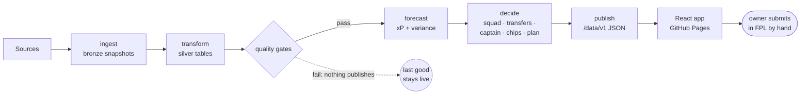

# FPL DOF — documentation

**FPL DOF** (Fantasy Premier League *Director of Football*) is a personal decision-support platform
for one manager's team in the 2026/27 season. It forecasts every player's expected points, with the
uncertainty around them, and turns those forecasts into advice: the squad, this week's transfers,
captain, chips, and a multi-gameweek plan, each explained against its runner-up and against doing
nothing. The owner reads the advice in a web app and makes the moves in FPL by hand — the system never
logs in to FPL and never acts on the account.

Three properties shape everything else: it costs **nothing to run** (free CI, free hosting, no paid
dependency), it has **no server** (a scheduled pipeline publishes static files that the browser reads),
and the **season is the clock** (weekly deadlines are immovable; stale and honest beats fresh and
wrong).

Each fact has one home, listed at the end of this page. Read the home; link to it; never copy it.
How to write and archive documents: [`agents/documentation.md`](agents/documentation.md).

---

## Data sources

| Source | What it provides | State |
| --- | --- | --- |
| **Official FPL API** | Players, prices, status, ownership, fixtures, per-gameweek stats including expected goals and assists, and the game's own rules | Essential: if it fails, the run stops and the last good advice stays live |
| **FPL community archive** (GitHub mirror) | Past seasons gameweek by gameweek — the backtest's history | Used by the backtest; frozen locally from R1.1.0 (PIPE-03) |
| **football-data.co.uk** | Bookmaker match odds, past and upcoming | Read by the prospective harness outside the adapter layer today; becomes a proper adapter in R1.1.0 (PIPE-04, PIPE-05) |
| Understat, FBref | Advanced player metrics (scraped) | **Blocked** upstream (D-23) and off by default; nothing that ships depends on them; removed in R1.1.0 (PIPE-09) |
| The Odds API | Live match odds | On by default but degrades without a key; free-tier credit cap and no history (D-20); not used by the model; stood down in R1.1.0 (PIPE-09) |

Every source sits behind an adapter in `pipeline/src/fpl_dof/sources/`, the only code allowed to know
a source exists (DP-01). Detail: [architecture §2](planning/03-solution-architecture.md#2-context-view-c4-level-1),
[design §2](planning/04-conceptual-design.md#2-data-sources).

---

## Solution architecture

- **Pipeline** — Python, one CLI (`fpl-dof`) run by GitHub Actions on a deadline-aware schedule. Raw
  responses are kept as immutable bronze snapshots; transform conforms them into canonical silver
  tables; quality gates block anything suspect; the forecast is a chain of small, arguable component
  models (minutes, team strength, goals, defence, saves, cards, bonus); the decision layer solves
  mixed-integer programmes with PuLP for the squad, the week's transfers and a multi-gameweek plan
  with chip scenarios (the plan on HiGHS).
- **Contract** — JSON Schemas in `contracts/v1/` define every published file; Python validates
  before writing and generates the TypeScript types from the same schemas (DP-04).
- **Web app** — React and TypeScript, installable and usable offline. It reads the published files
  and nothing else; legality checks and quick re-picks run in the browser from the published rules.
- **State** — rolling raw data on the `data` branch, a permanent snapshot per gameweek on
  `snapshots`, and each week's advice on `ledger`, written before the deadline so the season log is
  evidence rather than recollection.
- **Off the main path** — the walk-forward backtest that grades the model (its verdict is in the
  model card), a pre-registered prospective model comparison, and a challenger model run in shadow.

Detail: [solution architecture](planning/03-solution-architecture.md) (as built, with a module-design
review in §12) and [conceptual design](planning/04-conceptual-design.md) (each component).

---

## Where things stand

- **R1.0 — delivered.** Epics E0–E14 built the platform end to end; they are archived as records in
  [`planning/archive/R1.0/`](planning/archive/README.md).
- **R1.1.0 — open: data pipeline uplift.** [Backlog PIPE-01 … PIPE-14](planning/epics/R1.1.0-data-pipeline-backlog.md),
  in draft. Its effect on the architecture: [architecture §13](planning/03-solution-architecture.md#13-r110--target-data-architecture).
- **The season — live.** [E8 — ongoing in-season monitoring](planning/epics/E8-ongoing-in-season-monitoring.md)
  holds the season state and decision points, rewritten each gameweek.

## To-dos

Pointers, not the work itself: each line links to the home that holds the detail and the acceptance
criteria. The [release register](planning/epics/README.md) decides the order.

**This season ([E8](planning/epics/E8-ongoing-in-season-monitoring.md))**
- Keep E8's season state current; record the GW8 decision-point outcome. GW4 was recorded as
  "intuition ahead"; the response is R1.1.0 as ordered ([DL-79](decisions/DL-79.md)).
- A chip calendar for set 1 before GW15; set 1 expires at the GW19 deadline.

**R1.1.0 — data pipeline uplift ([backlog](planning/epics/R1.1.0-data-pipeline-backlog.md))**
- Phase 1, hygiene: first, write the permanent bronze archive, which has never run (PIPE-14);
  freeze prior seasons (PIPE-03); a football-data.co.uk adapter that also ends the
  fetch outside `sources/` (PIPE-04); persist accumulating silver tables with one restore step
  (PIPE-06); conditional HTTP (PIPE-07); The Odds API off by default (PIPE-09).
- Phase 2, temporal integrity: one clock and one current gameweek (PIPE-12), then season ×
  as-of-gameweek scoping (PIPE-01), a blocking look-ahead gate (PIPE-10), a schema-drift canary
  (PIPE-08).
- Phase 3, unified gold: one forecast-fitting interface (PIPE-13), then multi-season player history
  (PIPE-02) and match odds across seasons (PIPE-05); bronze integrity tooling (PIPE-11).

**Design fixes not yet scheduled ([architecture §12](planning/03-solution-architecture.md#12-module-design--review-of-2026-10-17))**
- One planning horizon: `xp_horizon` reads `decision.horizon` (D-29, [DL-78](decisions/DL-78.md)).
- Shared MILP legality constraints and a solver setting that is actually read (P2).
- Domain logic out of the stage edge (P3); an explicit published-model entry point (P6).
- The web app checks what it reads and its contract version (W1); end the Python/TypeScript drift in
  bench order and model labels (W2); one artefact registry and loading hook (W3); check generated
  types in CI (W4).
- Deploy only when a pipeline run actually published (O1); typed workflow hand-offs (O2).

**Open debt ([debt register](planning/debt-register.md))** — most visibly D-13 (the forecast does not
yet beat the model-free benchmark at the head of the ranking) and D-23 (scraped sources blocked).

**Decisions pending** — none open ([decisions](decisions/README.md)). The 2026-10-17 walkthrough
settled DL-11, DL-72 and OD-04 and recorded DL-76 to DL-79.

---

## Where each fact lives

| The fact | Its home |
| --- | --- |
| The ten binding design principles — amendment-controlled, never edited by an agent | [`DESIGN-PRINCIPLES.md`](DESIGN-PRINCIPLES.md) |
| Product, modelling and delivery guidance (DP-07, 08, 09, 10, 12) — editable | [`guiding-principles.md`](guiding-principles.md) |
| Invariants, commands, code layout | [`CLAUDE.md`](../CLAUDE.md) |
| A decision and its reasons (`DL-nn`); open decisions (`OD-nn`) | [`decisions/`](decisions/README.md) — one file per entry, with an index |
| Purpose, objectives, scope, requirements (`FR-nn`, `NFR-nn`) and their status, constraints, assumptions, definition of done | [Charter](planning/01-project-charter.md) |
| Blueprint (B1–B7), season calendar, RAID log (`R-nn`, `I-nn`) | [Project plan](planning/02-project-plan-and-blueprint.md) |
| Shortcuts taken and what repays each (`D-nn`) | [Debt register](planning/debt-register.md) |
| Structure, stack, hosting, data flow, the web contract, orchestration; the module-design review and R1.1.0 target architecture | [Solution architecture](planning/03-solution-architecture.md) |
| Each component's design: sources, data layer, models, optimiser, UX, testing, extensibility; open questions (`Q-nn`) | [Conceptual design](planning/04-conceptual-design.md) |
| Releases (`Rx.y.z`): what is being built now, how to choose what next, and the branching and release model | [Release register](planning/epics/README.md); the procedure is the `release` skill |
| R1.1.0, the open release: data pipeline uplift backlog | [`planning/epics/R1.1.0-data-pipeline-backlog.md`](planning/epics/R1.1.0-data-pipeline-backlog.md) |
| Where the season stands (rewritten each gameweek), the weekly loop, and the bar for changing the model mid-season | [E8 — ongoing in-season monitoring](planning/epics/E8-ongoing-in-season-monitoring.md) |
| Environment variables and secrets handling | [`environment.md`](environment.md) |
| FPL scoring, prices, chips; the FPL API | The `fpl-rules` and `fpl-api` skills in `.claude/skills/` |
| The published artefacts' shape | `contracts/v1/*.schema.json`; behaviour pinned in both languages: [`contracts/conformance/`](../contracts/conformance/README.md) |
| The pre-registered prospective model comparison | [`prospective/`](../prospective/README.md) |
| Browser and deployed-site verification | [`web/verify/README.md`](../web/verify/README.md) |
| Model quality right now (the backtest verdict) | `data/gold/season=2026-27/model-card.md`, generated by each run — not a document |
| Closed releases (R1.0: epics E0–E14) and superseded plans | [`planning/archive/`](planning/archive/README.md) — records, never updated |

## Where to start, by task

| Task | Read first |
| --- | --- |
| Design a module, add a source, change a model or the optimiser, alter a contract | `DESIGN-PRINCIPLES.md`, then the matching section of the conceptual design |
| Add a data source | [Design §14.1](planning/04-conceptual-design.md#141-adding-a-data-source) |
| Change the forecast | [Design §5](planning/04-conceptual-design.md#5-analytical-models), the model card, [E8 §5](planning/epics/E8-ongoing-in-season-monitoring.md#5-the-bar-for-changing-the-model-mid-season) |
| Change the optimiser | [Design §6](planning/04-conceptual-design.md#6-decision-engine) |
| Pick up a to-do | Its home above; the release register for order |
| Branch, open a pull request, promote, tag or hotfix | The `release` skill (`.claude/skills/release/`); policy in [DL-80](decisions/DL-80.md) |
| Understand why something is the way it is | The `DL-nn` the code cites: `docs/decisions/DL-nn.md` |
| Record a decision | [`decisions/README.md`](decisions/README.md#writing-an-entry) |
