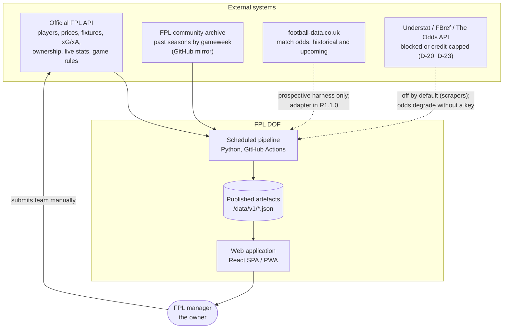
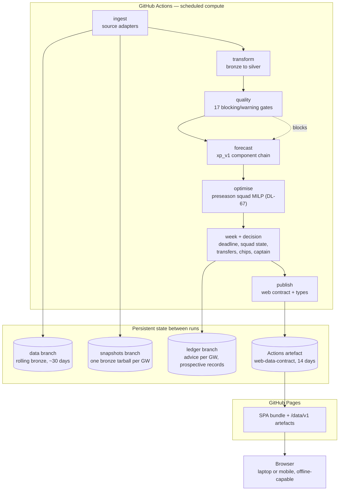
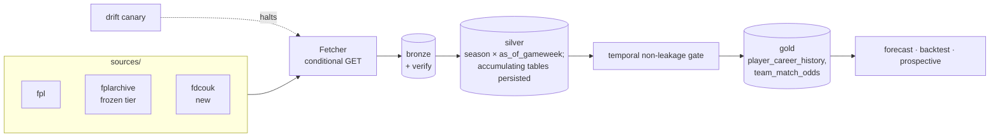

# Solution Architecture — FPL DOF

**Companion to:** [01-project-charter.md](01-project-charter.md), [02-project-plan-and-blueprint.md](02-project-plan-and-blueprint.md)
**Level:** High-level / logical-to-physical. Component internals are in [04-conceptual-design.md](04-conceptual-design.md).
**Baselined:** 2026-08-09 · **Revised:** 2026-10-17 — rewritten to the system as built at the end of
R1.0, with a module-design review (§12) and the R1.1.0 target (§13)

This page describes what runs today. Where the 2026-08-09 baseline chose something that was never
built, the choice is gone from the tables and named once in §5.4. The binding constraints on any
change are in [`DESIGN-PRINCIPLES.md`](../DESIGN-PRINCIPLES.md).

---

## 1. Architectural drivers

The architecture is shaped by four constraints and one ambition. Everything else follows.

| Driver | Source | Architectural consequence |
| --- | --- | --- |
| **Zero cost, no operated servers** | NFR-01, NFR-02, DL-03 | Batch-precompute architecture. No runtime backend, no database, no container to keep alive |
| **Hard weekly deadlines** | CON-1, OBJ-3 | Scheduling is a first-class concern: deadline-aware guards, a day-before run, always-available manual dispatch |
| **Undocumented, unversioned upstream APIs** | CON-5, CON-6 | Anti-corruption layer at every source; immutable raw snapshots; contract tests against recordings |
| **Extensibility to new sources** | DL-05, FR-04 | Adapter registry; a conformed silver model that nothing upstream can leak into (DP-01) |
| **Multi-gameweek combinatorial optimisation** | DL-06, DL-15 | Python analytics tier with a real MILP solver, run in CI where compute is free and unbounded by a request timeout |

### Architectural style

**Batch-precomputed, statically served, plugin-sourced.**

A scheduled pipeline pulls, conforms, gates, forecasts and decides; it publishes a versioned set of
JSON artefacts; a static single-page application reads them from GitHub Pages. There is no request
path from the browser to any code the project operates (Invariant 8).

This is deliberately old-fashioned and deliberately boring. It has no cold starts, no scaling
concerns, no availability risk beyond the CDN, no attack surface worth speaking of, and no bill.

---

## 2. Context view (C4 level 1)



The loop is **not closed**: the system never writes to FPL. The human is the actuator (ASM-6), by
design (DL-08, NFR-11). The official API now carries the expected-goals signals the model uses
(DL-34, DL-46), which is why losing the scraped sources degraded nothing that ships (DP-15).

| Source | Adapter | State |
| --- | --- | --- |
| FPL API | `sources/fpl` | Essential. Failure stops the run; the last good publication stays live |
| FPL archive | `sources/fplarchive` | Off by default; enabled for the backtest (`config/ci-backtest.yaml`, DL-68) |
| Understat, FBref | `sources/understat`, `sources/fbref` | Blocked upstream (`robots.txt`, Cloudflare 403) — D-23. Off by default (`enabled_by_default = False`); no workflow enables them. PIPE-09 removes them |
| The Odds API | `sources/oddsapi` | Enabled by default (`config/defaults/sources.yaml`); degrades cleanly without `ODDS_API_KEY`. Free-tier credit cap, no history — D-20; not used by the model (DL-59, DL-60). Stood down by PIPE-09 |
| football-data.co.uk | none yet — `prospective/fdcouk.py`, `scripts/prospective_ci.py` | Read outside `sources/` (§12, P5); a registered adapter is PIPE-04 |

---

## 3. Container view (C4 level 2)



The pipeline is one CLI, `fpl-dof`, whose stages are registered in `pipeline.py` and run in order by
`run_stages`; CI runs the same commands a developer does (NFR-09). Beside the main run sit three
off-path stages: `backtest` (walk-forward regression and the model card verdict, DL-21), the
`prospective` harness (pre-registered model comparison, frozen before each deadline), and `shadow`
(the challenger model, published beside the champion but never acted on — DP-08).

### Container responsibilities

| Container | Code | Responsibility | Never does |
| --- | --- | --- | --- |
| **Ingestion** | `sources/`, `stages/ingest.py` | Fetch from sources through one `Fetcher` (rate limit, retry, robots, cache), snapshot raw bytes to bronze with lineage | Interpret or reshape data |
| **Transformation** | `stages/transform.py`, adapters' `conform`, `sources/resolve.py`, `silver/` | Conform bronze into the canonical silver tables; resolve players and clubs across sources; field precedence by configuration | Name a source outside `sources/` (DP-01) |
| **Quality gates** | `quality/` | Schema, ranges, referential integrity, freshness; a blocking failure stops the run before anything is built on the data (Invariant 7) | Repair data silently |
| **Forecast** | `forecast/` | Expected points with variance and per-component decomposition; the backtest, baselines, model card | Make selection decisions (DP-02) |
| **Decision** | `optimise/`, `squad/`, `week/` | Squad MILP (preseason), weekly transfer MILP, multi-gameweek horizon plan with chip scenarios (HiGHS), captaincy, alerts, advised-versus-played reconciliation | Predict anything (DP-02) |
| **Publisher** | `publish/`, `stages/publish.py` | Validate and write each artefact against its JSON Schema; regenerate `web/src/contract/types.ts` | Hold business logic — see §12, P3 |
| **Web application** | `web/` | Present, explore, explain; client-side legality and heuristic re-optimisation | Call any external API (Invariant 8) |
| **Persistent state** | `data`, `snapshots`, `ledger` branches; Actions artefacts | Bounded, versioned, free storage | Serve queries |

---

## 4. The static-hosting constraint, and how interactivity survives it

DL-03 removes the server. Three tiers of interactivity replace it, and every UI feature is
consciously assigned to one.

| Tier | Mechanism | Latency | Used for |
| --- | --- | --- | --- |
| **T1 — Precomputed** | The pipeline computes it on a schedule; the app reads a file | Instant | Expected points, the plan and chip scenarios, this week's decision, fixture difficulty, scout data, history, model comparison, health, season log |
| **T2 — Client-side compute** | Pure TypeScript in the browser, parameterised from `rules.json` | Milliseconds | Squad legality (`legality.ts`), XI and bench choice (`lineup.ts`), lock-and-ban re-pick — a greedy build plus hill-climb, labelled as a heuristic (`reoptimise.ts`), player comparison verdicts (`verdict.ts`) |
| **T3 — Job-triggered** | A `workflow_dispatch` run with inputs; results land as a new publication | 2–10 min | Full re-optimisation under bespoke constraints, backtests, forced refreshes |

**Design rule:** anything the owner will want *at the deadline, under time pressure* must be T1 or T2.
T3 is for exploration, never for the critical path. This rule is what keeps the zero-cost choice from
degrading the product.

---

## 5. Technology decisions

### 5.1 Analytics tier — Python

| Concern | Choice | Rationale |
| --- | --- | --- |
| Language | Python 3.14 | Mandated by DL-04; the only ecosystem with mature ML *and* MILP tooling |
| Packaging / env | `uv` (`python -m uv`), editable install of `pipeline[dev]` | Fast, lockfile-based |
| HTTP | `httpx` behind `sources/fetch.py` | Timeouts and transport hooks; `respx` for recorded tests |
| Dataframes and storage | `pandas` + `pyarrow`; Parquet for silver, gzipped JSON for bronze, JSON for the web contract | Columnar and typed where it matters, plain JSON at the browser |
| Validation | Pandera (silver), `jsonschema` (contract), `pydantic` (config) | Each layer validated in its own idiom |
| Models | Hand-built component chain (M1–M8) over numpy/pandas; scikit-learn only for the shadow monolith (DL-53) | Arguable formulations (DP-10); scikit-learn because it is pure-wheel everywhere CI runs |
| Optimisation | PuLP with **HiGHS** for the multi-gameweek horizon (DL-15); CBC for the single-gameweek squad and transfer models | Open-source, no licence. PuLP capped below 4 (DL-71) |
| Logging | stdlib `logging` with a JSON formatter (`obs/logging.py`) plus the run manifest | No extra dependency |
| Testing | pytest, Hypothesis, `respx`, pytest-cov (100% on rules — NFR-08), mypy, ruff | Property tests for optimiser legality; recordings for adapters |

### 5.2 Web tier — TypeScript

| Concern | Choice | Rationale |
| --- | --- | --- |
| Framework | React 18 + TypeScript, strict | DL-04 |
| Build | Vite | Static output; first-class PWA plugin |
| Routing | `react-router-dom` 6 | Deep links with the Pages SPA fallback |
| Data loading | One `DataStore` (`web/src/data/store.ts`) over `fetch`, with per-artefact policies (required, nullable, lazy) | The only I/O seam in the app — four `fetch` calls, all there |
| Tables | `@tanstack/react-virtual` | ~700 rows, virtualised for NFR-04 |
| Charts | Hand-written SVG (`components/charts/`) | Intervals drawn as intervals (DP-09); no charting dependency |
| Styling | Plain CSS with design tokens (`tokens.css`), light and dark | No runtime cost |
| Client rules | `legality.ts`, parameterised from `rules.json` ([DL-14](../decisions/DL-14.md)) | Never a second hand-written copy of FPL's rules |
| PWA | `vite-plugin-pwa` | Offline access to the last publication (FR-34) |
| Testing | Vitest, Testing Library, Playwright browser and deployed-smoke checks (`web/verify/`) | Unit, component, layout, accessibility, offline |

### 5.3 Platform

| Concern | Choice | Rationale |
| --- | --- | --- |
| Repository visibility | **Public** ([DL-12](../decisions/DL-12.md)) | Unlimited Actions minutes and free Pages. See below — this is architecturally significant |
| Orchestration | GitHub Actions, ten workflows (§9) | Free, cron and dispatch built in, secret storage included |
| Persistent state | Orphan `data` branch (rolling bronze), append-only `snapshots` and `ledger` branches; Actions artefacts for the contract hand-off and logs | Free, versioned, no external service (§7.3) |
| Hosting | GitHub Pages | Free on a public repository |
| Secrets | GitHub Actions encrypted secrets | Never in the repo, never in the client bundle (NFR-13); variables in [`environment.md`](../environment.md) |
| Alerting | `alert-on-failure.yml`, a reusable job that opens an issue | Free, no third party |

### Repository visibility is architecturally significant

A **public** repository gets unlimited Actions minutes and free Pages. A private one on the Free plan
gets 2,000 minutes a month and cannot use Pages without a paid plan; the cadences in §9 were costed at
roughly 1,800–3,400 minutes a month before DL-12 reversed OD-01. The privacy was also mostly illusory:
the published artefacts are served from a public CDN regardless.

**The consequence that matters day to day: NFR-13 is load-bearing.** Every commit is world-readable
the moment it is pushed. API keys live only in Actions secrets, the secret-scan hook in
`.claude/hooks/` is the primary guard rather than a backstop, and nothing personal beyond a public FPL
team ID is ever committed (Invariant 10).

### 5.4 Planned in the baseline, not adopted

TanStack Query, Tailwind, Recharts or visx, DuckDB-WASM and Parquet in the web contract, LightGBM,
`highs-js` in the browser, `structlog`, and an import-lint step. Each was either unnecessary at this
scale (~700 players fit in plain JSON) or replaced by something simpler above. The source boundary is
enforced by `pipeline/tests/test_source_isolation.py`, not a linter.

---

## 6. Data flow

```mermaid
sequenceDiagram
    autonumber
    participant CRON as Schedule / dispatch
    participant G as Guard
    participant ING as Ingest
    participant BRZ as Bronze
    participant TRF as Transform
    participant QG as Quality gates
    participant FC as Forecast
    participant DEC as Optimise / week / decision
    participant PUB as Publish
    participant L as ledger branch
    participant CDN as Pages

    CRON->>G: is a run due? (fpl-dof-schedule)
    G->>ING: run_id assigned
    ING->>BRZ: immutable snapshot + lineage sidecar
    TRF->>BRZ: read latest snapshots
    TRF->>QG: conformed silver tables
    alt blocking gate fails
        QG-->>CRON: stop, alert; last good publication stays live
    else gates pass
        FC->>DEC: xP mean, variance, components per player per GW
        DEC->>L: this week's advice, before the deadline (DL-69)
        DEC->>PUB: squad state, plan, chips, transfers, alerts
        PUB->>CDN: validated /data/v1 artefacts via deploy.yml
    end
```

**Key property:** a failed gate never publishes. The site keeps serving the last good artefact set,
visibly stale on the health page, rather than serving something wrong (Invariant 7, DP-15).

---

## 7. Data architecture

### 7.1 Medallion layers

| Layer | Content | Format | Persisted between CI runs? |
| --- | --- | --- | --- |
| **Bronze** | Verbatim source responses with a `.meta.json` lineage sidecar (URL, time, SHA-256) | Gzipped JSON/HTML | Partly — the rolling window on `data`; one permanent tarball per closed gameweek on `snapshots`, first written when R1.1.0 reaches `main` (PIPE-14) |
| **Silver** | Conformed canonical tables (`silver/tables.py`), validated on read and write | Parquet, by season | **No** — rebuilt from bronze each run. Accumulating tables (`price_history`, `player_gameweek`) therefore lose history on CI; PIPE-06 fixes this |
| **Gold** | Forecasts, plans, decisions, model and backtest cards | Parquet + JSON + Markdown | **No**, except advice on `ledger`. The published contract survives as a 14-day artefact and on Pages |
| **Web contract** | The narrow, versioned slice the browser may read | JSON, `/data/v1/` | Replaced per publish |

### 7.2 The web data contract

The single most important seam in the system: the boundary between DL-04's two languages (DP-04).

- **One definition.** `contracts/v1/*.schema.json` — fourteen schemas, all `additionalProperties:
  false`. `publish/contract.py` holds the artefact registry (`ARTEFACTS`) and **validates every
  artefact before writing it**. `publish/typescript.py` generates `web/src/contract/types.ts` from the
  same registry.
- **Artefacts:** `meta` (run, freshness, `contract_version`), `rules`, `players`, `fixtures`, `squad`,
  `plan`, `week` (plus `week_challenger`), `history`, `models`, `health`, `league`, `log`, and the
  static `models_history` and `xp_accuracy` series. All JSON: ~700 rows needs no query engine.
- **Versioned.** `/data/v1/`. A breaking change bumps to `v2` and publishes both during the transition.
- **Behaviour pinned in both languages** by shared corpora in `contracts/conformance/`, read by pytest
  and vitest and never copied (DL-39). Today the legality corpus is the only one.
- **Read side.** The browser reads through `DataStore`; it casts rather than validates, and does not
  yet check `contract_version` (§12, W1).

#### `rules.json` — why the contract carries the rules ([DL-14](../decisions/DL-14.md))

§4 assigns live legality checking and lock-and-re-pick to **T2**. Those need the squad rules *in the
browser*, and there are only two ways to get them there:

| Option | Outcome |
| --- | --- |
| Hand-write the rules in TypeScript | Two implementations of FPL's rules, guaranteed to drift. A hardcoded `3` for the club limit in a `.tsx` file is the bug Invariant 2 exists to prevent |
| Move legality checking to T3 | Breaks the §4 rule that nothing on the deadline path is job-triggered |
| **Publish the rules config** ✔ | One definition, generated into the contract from the same configuration the Python rules module reads |

The TypeScript validator is **parameterised from `rules.json` and checks legality only** — it never
computes points. The conformance corpus runs the same squads through both validators, including a
twelve-a-side ruleset that catches any literal.

### 7.3 Storage volume and retention mechanics

About 700 players × 38 gameweeks × ~60 columns per season is a few MB of Parquet. Bronze dominates:
full JSON several times a day, gzipped, in the low hundreds of MB a season if kept naively.

**Deleting a file from the tip of a Git branch reclaims nothing** — the blob stays in history and in
every clone. That is why R-13 is rated High and why the stores have different mechanics:

| Store | Mechanism | Rationale |
| --- | --- | --- |
| **`data`** — rolling bronze | Orphan branch, rebuilt from the retained window (~30 days) and force-pushed by `pipeline/scripts/retention.py` | History is truncated, not accumulated; these snapshots debug the recent past |
| **`snapshots`** — permanent bronze | Append-only; `bronze-full/<season>/gwNN.tar.gz` holds the bronze dated after the previous deadline day up to the gameweek's own, written once the day after its deadline, and `index.json` lists the gameweeks archived, partial and lost (PIPE-14, DL-81). First written when R1.1.0 reaches `main` | The NFR-06 evidence trail, small enough to keep forever |
| **`ledger`** — advice and prospective records | Append-only; `advice/gwNN.json` written before each deadline, `prospective/gw*.tgz` frozen with it | What was advised, provably before the event (DL-69) |
| **Published contract** | Actions artefact `web-data-contract` (14 days) → Pages | Serving surface, not an archive |

**CI artefacts never hold anything NFR-06 depends on.** They expire; anything reproducibility needs
lives in a branch. The retention window is set in both `ingest-fast.yml` and configuration and must
be kept equal by hand (§12, O4).

---

## 8. Deployment and environments

| Environment | Purpose | Data | Access |
| --- | --- | --- | --- |
| **Local** | Development, debugging, ad-hoc analysis, the backtest and chip replay | Real sources, local `data/` (gitignored); bronze can be replayed offline | `localhost`, plus LAN for mobile testing (`vite.config.ts` sets `host: true`) |
| **CI** | The only path to production | Real sources; state restored from the branches in §7.3 | GitHub |
| **Production** | The live app | Published `/data/v1` only | Public Pages URL, laptop and mobile |

**Local/CI parity (NFR-09)** is structural: CI invokes the same `fpl-dof` entry points a developer
does. The differences are credentials, schedule, and which state is restored from branches.

---

## 9. Orchestration

Ten workflows. Cadence escalates as a deadline approaches, and every scheduled workflow is also
manually dispatchable.

| Workflow | Trigger | Does |
| --- | --- | --- |
| `ci.yml` | Push to `main`, `pre-release`, `dev/**`; every pull request | Lint, type-check, unit, property and contract tests; `scripts/docs.py check` |
| `ingest-fast.yml` | Hourly; a guard (`fpl-dof-schedule --decide fast`) decides whether to fetch | `bootstrap-static` and `fixtures` — prices, status, ownership. Rebuilds `data` |
| `ingest-slow.yml` | Daily, with a fallback slot; dispatch | Full ingest including per-player summaries; updates `data`; archives each newly closed gameweek's bronze to `snapshots`, once, and fails if bronze has no gameweek schedule |
| `pipeline.yml` | Nightly with a fallback; a deadline guard several times an hour; after `Ingest (slow)`; dispatch | `guard` → `prospective` (frozen harness, appended to `ledger`) → `run` (`fpl-dof run --only transform…publish`, advice appended to `ledger`, contract uploaded) |
| `day-before.yml` | Every 20 minutes in a nightly UTC window | On the day before a deadline, dispatches `ingest-slow`; Pipeline and Deploy follow by `workflow_run` |
| `deploy.yml` | Push to `main`; after Pipeline completes | Builds the SPA, downloads the latest contract, deploys to Pages |
| `backtest.yml` | Weekly; dispatch | Archive ingest under `config/ci-backtest.yaml` (DL-68), then the walk-forward regression |
| `pre-release.yml` | Push to `pre-release`; pull requests into `main` | Builds the site against the latest published contract and runs `verify:smoke` — the promotion gate ([DL-80](../decisions/DL-80.md)) |
| `release.yml` | Push of an `R*` tag | Checks the tag is on `main` and publishes the GitHub Release |
| `alert-on-failure.yml` | Called by the others | Opens an issue on failure |

### Two cadence rules that are easy to get wrong

**1. Per-player summaries never run on the fast path.** They are ~700 requests; at a polite two a
second that is six minutes. The fast workflow exists to keep *prices, status and ownership* inside the
NFR-05 freshness window, and those all live in `bootstrap-static` — two requests, seconds.

**2. The pipeline does not run after every fast ingest.** Re-solving a MILP because a price moved by
£0.1 is waste. The fast ingest keeps the data fresh; the pipeline turns it into a recommendation on
its own deadline-aware schedule.

**Scheduling caveat (R-09):** scheduled runs are best-effort and can be delayed under platform load.
The day-before run and the deadline guard exist so a delayed cron is never the reason a deadline is
missed; manual dispatch is always the fallback.

---

## 10. Cross-cutting concerns

### 10.1 Configuration

Layered, most specific wins (`config/loader.py`): committed YAML defaults packaged with the code
(`config/defaults/*.yaml`) → a gitignored `config/local.yaml`, or the file `FPL_DOF_CONFIG_FILE`
names → `FPL_DOF_*` environment variables → CLI arguments. The merged mapping is validated once into
`Config`, and its digest goes into the run manifest (DP-11). Rules and tunables live here, never in
code (DP-05, DP-06). Secrets only arrive by environment variable ([`environment.md`](../environment.md)).

### 10.2 Observability

No paid tooling exists in a £0 budget, so observability is built from artefacts:

- **Run manifest** (`obs/manifest.py`) — `run_id`, git SHA and dirty flag, config digest, per-stage
  timing and status, per-source outcomes, gate results, solver status.
- **Structured JSON logs** per run, kept as CI artefacts.
- **`health.json`**, rendered at `/health` (FR-33) — every source with its status, freshness and
  reason, the gates, and the price-dependence diagnostic. The monitoring dashboard *is* the product.
- **The model card** beside the published artefacts, carrying the backtest verdict (DL-21).

### 10.3 Failure handling

| Failure | Behaviour |
| --- | --- |
| A non-essential source is unavailable or blocked | Degraded in the manifest and on `/health`; the run continues without its fields (NFR-15) |
| The FPL API fails | The run stops; the last good publication stays live; an issue is opened |
| A blocking quality gate fails | Publication blocked; last good publication stays live; issue opened |
| The solver fails or times out | Greedy fallback; the result is flagged as fallback-quality |
| The challenger model fails | Logged and skipped; the champion publishes (`run_shadow_safely`) |
| A deploy fails | The previous site stays live; static hosting makes this the default |

### 10.4 Security and privacy

- No authentication anywhere; no user data; no FPL credentials (NFR-11, DL-08).
- Secrets only in Actions; the secret-scan hook blocks commits that carry one.
- Dependencies pinned; updates reviewed before merge. Supply-chain compromise is the main realistic
  risk for a static site with no inputs, no session and no secrets.

### 10.5 Legal and ethical use (NFR-10)

| Source | Access | Obligations |
| --- | --- | --- |
| FPL API | Public JSON, unauthenticated | Honest user agent, conservative rate limiting, cache aggressively |
| FPL archive, football-data.co.uk | Public files | Cache permanently once a season is complete (PIPE-03, PIPE-04); attribute in the UI |
| Understat, FBref | Scraped HTML | Both now refuse automated access; `robots.txt` is honoured, so they stay off rather than working around it |
| The Odds API | Documented API | Stay inside the free-tier terms and credit cap |

---

## 11. Repository structure

```
fpl_dof2/
├─ docs/                       # map: docs/README.md
├─ .github/workflows/          # the ten workflows in §9
├─ config/                     # committed CI configs (ci-backtest.yaml); local.yaml is gitignored
├─ contracts/
│  ├─ v1/                      # JSON Schemas — the web contract's single definition
│  └─ conformance/             # fixture corpora read by both pytest and vitest
├─ pipeline/
│  ├─ src/fpl_dof/
│  │  ├─ cli.py  pipeline.py   # `fpl-dof` entry point; stage registry and run_stages
│  │  ├─ schedule_cli.py       # `fpl-dof-schedule`: the CI guards
│  │  ├─ config/               # layered loader, pydantic models, defaults/*.yaml
│  │  ├─ sources/              # ADAPTERS — the only code that knows a source exists (DP-01)
│  │  │  ├─ base.py registry.py fetch.py bronze.py robots.py
│  │  │  ├─ resolve.py precedence.py enrich.py catalogue.py
│  │  │  └─ fpl/ fplarchive/ understat/ fbref/ oddsapi/
│  │  ├─ silver/               # canonical tables, Pandera schemas, Parquet store
│  │  ├─ quality/              # gates as data; run_gates
│  │  ├─ rules/                # FPL rules from the API + config: scoring, legality (pure, 100% covered)
│  │  ├─ forecast/             # features, M1–M8, xp_v0/xp_v1, backtest, baselines, monolith, model card
│  │  ├─ optimise/             # squad, transfer and horizon MILPs, chips, captain, risk, explain
│  │  ├─ squad/                # current squad state; XI and bench selection
│  │  ├─ week/                 # deadlines, alerts, ledger, reconciliation, hindsight oracle, schedule
│  │  ├─ shadow/               # the challenger model (C1)
│  │  ├─ prospective/          # the pre-registered model comparison harness
│  │  ├─ publish/              # contract writer, builders, TypeScript generator
│  │  ├─ stages/               # the effectful edge: one module per stage (DP-03)
│  │  └─ obs/                  # logging, manifest, run context, clock
│  ├─ scripts/                 # CI helpers: retention, ledger, prospective, run lookup
│  └─ tests/
├─ web/
│  ├─ src/
│  │  ├─ contract/types.ts     # GENERATED by `fpl-dof publish` — never edit
│  │  ├─ data/                 # DataStore, DataProvider, model choice, offline cache
│  │  ├─ routes/               # thin pages composing components
│  │  ├─ components/           # feature folders with their pure domain logic beside them
│  │  └─ gate/ layout/ theme/
│  └─ verify/                  # browser and deployed-site verification
├─ prospective/                # the pre-registration record
└─ data/                       # local working data (gitignored)
```

Two things are load-bearing in this layout:

1. **`sources/` is the only directory that may name a source** — enforced by
   `tests/test_source_isolation.py`. It scans `src/` only, which is how §12 P5 slipped through.
2. **`contracts/` is the single definition of the two-language seam.** Both sides generate from it;
   neither hand-writes it.

---

## 12. Module design — review of 2026-10-17

A review of the code as built, in the vocabulary of deep modules: a **module** is deep when a lot of
behaviour sits behind a small interface; a **seam** is where that interface lives; a seam with one
adapter is hypothetical, with two it is real. The test of a module is whether deleting it makes
complexity vanish (a pass-through) or reappear across its callers (it was earning its keep). Findings
cite file and line as of the review; they are a design backlog, not yet scheduled. When one is taken
up it becomes a story in the open release or a `D-nn` in the [debt register](debt-register.md).

### 12.1 Dependency direction

| Package | Imports (besides `config`, `obs`, `frames`) |
| --- | --- |
| `sources` | `silver`, `rules` |
| `silver`, `rules` | `rules` / nothing |
| `forecast` | `rules` |
| `optimise` | `rules`, `squad`, **`forecast`** (`captain.py:17-18`, `replay.py:68-71`) |
| `squad` | `rules` |
| `week` | `rules`, `squad`, `optimise` |
| `shadow` | `rules`, `squad`, `optimise` |
| `publish` | `rules`, `squad`, `forecast`, `optimise`, `week`, `sources` (catalogue only) |
| `quality` | `silver` |
| `stages` | everything, plus 13 stage-to-stage imports |

No cycles between packages; nothing outside `sources/` imports a source subpackage. The one
direction that should not exist is **`optimise → forecast`** (DP-02).

### 12.2 Where the design is deep — keep

| Module | Interface | Why it earns its keep |
| --- | --- | --- |
| Source adapters | `registry.build()`, `SourceAdapter.ingest/conform`, `Fetcher`, `BronzeStore` | Five real adapters behind ~25 names; `ingest` is 77 lines and never names a source. Adding a source is one module plus config |
| `rules.validate_squad` | One function | The single legality check after every solve and in squad state and selection |
| Quality gates | `run_gates` over `GATES` as data | Seventeen gates, one entry point |
| `squad.load_squad_state` | One function | ~470 lines of transfer and price reconstruction behind it |
| `pipeline.run_stages` | Stage registry with resolver injection | Owns timing, manifest and failure handling; the injection is a real test seam (nine adapters) |
| Narrow config sections | `ForecastConfig`, `OptimiserConfig`, … passed in | No core module loads configuration (DP-03) |
| Contract write side | `Contract.write` | Validate-then-write against one registry; types generated from it |
| Web domain logic | `verdict()`, `chooseLineup()`, `reoptimise()`, `validateSquad()` | Pure, take `Rules` as an argument, return results; the interface is the test surface |
| `DataStore` | `get(key)`, `loadPublished()` | One in-flight promise per key, eviction on failure, four loading policies; the app's only `fetch` |

### 12.3 Pipeline findings, most impactful first

| # | Finding | Evidence | Deepening |
| --- | --- | --- | --- |
| **P1** | **The forecast fit is assembled in four places, two of them in the decision layer** (DP-02). Fold → training rows → `fit_components` → features recurs; `optimise/replay.py` carries its own `_team_matches` that has drifted from `xp_v1`'s (no xG). B0 is fitted inside `optimise/captain.py`; the C1 challenger has its own features and fit outside the `Predictor` protocol | `forecast/live.py:131-246`, `forecast/backtest.py:392-604`, `forecast/xp_v1.py:527-530`, `optimise/replay.py:280-438,591`, `optimise/captain.py:17`, `shadow/c1.py:63` | One interface in `forecast/`: `fit_as_of(history, deadline, config, rules) → FittedModel` with `.predict(window)`. live, backtest, replay and C1 call it. B0's captain score becomes a forecast column that `optimise` reads |
| **P2** | **Three solver models each re-encode squad legality**; solver construction is repeated; `optimiser.solver` is never read — squad and transfer hard-code CBC | `optimise/squad.py:251,288-326,342`, `optimise/transfer.py:278-332,348`, `optimise/horizon.py:154,388-470`; formation tally at `squad.py:430`, `transfer.py:468`, `horizon.py:655` | `optimise/milp.py`: `add_squad_constraints(problem, select, start, rules, week=None)` and `solver_for(config)`. Each model keeps only its objective. Delete the dead field |
| **P3** | **The stage edge holds domain logic and duplicated orchestration** (2,648 lines). Publish fits M2 and, through the season log, runs the hindsight oracle; six optional artefacts are handled inline with differing error handling; `week` and `decision` duplicate context loading and their `_write`; the gold season path is rebuilt ten times; ~410 lines of backtest-card Markdown live in the stage while core `model_card.py` writes files | `stages/publish.py:93-160,368-379`, `week/oracle.py:118`, `stages/week.py:64-112,280`, `stages/decision.py:38-84,144`, `stages/backtest.py:127-540`, `forecast/model_card.py:342` | `DataLayout.gold_for(season)` and one artefacts module owning file names; `load_decision_context(ctx) → DecisionContext | Skipped`; `optional_artefact(name, build)`; M2 ratings as a forecast output; card renderers return strings and stages write them |
| **P4** | **The clock and "the next gameweek" are not coherent** (DP-11). `utcnow()` is read eight times across stages; three definitions of the next gameweek — first unfinished, first deadline after now, FPL's `is_next`. Between a deadline passing and the gameweek finishing, `xp_next` may describe GW N while the advice is for GW N+1 (inferred, not yet reproduced) | `forecast/live.py:84`, `forecast/xp_v0.py:332`, `week/cadence.py:130`, `stages/publish.py:383`, `stages/week.py:76,140`, `quality/rules.py:143` | Set `StageContext.as_of` once in `cli.py` and record it in the manifest; one `current_gameweek(gameweeks, as_of)` used by forecast, week and publish. A prerequisite for PIPE-01 and PIPE-10 |
| **P5** | **A source is handled outside `sources/`, and the guard misses it** (DP-01). football-data.co.uk URLs, a second team-name resolver, and a `urllib` fetch writing straight to bronze, bypassing `Fetcher`, robots and lineage. The isolation test neither lists the source nor scans `scripts/` | `prospective/fdcouk.py:16`, `prospective/timing.py:50` vs `sources/resolve.py:302`, `scripts/prospective_ci.py:56-81`, `tests/test_source_isolation.py:28-37` | A registered, off-by-default `fdcouk` adapter (PIPE-04). Meanwhile add the pattern to the test and scan `scripts/` |
| **P6** | **The published-model seam is implicit.** Choosing xp_v1 or the xp_v0 cold-start fallback is pure logic living in the edge; the package exports the *fallback* as `build_forecast`, unused; the Poisson survival function and points arithmetic are duplicated across `rules/scoring.py`, `xp_v0` and `xp_v1` | `stages/forecast.py:114`, `forecast/__init__.py`, `xp_v0.py:66,399-482`, `xp_v1.py:146,352-411`, `rules/scoring.py:60` | `forecast.publishable(inputs, rules, config) → Forecast` as the package entry point; `rules.scoring.expected_points(components, position, rules)` shared by every model |
| **P7** | **Shallow facades and a grab-bag in `week/`.** Three pure re-export modules; three different functions called `next_deadline`; `cadence.py` mixes deadlines, CI idempotency, cron gating and a veto; scheduling spread over five files | `week/deadline.py`, `week/day_before.py`, `week/ci_runs.py`, `week/cadence.py:118`, `forecast/live.py:80`, `schedule_cli.py`, `scripts/day_before_gate.py` | Delete the facades; move cron and CI gating into a `schedule/` package so `week/` is only about advice |
| **P8** | **Very large files** — a locality cost, not a depth one. `config/models.py` is 2,215 lines and 53 classes, imported directly by 40 files; `sources/fpl/adapter.py` 1,301; `forecast/models.py` 1,106; `optimise/horizon.py` 950 | `wc -l` | Split `config/models.py` by area behind the package root. The others sit behind deep seams; split only when touched |
| **P9** | **Tests reach past interfaces** — symptoms of P1, P3 and P6 | `test_adaptive_shrinkage.py:295`, `test_duty.py:400` (`stages.backtest._card`); `test_expected_goals.py:17`, `test_goalkeeper.py:150` (`xp_v1` privates); `test_source_catalogue.py:156-185`; `test_champion_challenger.py:68` | Re-point at the new interfaces as each finding lands |
| **P10** | **Minor DP-03 leaks** — file I/O in core; publish reads `os.environ` directly, bypassing the CLI's override path | `forecast/model_card.py:342`, `week/ledger.py:60-76`, `shadow/c1.py`, `stages/publish.py:445` | Return values; let stages write. Read the setting through `Config` |

### 12.4 Web and contract findings

| # | Finding | Evidence | Deepening |
| --- | --- | --- | --- |
| **W1** | **The read side of the contract is unchecked.** Responses are cast, not validated; `contract_version` is never read although the generated header says the app refuses unknown versions; `data/v1` and the cache suffix are hard-coded | `web/src/data/store.ts:24,84,93`, `offline.ts:35`, `contract/types.ts:11` | `DataStore.get` checks `meta.contract_version` once and runs a generated minimal guard per artefact; derive the data path and cache name from `CONTRACT_VERSION` |
| **W2** | **Behaviour duplicated across languages without a corpus has already drifted.** Bench order: TS sorts by `xp_next`, Python by P(plays) × xP. Model ids and labels restated in TS and now differ from `models.json`. Violation codes listed twice. `sellingPrice` in TS has no production caller | `web/src/components/squad/lineup.ts:84-86` vs `squad/selection.py:8-11`; `web/src/data/model.ts:14-40` vs `publish/benchmark.py:18-24`; `legality.ts:44` vs `rules/legality.py:23` | Labels and ids from `ModelInfo`; a `lineup-corpus.json` beside the legality corpus; violation codes as a schema enum; delete `sellingPrice` |
| **W3** | **Six loading hooks, three spellings of "absent", six hand-kept artefact lists in TS** plus `ARTEFACTS` in Python. Adding an artefact touches about six files; `retry` drops eight artefacts | `store.ts:35,59,220,244,284`, `offline.ts:44`, `data/api.ts` (15 pass-throughs), `useFixtures.ts`, `useLeague.ts`, `useLog.ts`, `useHealth.ts`, `useLazyArtefact.ts` | One generated artefact registry carrying each loading policy; one `useArtefact(key)` returning `loading | ready | absent | malformed | error`; delete the pass-through layers |
| **W4** | **Type generation is a side effect of every data run and is not checked in CI**; duplicate `$defs` names would collide silently | `stages/publish.py:166-169`, `publish/typescript.py:96-97` | `fpl-dof contract types --check` in CI; stop writing into `web/src` from the publish stage |
| **W5** | **One artefact has no schema** (the season replay, typed by hand in TS), and `week_challenger` bypasses `Contract.write` | `web/src/components/history/season.ts:34-48`, `stages/publish.py:150-157` | Add its schema to `ARTEFACTS`; route the challenger through `write` |
| **W6** | **The data layer imports components**, and `effectiveSquad` is applied twice | `store.ts:17-18`, `DataProvider.tsx:8,121`, `store.ts:199` | Move `effective.ts` and the replay type into `data/`; apply once in `withModel` |

### 12.5 Orchestration findings

| # | Finding | Evidence | Deepening |
| --- | --- | --- | --- |
| **O1** | **Deploy runs after every Pipeline completion**, including guard-only skips, which report success — up to ~96 redundant builds a day re-deploying an old contract (counted from triggers, not run history) | `deploy.yml:18-42` | Deploy only when the triggering run uploaded `web-data-contract` |
| **O2** | **Workflows chain through title strings and display names** (`[day-before` matched in three files; `workflows: ["Pipeline"]`; cron strings compared literally) | `ingest-slow.yml:9`, `pipeline.yml:17-19,94,112`, `deploy.yml:38-42` | A typed `workflow_dispatch` input or a small hand-off artefact |
| **O3** | **Branch-restore logic copied five times**; the guard restores `silver` from a branch that only holds bronze | `ingest-fast.yml:43`, `ingest-slow.yml:79`, `pipeline.yml:75,333,348` | One composite action or `retention.py restore` |
| **O4** | **The retention window is kept equal by hand** in YAML and configuration; the alert workflow's comment names a `retention.yml` that does not exist | `ingest-fast.yml:73-76`, `alert-on-failure.yml:21` | Read the window from configuration in the workflow step |

---

## 13. R1.1.0 — target data architecture

The open release, the data pipeline uplift, is planned in
[`epics/R1.1.0-data-pipeline-backlog.md`](epics/R1.1.0-data-pipeline-backlog.md) (PIPE-01 … PIPE-11,
in draft). Its stories and acceptance criteria live there; this section records what it changes in the
architecture above, and where it depends on §12.

### 13.1 What changes

| Concern | Today (§2–§9) | After R1.1.0 | Items |
| --- | --- | --- | --- |
| Source set | Five adapters: the scrapers off by default and blocked; The Odds API on, capped and unused by the model | FPL API, FPL archive and a registered **`fdcouk`** adapter; Understat, FBref and The Odds API **decommissioned** (no ingress; retained bronze still replayable) | PIPE-04, PIPE-09 |
| Prior seasons | Archive re-fetched on TTL expiry, from an external mirror | **Frozen bronze tier**: completed seasons never touch the network unless re-acquisition is forced | PIPE-03 |
| Transport | Unconditional GET on TTL expiry | **Conditional requests** (`ETag`, `Last-Modified`; 304 is a zero-byte fetch recorded in lineage) | PIPE-07 |
| Ingest safety | Structural drift found in transform, after the slow sweep | A **drift canary** on `bootstrap-static` and `fixtures` halts ingest before per-player fetches, with a key diff in the manifest | PIPE-08 |
| Bronze integrity | Torn or corrupt snapshots crash transform | `fpl-dof bronze verify` (checksums, gzip, orphans) with a quarantine option | PIPE-11 |
| Silver persistence | Rebuilt each run; accumulating tables lose history on CI | Accumulating partitions (`price_history`) persisted on `data`; a deterministic replay rebuilds them from bronze | PIPE-06 |
| Temporal grain | Scraped aggregates conformed as `scope="season"`, `gameweek=None` | Metrics keyed by `season` **and `as_of_gameweek`**; mid-season sources backfilled to deadline-aligned snapshots with provenance | PIPE-01 |
| Look-ahead guard | Invariant 5 enforced by tests and the backtester | Plus a **blocking temporal non-leakage gate** on silver | PIPE-10 |
| Gold | Per-run outputs only | Two **unified gold datasets**: `player_career_history` keyed on the permanent `player_code`, and `team_match_odds` with one de-vig formulation across seasons | PIPE-02, PIPE-05 |



### 13.2 How R1.1.0 meets the design review

The backlog was written before the review. Four places where building it on the current structure
would deepen a §12 problem rather than remove it — all four now in R1.1.0 ([DL-79](../decisions/DL-79.md)):

| Backlog item | Depends on | Why |
| --- | --- | --- |
| PIPE-01, PIPE-10 | **P4** — one `as_of` per run, one `current_gameweek` — now PIPE-12 | A gate that tests "observed before the GW *N* deadline" needs a single definition of *now* and of *N*; today there are three |
| PIPE-02, PIPE-05 | **P1** — `fit_as_of` in `forecast/` — now PIPE-13 | Unified gold is only worth having if live, backtest, replay and the challenger read it through one interface rather than four fitting paths |
| PIPE-04 | **P5** | The `fdcouk` adapter is the fix for the source handled outside `sources/`; the prospective harness should read it through silver, and `scripts/prospective_ci.py` should stop fetching |
| PIPE-06 | **O3, O4** | Persisting silver adds a sixth branch-restore; do it once, in one place |

The other §12 findings (P2, P3, P6–P10, W1–W6, O1, O2) are independent of R1.1.0. Whether to fold any
into it is a planning decision for the [release register](epics/README.md). PIPE-09 is narrowed to
turning The Odds API off by default; the scrapers are already off (DL-79).

---

## 14. Non-functional architecture

| Quality | How the architecture delivers it |
| --- | --- |
| **Cost** | No compute outside free CI; no database; no paid tier. The bill is structurally zero |
| **Availability** | CDN-served static files. Pipeline downtime degrades freshness, never availability |
| **Performance** | Precomputation moves heavy work off the request path; virtualised tables; lazy-loaded detail; offline cache |
| **Scalability** | Not a requirement — one user, ~700 players. Bounded by CI wall-clock, addressed by candidate pruning |
| **Reproducibility** | Immutable bronze + pinned dependencies + config digest + git SHA in every manifest ⇒ any output is regenerable *logically* (NFR-06, DL-13): identical silver and published decisions, with determinism of the decision from an explicit tie-break, never from assuming the solver is stable. Weakened today by P4 (several clock reads) and by silver not persisting (PIPE-06) |
| **Evolvability** | Adapter registry for sources; a typed forecast→decision contract; a versioned web contract. The forecast seam is real but implicit (P1, P6) |
| **Testability** | Rules and constraints are pure; adapters are contract-tested against recordings; optimiser output is property-tested for legality; conformance corpora pin cross-language behaviour |
| **Operability** | One maintainer, so the manifest, `/health`, the model card and the [in-season monitoring epic](epics/E8-ongoing-in-season-monitoring.md) carry the operational load |

### Known limitations, accepted

| Limitation | Why accepted |
| --- | --- |
| No live in-play data | Out of scope; batch cadence cannot support it |
| Full re-optimisation is minutes, not seconds (T3) | Deadline-critical paths are all T1/T2; the browser re-pick is a labelled heuristic |
| Squad state is reconstructed from public data, not read from the account | Consequence of DL-08's no-credentials stance; correct trade |
| Scraped sources break, and two now refuse access | Contract tests detect it; NFR-15 contains the blast radius; the model no longer depends on them |
| Single region, single host | One user; the CDN handles it |

### Evolution paths, pre-considered

| If this becomes necessary | Change required |
| --- | --- |
| Stochastic / Monte-Carlo optimisation | A new decision model behind the forecast→decision contract, which already carries variance (DL-06); easier once P2 extracts shared constraints |
| A new data source | One adapter module plus a config entry (FR-04, Design §14.1) |
| Real-time or on-demand API | A serverless endpoint reading the same gold layer; nothing else changes |
| Multi-user | Auth and per-user state; this architecture would need a backend tier. Consciously deferred (charter §4.3) |
| Heavier compute than CI allows | Run the pipeline elsewhere and publish the same artefacts. The contract is the seam, so the app never knows |
