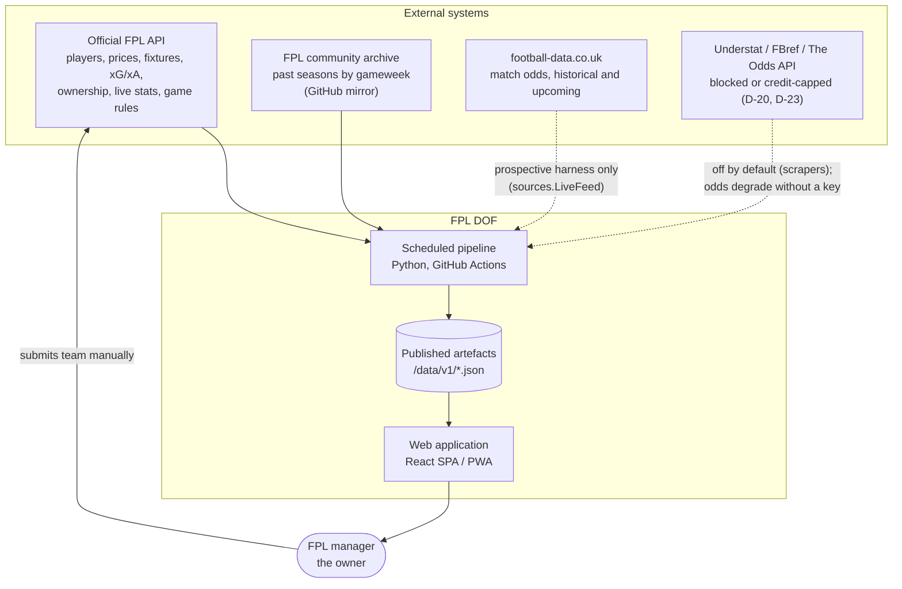
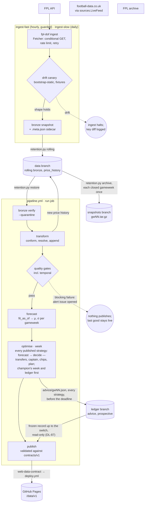
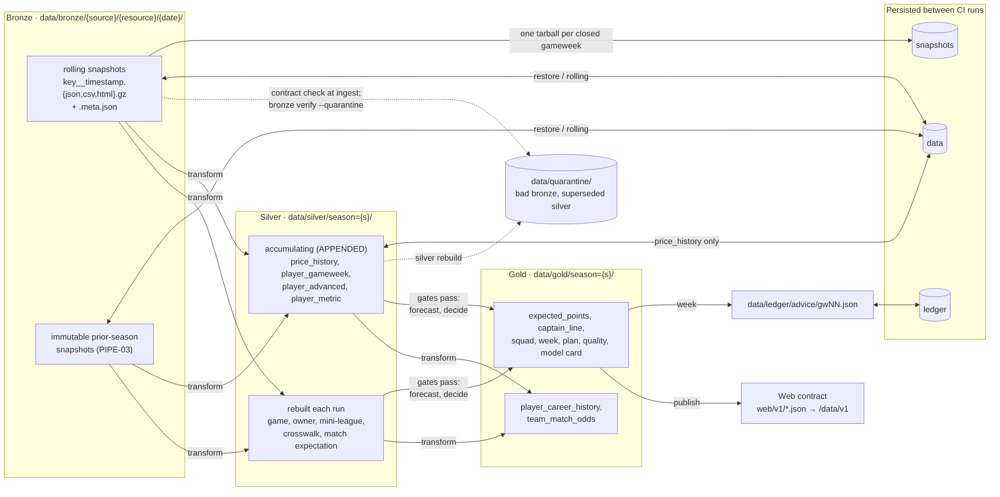
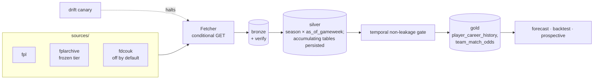

# Solution Architecture — FPL DOF

**Companion to:** [01-project-charter.md](01-project-charter.md), [02-project-plan-and-blueprint.md](02-project-plan-and-blueprint.md)
**Level:** High-level / logical-to-physical. Component internals are in [04-conceptual-design.md](04-conceptual-design.md).
**Baselined:** 2026-08-09 · **Revised:** 2026-10-17 — rewritten to the system as built at the end of
R1.0, with a module-design review (§12) and the R1.1.0 data architecture as delivered (§13)

This page describes what runs today; the design it is moving to is
[05-target-architecture.md](05-target-architecture.md) ([DL-86](../decisions/DL-86.md)). Where the 2026-08-09 baseline chose something that was never
built, the choice is gone from the tables and named once in §5.4. The binding constraints on any
change are in [`DESIGN-PRINCIPLES.md`](../DESIGN-PRINCIPLES.md).

---

## 1. Architectural drivers

The architecture is shaped by four constraints and one ambition. Everything else follows.

| Driver | Source | Architectural consequence |
| --- | --- | --- |
| **Zero cost, no operated servers** | NFR-01, NFR-02, DL-03 | Batch-precompute architecture. No runtime backend, no database, no container to keep alive |
| **Hard weekly deadlines** | CON-1, OBJ-3 | Scheduling is a first-class concern: deadline-aware guards, a day-before run, always-available manual dispatch |
| **Undocumented, unversioned upstream APIs** | CON-5, CON-6 | Anti-corruption layer at every source; immutable raw snapshots; contract tests against recordings |
| **Extensibility to new sources** | DL-05, FR-04 | Adapter registry; a conformed silver model that nothing upstream can leak into (DP-01) |
| **Multi-gameweek combinatorial optimisation** | DL-06, DL-15 | Python analytics tier with a real MILP solver, run in CI where compute is free and unbounded by a request timeout |

### Architectural style

**Batch-precomputed, statically served, plugin-sourced.**

A scheduled pipeline pulls, conforms, gates, forecasts and decides; it publishes a versioned set of
JSON artefacts; a static single-page application reads them from GitHub Pages. There is no request
path from the browser to any code the project operates (Invariant 8).

This is deliberately old-fashioned and deliberately boring. It has no cold starts, no scaling
concerns, no availability risk beyond the CDN, no attack surface worth speaking of, and no bill.

---

## 2. Context view (C4 level 1)



The loop is **not closed**: the system never writes to FPL. The human is the actuator (ASM-6), by
design (DL-08, NFR-11). The official API now carries the expected-goals signals the model uses
(DL-34, DL-46), which is why losing the scraped sources degraded nothing that ships (DP-15).

| Source | Adapter | State |
| --- | --- | --- |
| FPL API | `sources/fpl` | Essential. Failure stops the run; the last good publication stays live |
| FPL archive | `sources/fplarchive` | On in the live run and the backtests, with the 2023/24 to 2025/26 seasons backfilled (DL-87) |
| Understat, FBref | `sources/understat`, `sources/fbref` | Blocked upstream (`robots.txt`, Cloudflare 403) — D-23. Off by default; no workflow enables them. The adapters stay, dormant, so retained bronze still replays (PIPE-09) |
| The Odds API | `sources/oddsapi` | Off by default (PIPE-09); degrades cleanly without `ODDS_API_KEY`, which no workflow passes. Free-tier credit cap, no history — D-20; not used by the model (DL-59, DL-60) |
| football-data.co.uk | `sources/fdcouk` | Off by default, and no workflow enables it. The prospective harness reads upcoming odds and its hash-pinned past seasons through it (`sources.LiveFeed`, REM-07); when enabled, it conforms past seasons' match files into silver by permanent club code, each fetched once (PIPE-03, PIPE-04) |

---

## 3. Container view (C4 level 2)


The pipeline is one CLI, `fpl-dof`, whose stages are registered in `pipeline.py` and run in order by
`run_stages`; CI runs the same commands a developer does (NFR-09). Beside the main run sit the
`backtest` stage (walk-forward regression and the model card verdict, DL-21) and the `prospective`
harness, retired at the switch (DL-87). The `week` stage runs every
published strategy of the registry through `forecast` → `decide` on one snapshot (MOD-04); the
challenger's (C1's) week and plan are published beside the champion's but never acted on (DP-08).

### Container responsibilities

| Container | Code | Responsibility | Never does |
| --- | --- | --- | --- |
| **Ingestion** | `sources/`, `stages/ingest.py` | Fetch from sources through one `Fetcher` (rate limit, retry, robots, cache), snapshot raw bytes to bronze with lineage | Interpret or reshape data |
| **Transformation** | `stages/transform.py`, adapters' `conform`, `sources/resolve.py`, `silver/` | Conform bronze into the canonical silver tables; resolve players and clubs across sources; field precedence by configuration | Name a source outside `sources/` (DP-01) |
| **Quality gates** | `quality/` | Schema, ranges, referential integrity, freshness; a blocking failure stops the run before anything is built on the data (Invariant 7) | Repair data silently |
| **Forecast** | `forecast/` | Expected points with variance and per-component decomposition; the backtest, baselines, model card | Make selection decisions (DP-02) |
| **Decision** | `optimise/`, `squad/`, `week/` | Squad MILP (preseason), weekly transfer MILP, multi-gameweek horizon plan with chip scenarios (HiGHS), captaincy, alerts, advised-versus-played reconciliation | Predict anything (DP-02) |
| **Publisher** | `publish/`, `stages/publish.py` | Validate and write each artefact against its JSON Schema | Hold business logic — see §12, P3 |
| **Web application** | `web/` | Present, explore, explain; client-side legality and heuristic re-optimisation | Call any external API (Invariant 8) |
| **Persistent state** | `data`, `snapshots`, `ledger` branches; Actions artefacts | Bounded, versioned, free storage | Serve queries |

---

## 4. The static-hosting constraint, and how interactivity survives it

DL-03 removes the server. Three tiers of interactivity replace it, and every UI feature is
consciously assigned to one.

| Tier | Mechanism | Latency | Used for |
| --- | --- | --- | --- |
| **T1 — Precomputed** | The pipeline computes it on a schedule; the app reads a file | Instant | Expected points, the plan and chip scenarios, this week's decision, fixture difficulty, scout data, history, model comparison, health, season log |
| **T2 — Client-side compute** | Pure TypeScript in the browser, parameterised from `rules.json` | Milliseconds | Squad legality (`legality.ts`), XI and bench choice (`lineup.ts`), lock-and-ban re-pick — a greedy build plus hill-climb, labelled as a heuristic (`reoptimise.ts`), player comparison verdicts (`verdict.ts`) |
| **T3 — Job-triggered** | A `workflow_dispatch` run with inputs; results land as a new publication | 2–10 min | Full re-optimisation under bespoke constraints, backtests, forced refreshes |

**Design rule:** anything the owner will want *at the deadline, under time pressure* must be T1 or T2.
T3 is for exploration, never for the critical path. This rule is what keeps the zero-cost choice from
degrading the product.

---

## 5. Technology decisions

### 5.1 Analytics tier — Python

| Concern | Choice | Rationale |
| --- | --- | --- |
| Language | Python 3.14 | Mandated by DL-04; the only ecosystem with mature ML *and* MILP tooling |
| Packaging / env | `uv` (`python -m uv`), editable install of `pipeline[dev]` | Fast, lockfile-based |
| HTTP | `httpx` behind `sources/fetch.py` | Timeouts and transport hooks; `respx` for recorded tests |
| Dataframes and storage | `pandas` + `pyarrow`; Parquet for silver, gzipped JSON for bronze, JSON for the web contract | Columnar and typed where it matters, plain JSON at the browser |
| Validation | Pandera (silver), `jsonschema` (contract), `pydantic` (config) | Each layer validated in its own idiom |
| Models | Hand-built component chain (M1–M8) over numpy/pandas; scikit-learn only for the backtest's monolith benchmark (DL-53) and the C1 challenger (`shadow/c1.py`) | Arguable formulations (DP-10); scikit-learn because it is pure-wheel everywhere CI runs |
| Optimisation | PuLP with **HiGHS** for the multi-gameweek horizon (DL-15); CBC for the single-gameweek squad and transfer models | Open-source, no licence. PuLP capped below 4 (DL-71) |
| Logging | stdlib `logging` with a JSON formatter (`obs/logging.py`) plus the run manifest | No extra dependency |
| Testing | pytest, Hypothesis, `respx`, pytest-cov (100% on rules — NFR-08), mypy, ruff | Property tests for optimiser legality; recordings for adapters |

### 5.2 Web tier — TypeScript

| Concern | Choice | Rationale |
| --- | --- | --- |
| Framework | React 18 + TypeScript, strict | DL-04 |
| Build | Vite | Static output; first-class PWA plugin |
| Routing | `react-router-dom` 6 | Deep links with the Pages SPA fallback |
| Data loading | One `DataStore` (`web/src/data/store.ts`) over `fetch`, with per-artefact policies (required, nullable, lazy) | The only I/O seam in the app — four `fetch` calls, all there |
| Tables | `@tanstack/react-virtual` | ~700 rows, virtualised for NFR-04 |
| Charts | Hand-written SVG (`components/charts/`) | Intervals drawn as intervals (DP-09); no charting dependency |
| Styling | Plain CSS with design tokens (`tokens.css`), light and dark | No runtime cost |
| Client rules | `legality.ts`, parameterised from `rules.json` ([DL-14](../decisions/DL-14.md)) | Never a second hand-written copy of FPL's rules |
| PWA | `vite-plugin-pwa` | Offline access to the last publication (FR-34) |
| Testing | Vitest, Testing Library, Playwright browser and deployed-smoke checks (`web/verify/`) | Unit, component, layout, accessibility, offline |

### 5.3 Platform

| Concern | Choice | Rationale |
| --- | --- | --- |
| Repository visibility | **Public** ([DL-12](../decisions/DL-12.md)) | Unlimited Actions minutes and free Pages. See below — this is architecturally significant |
| Orchestration | GitHub Actions, ten workflows (§9) | Free, cron and dispatch built in, secret storage included |
| Persistent state | Orphan `data` branch (rolling bronze), append-only `snapshots` and `ledger` branches; Actions artefacts for the contract hand-off and logs | Free, versioned, no external service (§7.3) |
| Hosting | GitHub Pages | Free on a public repository |
| Secrets | GitHub Actions encrypted secrets | Never in the repo, never in the client bundle (NFR-13); variables in [`environment.md`](../environment.md) |
| Alerting | `alert-on-failure.yml`, a reusable job that opens an issue | Free, no third party |

### Repository visibility is architecturally significant

A **public** repository gets unlimited Actions minutes and free Pages. A private one on the Free plan
gets 2,000 minutes a month and cannot use Pages without a paid plan; the cadences in §9 were costed at
roughly 1,800–3,400 minutes a month before DL-12 reversed OD-01. The privacy was also mostly illusory:
the published artefacts are served from a public CDN regardless.

**The consequence that matters day to day: NFR-13 is load-bearing.** Every commit is world-readable
the moment it is pushed. API keys live only in Actions secrets, the secret-scan hook in
`.claude/hooks/` is the primary guard rather than a backstop, and nothing personal beyond a public FPL
team ID is ever committed (Invariant 10).

### 5.4 Planned in the baseline, not adopted

TanStack Query, Tailwind, Recharts or visx, DuckDB-WASM and Parquet in the web contract, LightGBM,
`highs-js` in the browser, `structlog`, and an import-lint step. Each was either unnecessary at this
scale (~700 players fit in plain JSON) or replaced by something simpler above. The source boundary is
enforced by `pipeline/tests/test_source_isolation.py`, not a linter.

---

## 6. Data flow



**Key property:** a failed gate never publishes. The site keeps serving the last good artefact set,
visibly stale on the health page, rather than serving something wrong (Invariant 7, DP-15).

---

## 7. Data architecture

### 7.1 Medallion layers



| Layer | Content | Format | Persisted between CI runs? |
| --- | --- | --- | --- |
| **Bronze** | Verbatim source responses with a `.meta.json` lineage sidecar (URL, time, SHA-256, validators, immutability) | Gzipped JSON, CSV or HTML | Partly — the rolling window on `data`, plus immutable prior-season snapshots and every `retain`ed capture (football-data.co.uk odds, DL-89) whatever their age (PIPE-03); one permanent tarball per closed gameweek on `snapshots` (PIPE-14) |
| **Silver** | Conformed canonical tables (`silver/tables.py`), validated on read and write; advanced metrics keyed by `as_of_gameweek` and stamped `observed_at` (DL-83) | Parquet, by season | Partly — rebuilt from bronze each run, except the accumulating tables (`APPENDED` in `stages/transform.py`: `price_history`, `player_gameweek`, `player_advanced`, `player_metric`), which are appended to. Of those, only `price_history` is persisted on `data`; `silver replay-prices` rebuilds it from bronze (PIPE-06). An accumulating table from an older schema stops transform until `silver rebuild` (REM-10) |
| **Gold** | Forecasts, plans, decisions, model and backtest cards; `player_career_history` and `team_match_odds`, built by `transform` (PIPE-02, PIPE-05) | Parquet + JSON + Markdown | **No**, except advice on `ledger`. The published contract survives as a 14-day artefact and on Pages |
| **Web contract** | The narrow, versioned slice the browser may read | JSON, `/data/v1/` | Replaced per publish |

### 7.2 The web data contract

The single most important seam in the system: the boundary between DL-04's two languages (DP-04).

- **One definition.** `contracts/v1/*.schema.json` — sixteen schemas, all `additionalProperties:
  false`. `publish/contract.py` holds the artefact registry (`ARTEFACTS`) and **validates every
  artefact before writing it**; each entry also says whether every publication writes it
  (`required`) and whether the app warms it for offline use (`warm`). `fpl-dof contract types`
  generates `web/src/contract/types.ts` from the same registry: the types, the `ARTEFACTS` registry
  the app's loader, offline warm-up and smoke check read, and `ArtefactMap` (WEB-04).
- **Artefacts:** `meta` (run, freshness, `contract_version`), `rules`, `players`, `fixtures`, `squad`,
  `plan` and `week` (the champion's; every other published strategy writes `week_<id>` and,
  if its policy plans, `plan_<id>` in the same schemas, at the paths `strategies.json` names;
  publish removes any week or plan file no published strategy writes now), `history`, `models`,
  `health`, `league`, `log`, `xp_accuracy` (the 2025/26 backtest season, a frozen-era record
  nothing rebuilds carried forward from `publish/records/`, and the live season's from the
  evaluations, ORC-05; WEB-04),
  `strategies` (the strategy registry, [04 §13](04-conceptual-design.md#13-configuration-and-feature-flags)),
  `models_history` (the latest archive season the weekly backtest simulated, from
  `ledger:models_history/`, ORC-06), and `as_if_played` (today's published models replayed
  in-sample on the live season, `kind` `in_sample`, in the same schema, from
  `ledger:as_if_played/`, ORC-13, DL-97), and `live` (the gameweek in play, from its first kick-off
  until the next deadline: each fixture's state, the matchdays done and to come, and the owner's
  and every league team's provisional points from the one realised scorer, live total (the
  game's total after the gameweek before, from `entry_gameweek` or the rival's `league_gameweek`,
  plus those points) and rank, with FPL's own figures and whether the scorer matches them;
  absent otherwise; provisional, never read back into the ledger, and `final` only once the
  gameweek is data-checked and the scores (and, for a team, its own figures) are the captures
  taken after the check; `publish/live.py` over `fpl_dof/live.py`, LIVE-04, DL-99). Every one
  goes through `Contract.write`. All JSON: ~700 rows needs no query engine.
- **Versioned.** `/data/v1/`. A breaking change bumps to `v2` and publishes both during the transition.
- **Behaviour pinned in both languages** by shared corpora in `contracts/conformance/`, read by pytest
  and vitest and never copied (DL-39): squad legality, and the XI, armbands and bench order
  (`lineup-corpus.json`; the bench by P(plays) × xP, WEB-04).
- **Read side.** The browser reads every artefact through `DataStore` and one hook,
  `useArtefact(key)`: `loading`, `ready`, `absent`, `malformed` or `error`. A per-artefact guard
  catches a body that is not the artefact, a floor rather than schema validation (§12, W1); the
  contract major is checked once, on `meta` (WEB-02). The data layer imports no component
  (`data/layering.test.ts`). An open app that becomes visible again (`visibilitychange` to
  visible) calls `DataStore.refresh()`, which drops every cached file and bumps a generation the
  views subscribe to: they read again and update in place, keeping what they show if the read
  fails, so a matchday refresh is seen without a reload. Nothing is fetched while the document is
  hidden and there is no timer (`data/refresh.ts`, LIVE-06, R1.4.3 §5 Q5); the files stay
  `NetworkFirst` in the service worker.

#### `rules.json` — why the contract carries the rules ([DL-14](../decisions/DL-14.md))

§4 assigns live legality checking and lock-and-re-pick to **T2**. Those need the squad rules *in the
browser*, and there are only two ways to get them there:

| Option | Outcome |
| --- | --- |
| Hand-write the rules in TypeScript | Two implementations of FPL's rules, guaranteed to drift. A hardcoded `3` for the club limit in a `.tsx` file is the bug Invariant 2 exists to prevent |
| Move legality checking to T3 | Breaks the §4 rule that nothing on the deadline path is job-triggered |
| **Publish the rules config** ✔ | One definition, generated into the contract from the same configuration the Python rules module reads |

The TypeScript validator is **parameterised from `rules.json` and checks legality only** — it never
computes points. The conformance corpus runs the same squads through both validators, including a
twelve-a-side ruleset that catches any literal.

### 7.3 Storage volume and retention mechanics

About 700 players × 38 gameweeks × ~60 columns per season is a few MB of Parquet. Bronze dominates:
full JSON several times a day, gzipped, in the low hundreds of MB a season if kept naively.

**Deleting a file from the tip of a Git branch reclaims nothing** — the blob stays in history and in
every clone. That is why R-13 is rated High and why the stores have different mechanics:

| Store | Mechanism | Rationale |
| --- | --- | --- |
| **`data`** — rolling bronze | Orphan branch, rebuilt from the retained window (`retention.bronze_days`) and the immutable prior-season snapshots by `pipeline/scripts/retention.py`, with the accumulated `price_history`. The script first folds in what the branch holds and force-pushes with a lease on it, so concurrent workflows never drop each other's pushes. A quarantined capture is never pushed or folded back in; only its sidecar, the record `/health` counts, travels under `quarantine/` within the window (ORC-10) | History is truncated, not accumulated; these snapshots debug the recent past |
| **`snapshots`** — permanent bronze | Append-only; `bronze-full/<season>/gwNN.tar.gz` holds the bronze dated after the previous deadline day up to the gameweek's own, written once the day after its deadline, and `index.json` lists the gameweeks archived, partial and lost (PIPE-14, DL-81). Gameweeks that closed before it first ran on `main` are listed as lost (DL-85) | The NFR-06 evidence trail, small enough to keep forever |
| **`ledger`** — advice and prospective records | Append-only, a pipeline run's files in one commit and one push (`retention.py ledger`, ORC-09); `advice/gwNN.json` holds each strategy's last success before the deadline, a later failure noted beside it, and the writer refuses a write after the deadline ([DL-94](../decisions/DL-94.md)); `predictions/gwNN/<strategy>.parquet` holds each strategy's forecast under the same rule (ORC-08); `evaluation/entry-<id>/gwNN.json` holds each finished gameweek's judgement, written once and rewritten only when the evaluation's version changes (ORC-05); `prospective/gw*.tgz` frozen with it | What was advised, provably before the event (DL-69) |
| **Published contract** | Actions artefact `web-data-contract` (14 days) → Pages | Serving surface, not an archive |

**CI artefacts never hold anything NFR-06 depends on.** They expire; anything reproducibility needs
lives in a branch. The retention window has one home, `retention.bronze_days`, which the script
reads (REM-10).

---

## 8. Deployment and environments

| Environment | Purpose | Data | Access |
| --- | --- | --- | --- |
| **Local** | Development, debugging, ad-hoc analysis, the backtest and chip replay | Real sources, local `data/` (gitignored); bronze can be replayed offline | `localhost`, plus LAN for mobile testing (`vite.config.ts` sets `host: true`) |
| **CI** | The only path to production | Real sources; state restored from the branches in §7.3 | GitHub |
| **Production** | The live app | Published `/data/v1` only | Public Pages URL, laptop and mobile |

**Local/CI parity (NFR-09)** is structural: CI invokes the same `fpl-dof` entry points a developer
does. The differences are credentials, schedule, and which state is restored from branches.

---

## 9. Orchestration

Ten workflows. Cadence escalates as a deadline approaches, and every scheduled workflow is also
manually dispatchable.

| Workflow | Trigger | Does |
| --- | --- | --- |
| `ci.yml` | Push to `main`, `pre-release`, `dev/**`; every pull request | Lint, type-check, unit, property and contract tests; `scripts/docs.py check` |
| `ingest-fast.yml` | Hourly; a guard (`fpl-dof-schedule --decide fast`) decides whether to fetch: four-hourly, but every hour within a day of the Open gameweek's deadline and while a gameweek is in play, from its deadline until data-checked (LIVE-02) | `bootstrap-static`, `fixtures` and the upcoming odds — prices, status, ownership; while a gameweek is in play, also its live scores and the league standings every firing, and each team's picks for it once after the deadline and once after data-check (LIVE-01), and, in the firing that first sees a gameweek data-checked (the live one, or one FPL checks after the next deadline), the per-player summaries once (LIVE-07). Rebuilds `data`, then dispatches `pipeline.yml` with `trigger=change` and the kinds its change manifest moved, if any (ORC-02) |
| `ingest-slow.yml` | Daily, with a fallback slot (each scheduled firing is a no-op once today's ingest succeeded); dispatch, with `must_publish` from `day-before.yml` | Full ingest including per-player summaries; updates `data`; dispatches `pipeline.yml` (`day-before` when `must_publish`, else `change` with its kinds, else the daily `schedule` refresh); archives each newly closed gameweek's bronze to `snapshots`, once, and fails if bronze has no gameweek schedule |
| `pipeline.yml` | One tick four times an hour (`7,23,41,53 * * * *`); dispatch with typed inputs `trigger` (`manual`, `change`, `schedule`, `day-before`), `kinds`, `gameweek`, `must_publish` (ORC-02) | `guard` (`fpl-dof-schedule --decide pipeline`: the tick runs only in a pre-deadline window; every trigger is refused inside the freeze or for a gameweek no longer Open, except that a `results` change may be for a gameweek in play and needs none Open; an unknown input fails the step) → `run` (restores the retired frozen harness's last record from `ledger`, read-only, so `models.json` keeps its history up to the switch; `fpl-dof bronze verify --quarantine`, then `fpl-dof run --only transform…publish`; advice appended to `ledger` — the champion's as soon as its week exists, before its plan and the challengers run — contract uploaded, `data` rebuilt with the new price history) → `deploy` (calls `deploy.yml` only when `run` published, ORC-03) |
| `day-before.yml` | Every 20 minutes in a nightly UTC window | On the day before a deadline, dispatches `ingest-slow` with `must_publish=true` once (deduplicated by the run's `workflow_dispatch` event since midnight Sydney, never its title); that ingest dispatches the pipeline, whose deploy then requires a fresh contract |
| `deploy.yml` | Called by Pipeline as its last job when the run published; push to `main`; dispatch | Builds the SPA with the calling run's own contract (a push or dispatch takes the newest pipeline run's, until WEB-01), deploys to Pages (ORC-03, [DL-94](../decisions/DL-94.md)) |
| `backtest.yml` | Weekly; dispatch | Archive ingest under `config/ci-backtest.yaml` (DL-68), then the walk-forward regression; beside it, its own job replays today's models in-sample on the live season (`fpl-dof as-if-played`, ORC-13) |
| `pre-release.yml` | Push to `pre-release`; pull requests into `main` | Builds the site against the latest published contract and runs `verify:smoke` — the promotion gate ([DL-80](../decisions/DL-80.md)) |
| `release.yml` | Push of an `R*` tag | Checks the tag is on `main` and publishes the GitHub Release |
| `alert-on-failure.yml` | Called by the others | Opens an issue on failure |

### Two cadence rules that are easy to get wrong

**1. Per-player summaries run on the fast path once a gameweek, at its data-check, and never
otherwise.** They are ~700 requests; at a polite two a second that is six minutes. The fast workflow
exists to keep *prices, status and ownership* inside the NFR-05 freshness window, and those all live
in `bootstrap-static` — two requests, seconds.
A summary is cached for a week, except that one fetched before the latest gameweek was checked
(`finished` and `data_checked`) is stale whatever its age: its `history` is where `player_gameweek`
comes from, and it lacks that gameweek. FPL publishes no finish time, so "checked" dates from the
oldest bronze `bootstrap-static` snapshot that shows it, by sidecar `fetched_at`, never file mtime
(F2). The first ingest after each gameweek is checked therefore re-fetches the whole sweep once. If
that is the fast ingest whose capture is the first to show the flag flip (the resource's `on_check`,
LIVE-07), the `results` run it starts evaluates the gameweek on its final rows, not at the next slow
ingest. It keys on the gameweek checked, not the live one, so a gameweek FPL checks after the next
deadline (a Monday match, a Tuesday deadline) is swept too. Every other fast firing leaves the
summaries alone: it reads the bootstrap capture before its own to see the check is not new, and
neither fetches nor walks them. With no capture before its own (a fresh bronze), the check counts
as new. The same firing refetches each published rival's history once, as fresh as its capture,
otherwise the slow ingest's daily read, so the totals FPL corrected at the check are what the next
gameweek's live totals stand on (LIVE-04): one request a rival, within `league_rival_limit`. A
rival's history row counts as a finished gameweek's total only if the bootstrap capture bronze held
when that history was captured shows the gameweek finished; otherwise the total is unknown and
that team goes without a live figure, said. The warning gate `player_gameweek_current` flags any player whose club played that gameweek but who
has no row for it.

**2. An ingest starts a pipeline run only when something material moved** (ORC-02,
[DL-94](../decisions/DL-94.md)). Ingest compares the bronze it restored with the bronze it fetched
(`sources/changes.py`, each source diffing its own captures) and writes the kinds that moved to
`data/runs/changes.json`: any price, any status or news line, any fixture's kick-off or gameweek, a
match of the Open gameweek priced for the first time, and `results` (LIVE-02,
[DL-99](../decisions/DL-99.md)). There are no thresholds. Ownership, a price moving on an
already-priced match, a kick-off, a goal or a score starts nothing; a recapture of the same bytes
starts nothing either, except through the settle cap below.

`results` moves when a **matchday** of the gameweek in play becomes done, when the gameweek is
marked finished, and when it is marked data-checked. A matchday is a gameweek's fixtures sharing a
kick-off date in `schedule.matchday_zone` (UK time); it is done when every one of its fixtures has
FPL's `finished` (bonus confirmed), or when `schedule.matchday_settle_hours` (three) have passed
since its last kick-off, and is then published bonus pending, which the run reads from the same
flags. A postponed fixture (no kick-off, or out of the gameweek) belongs to no matchday. The rule
is `gameweek.py` `matchdays_done_since`, pure and source-free; each capture's time is its sidecar
`fetched_at`. Comparing the restored capture with the new one, rather than reading the clock, moves
each matchday once, at whichever firing first sees it done, however many GitHub drops (D-35). A
`results` run is a full run that deploys; the guard lets it through for a gameweek in play and with
no gameweek Open (the season's last weekend), and the freeze still binds it: a check inside the
freeze spends its change on a refused run, and the gameweek, Finished and unevaluated, is evaluated
by the next run outside the freeze, whatever started it (ORC-05). The run banner names it a results
refresh.

**Scheduling caveat (R-09):** scheduled runs are best-effort and can be delayed under platform load.
The day-before run and the deadline guard exist so a delayed cron is never the reason a deadline is
missed; manual dispatch outside the freeze is always the fallback. Runs with work queue in one
concurrency group, the `run` job's, newest wins: a newer queued run supersedes an older one, so its
`trigger` stamp names only the newest cause, while the data it restores includes every earlier
change. A tick whose guard says no never joins the queue, and a run that waited asks the guard
again before it works, so the freeze binds when it starts.

---

## 10. Cross-cutting concerns

### 10.1 Configuration

Layered, most specific wins (`config/loader.py`): committed YAML defaults packaged with the code
(`config/defaults/*.yaml`) → a gitignored `config/local.yaml`, or the file `FPL_DOF_CONFIG_FILE`
names → `FPL_DOF_*` environment variables → CLI arguments. The merged mapping is validated once into
`Config`, and its digest goes into the run manifest (DP-11). Rules and tunables live here, never in
code (DP-05, DP-06). Secrets only arrive by environment variable ([`environment.md`](../environment.md)).

### 10.2 Observability

No paid tooling exists in a £0 budget, so observability is built from artefacts:

- **Run manifest** (`obs/manifest.py`) — `run_id`, git SHA and dirty flag, config digest, per-stage
  timing and status, per-source outcomes, gate results, solver status.
- **Structured JSON logs** per run, kept as CI artefacts.
- **`health.json`**, rendered at `/health` (FR-33) — every source with its status, freshness and
  reason, the gates, and the price-dependence diagnostic. The monitoring dashboard *is* the product.
- **The model card** beside the published artefacts, carrying the backtest verdict (DL-21).

### 10.3 Failure handling

| Failure | Behaviour |
| --- | --- |
| A non-essential source is unavailable or blocked | Degraded in the manifest and on `/health`; the run continues without its fields (NFR-15) |
| A capture breaks its source's contract | The fetcher checks every new capture with the parser conformance uses (`SourceAdapter.check`); one malformed row makes the whole capture malformed. It goes to `data/quarantine/` with `quarantine_reason` in its sidecar, and every reader — the run, training, the backtest, every replay — gets the last valid capture at or before its `as_of` from `BronzeStore.latest`. With none, the source fails as before. The freshness gate and `/health` judge the capture used, by `fetched_at`; `/health` counts the quarantined ones (ORC-10, DL-94) |
| The FPL API fails | The run stops; the last good publication stays live; an issue is opened |
| A blocking quality gate fails | Publication blocked; last good publication stays live; issue opened |
| The solver fails or times out | Greedy fallback; the result is flagged as fallback-quality |
| A challenger strategy fails | Its week, plan and ledger entry say "no advice" with the reason, unless an earlier success this gameweek stands: that stays the advice of record in the ledger and in its published week file, with the failure noted as `last_failure` ([DL-94](../decisions/DL-94.md)). One short of a source's data is named in `models.json` with that source, since when and the next fast-ingest check, shown on every route until it advises or the deadline passes, and the run it advises in says the source arrived (ORC-07); every other strategy publishes (`stages.week.advise_all`, NFR-15). The champion's week is written and ledgered before its plan or any challenger runs: a champion plan failure of any kind is "no plan" with its reason and the week stands; a champion week failure fails the run |
| A deploy fails | The previous site stays live; static hosting makes this the default |

### 10.4 Security and privacy

- No authentication anywhere; no user data; no FPL credentials (NFR-11, DL-08).
- Secrets only in Actions; the secret-scan hook blocks commits that carry one.
- Dependencies pinned; updates reviewed before merge. Supply-chain compromise is the main realistic
  risk for a static site with no inputs, no session and no secrets.

### 10.5 Legal and ethical use (NFR-10)

| Source | Access | Obligations |
| --- | --- | --- |
| FPL API | Public JSON, unauthenticated | Honest user agent, conservative rate limiting, cache aggressively |
| FPL archive, football-data.co.uk | Public files | Cache permanently once a season is complete (PIPE-03, PIPE-04); attribute in the UI |
| Understat, FBref | Scraped HTML | Both refuse automated access; `robots.txt` is honoured, so they stay off rather than working around it |
| The Odds API | Documented API | Stay inside the free-tier terms and credit cap |

---

## 11. Repository structure

```
fpl_dof2/
├─ docs/                       # map: docs/README.md
├─ .github/workflows/          # the ten workflows in §9
├─ config/                     # committed CI configs (ci-backtest.yaml); local.yaml is gitignored
├─ contracts/
│  ├─ v1/                      # JSON Schemas — the web contract's single definition
│  └─ conformance/             # fixture corpora read by both pytest and vitest
├─ pipeline/
│  ├─ src/fpl_dof/
│  │  ├─ cli.py  pipeline.py   # `fpl-dof` entry point; stage registry and run_stages
│  │  ├─ schedule_cli.py       # `fpl-dof-schedule`: the CI guards
│  │  ├─ config/               # layered loader, pydantic models, defaults/*.yaml
│  │  ├─ sources/              # ADAPTERS — the only code that knows a source exists (DP-01)
│  │  │  ├─ base.py registry.py fetch.py bronze.py robots.py
│  │  │  ├─ resolve.py precedence.py enrich.py catalogue.py
│  │  │  └─ fpl/ fplarchive/ fdcouk/ understat/ fbref/ oddsapi/
│  │  ├─ silver/               # canonical tables, Pandera schemas, Parquet store
│  │  ├─ quality/              # gates as data; run_gates
│  │  ├─ rules/                # FPL rules from the API + config: scoring, legality (pure, 100% covered)
│  │  ├─ factory/              # the strategy registry: forecast and decision policy per strategy; chip replay (DL-28)
│  │  ├─ forecast/             # features, M1–M8, fit_as_of, horizon, xp_v0/xp_v1, backtest, baselines, monolith, model card
│  │  ├─ optimise/             # squad, transfer and horizon MILPs, chips, captain, risk, explain
│  │  ├─ decision/             # decide: one decision path for every strategy (MOD-04)
│  │  ├─ squad/                # current squad state; XI and bench selection
│  │  ├─ week/                 # deadlines, alerts, ledger, reconciliation, hindsight oracle, schedule
│  │  ├─ shadow/               # the C1 forecaster, reached through the registry
│  │  ├─ prospective/          # the pre-registered model comparison harness
│  │  ├─ publish/              # contract writer, builders, TypeScript generator
│  │  ├─ stages/               # the effectful edge: one module per stage (DP-03)
│  │  └─ obs/                  # logging, manifest, run context, clock
│  ├─ scripts/                 # CI helpers: retention, ledger, prospective, run lookup
│  └─ tests/
├─ web/
│  ├─ src/
│  │  ├─ contract/types.ts     # GENERATED by `fpl-dof contract types` — never edit
│  │  ├─ data/                 # DataStore, DataProvider, model choice, offline cache
│  │  ├─ routes/               # thin pages composing components
│  │  ├─ components/           # feature folders with their pure domain logic beside them
│  │  └─ gate/ layout/ theme/
│  └─ verify/                  # browser and deployed-site verification
├─ prospective/                # the pre-registration record
└─ data/                       # local working data (gitignored)
```

Two things are load-bearing in this layout:

1. **`sources/` is the only directory that may name a source** — enforced by
   `tests/test_source_isolation.py`, which scans `src/` and `pipeline/scripts/`, and fails on adapter
   internals re-exported from the `sources` root.
2. **`contracts/` is the single definition of the two-language seam.** Both sides generate from it;
   neither hand-writes it.

---

## 12. Module design — review of 2026-10-17

A review of the code as built, in the vocabulary of deep modules: a **module** is deep when a lot of
behaviour sits behind a small interface; a **seam** is where that interface lives; a seam with one
adapter is hypothetical, with two it is real. The test of a module is whether deleting it makes
complexity vanish (a pass-through) or reappear across its callers (it was earning its keep). Findings
cite file and line as of the review; they are a design backlog. When one is taken up it becomes a
story in the open release or a `D-nn` in the [debt register](debt-register.md); one that R1.1.0 closed
says so in its first words. §12.6 adds the code findings of the 2026-10-22 documentation review.

### 12.1 Dependency direction

| Package | Imports (besides `config`, `obs`, `frames`) |
| --- | --- |
| `sources` | `silver`, `rules` |
| `silver`, `rules` | `rules` / nothing |
| `forecast` | `rules` |
| `optimise` | `rules`, `squad` |
| `squad` | `rules` |
| `week` | `rules`, `squad`, `optimise` |
| `decision` | `rules`, `squad`, `optimise` |
| `shadow` | `rules`, `forecast`, `optimise` (the frame) |
| `publish` | `rules`, `squad`, `forecast`, `optimise`, `week`, `sources` (catalogue only) |
| `quality` | `silver` |
| `stages` | everything, plus 13 stage-to-stage imports |

The direction is enforced, not just described: `import-linter` contracts in `pipeline/pyproject.toml`
(`lint-imports`, in the CI lint job and `tests/test_import_boundaries.py`) hold the target of
[05 §3](05-target-architecture.md#3-module-map) — core imports nothing from the data platform, the
model factory or the orchestrator; the data platform and the factory never import the orchestrator;
only `pipeline` and `cli` import `stages`; stages do not import each other. Stages share artefact names and the rules reader through `fpl_dof/artefacts.py` and gold paths
through `DataLayout.gold_for`; `current_gameweek` lives in `fpl_dof/gameweek.py`. The allow-list
of violations (`ignore_imports`) that R1.2.0 started with is empty (MOD-01, DL-87): a new forbidden
import fails CI. Nothing outside `sources/` imports a source subpackage, and
`optimise` imports nothing from `forecast` (DP-02, PIPE-13).

### 12.2 Where the design is deep — keep

| Module | Interface | Why it earns its keep |
| --- | --- | --- |
| Source adapters | `registry.build()`, `SourceAdapter.ingest/conform`, `Fetcher`, `BronzeStore` | Five real adapters behind ~25 names; `ingest` is 77 lines and never names a source. Adding a source is one module plus config |
| `rules.validate_squad` | One function | The single legality check after every solve and in squad state and selection |
| Quality gates | `run_gates` over `GATES` as data | Nineteen gates, one entry point |
| `squad.load_squad_state` | One function | ~470 lines of transfer and price reconstruction behind it |
| `pipeline.run_stages` | Stage registry with resolver injection | Owns timing, manifest and failure handling; the injection is a real test seam (nine adapters) |
| Narrow config sections | `ForecastConfig`, `OptimiserConfig`, … passed in | No core module loads configuration (DP-03) |
| Contract write side | `Contract.write` | Validate-then-write against one registry; types generated from it |
| Web domain logic | `verdict()`, `chooseLineup()`, `reoptimise()`, `validateSquad()` | Pure, take `Rules` as an argument, return results; the interface is the test surface |
| `DataStore` | `get(key)`, `loadPublished()` | One in-flight promise per key, eviction on failure, four loading policies; the app's only `fetch` |

### 12.3 Pipeline findings, most impactful first

| # | Finding | Evidence | Deepening |
| --- | --- | --- | --- |
| **P1** | **Closed by PIPE-13 except for C1:** live, backtest and the chip replay (`factory/replay.py`) fit through `fit_as_of`; B0 stays on the fitted model and reaches the captain policy as its own input (MOD-02). The C1 challenger keeps its own features and its own `fit_as_of`; both it and `xp_v1` reach the harness through `Strategy.predictor` (`fit_as_of`/`predict(features, gameweek=)`, MOD-05; the fold's gameweek is passed because a fit is reused between refits), which is how `walk_forward` fits every strategy (MOD-08) | `forecast/fit.py`, `forecast/backtest.py` `StrategyPredictor`, `shadow/c1.py` | One interface in `forecast/`: `fit_as_of(history, deadline, config, rules) → FittedModel` with `.predict(window)`. live, backtest, replay and C1 call it |
| **P2** | **Three solver models each re-encode squad legality**; solver construction is repeated; `optimiser.solver` is never read — squad and transfer hard-code CBC | `optimise/squad.py:251,288-326,342`, `optimise/transfer.py:278-332,348`, `optimise/horizon.py:154,388-470`; formation tally at `squad.py:430`, `transfer.py:468`, `horizon.py:655` | `optimise/milp.py`: `add_squad_constraints(problem, select, start, rules, week=None)` and `solver_for(config)`. Each model keeps only its objective. Delete the dead field |
| **P3** | **Decision part closed by MOD-04:** XI selection, the start-probability floor relaxation and the price-and-position captain relabel moved out of `stages/week.py` into `decision.decide`, and the `decision` stage folded into `week`, so its duplicated context loading and `_write` went; each strategy's file names have one home, `publish.strategies.artefact_paths`. **Still open: the stage edge holds domain logic** (2,648 lines at the review). Publish fits M2 and, through the season log, runs the hindsight oracle; six optional artefacts are handled inline with differing error handling; the gold season path is rebuilt ten times; ~410 lines of backtest-card Markdown live in the stage while core `model_card.py` writes files | `stages/publish.py:93-160,368-379`, `week/oracle.py:118`, `stages/backtest.py:127-540`, `forecast/model_card.py:342` | `DataLayout.gold_for(season)` and one artefacts module owning file names; `optional_artefact(name, build)`; M2 ratings as a forecast output; card renderers return strings and stages write them |
| **P4** | **Closed by PIPE-12:** one `as_of` per run, recorded in the manifest, and one gameweek predicate ([DL-84](../decisions/DL-84.md)). **The clock and "the next gameweek" are not coherent** (DP-11). `utcnow()` is read eight times across stages; three definitions of the next gameweek — first unfinished, first deadline after now, FPL's `is_next`. Between a deadline passing and the gameweek finishing, `xp_next` may describe GW N while the advice is for GW N+1 (inferred, not yet reproduced) | `forecast/live.py:84`, `forecast/xp_v0.py:332`, `week/cadence.py:130`, `stages/publish.py:383`, `stages/week.py:76,140`, `quality/rules.py:143` | Set `StageContext.as_of` once in `cli.py` and record it in the manifest; one `current_gameweek(gameweeks, as_of)` used by forecast, week and publish. A prerequisite for PIPE-01 and PIPE-10 |
| **P5** | **Closed by PIPE-04:** the `fdcouk` adapter, scripts reading through `sources.LiveFeed`, and an isolation test that scans `scripts/` with no allow-list (REM-06). **A source is handled outside `sources/`, and the guard misses it** (DP-01). football-data.co.uk URLs, a second team-name resolver, and a `urllib` fetch writing straight to bronze, bypassing `Fetcher`, robots and lineage. The isolation test neither lists the source nor scans `scripts/` | `prospective/fdcouk.py:16`, `prospective/timing.py:50` vs `sources/resolve.py:302`, `scripts/prospective_ci.py:56-81`, `tests/test_source_isolation.py:28-37` | A registered, off-by-default `fdcouk` adapter (PIPE-04). Meanwhile add the pattern to the test and scan `scripts/` |
| **P6** | **Closed by MOD-02 except the shared scoring:** `forecast.publishable(inputs, rules, config) → Forecast` owns the choice between xp_v1 and the xp_v0 fallback and is the package's entry point; the stage reaches it through the champion's `Strategy.forecast`, and every frame is validated against the forecast-frame schema (`optimise/frame.py`) before the engine reads it. **Still open:** the Poisson survival function and points arithmetic are duplicated across `rules/scoring.py`, `xp_v0` and `xp_v1` | `xp_v0.py:66,399-482`, `xp_v1.py:146,352-411`, `rules/scoring.py:60` | `rules.scoring.expected_points(components, position, rules)` shared by every model |
| **P7** | **Shallow facades and a grab-bag in `week/`.** Three pure re-export modules; three different functions called `next_deadline`; `cadence.py` mixes deadlines, CI idempotency, cron gating and a veto; scheduling spread over five files | `week/deadline.py`, `week/day_before.py`, `week/ci_runs.py`, `week/cadence.py:118`, `forecast/live.py:80`, `schedule_cli.py`, `scripts/day_before_gate.py` | Delete the facades; move cron and CI gating into a `schedule/` package so `week/` is only about advice |
| **P8** | **Very large files** — a locality cost, not a depth one. `config/models.py` is 2,215 lines and 53 classes, imported directly by 40 files; `sources/fpl/adapter.py` 1,301; `forecast/models.py` 1,106; `optimise/horizon.py` 950 | `wc -l` | Split `config/models.py` by area behind the package root. The others sit behind deep seams; split only when touched |
| **P9** | **Backtest part closed by MOD-08:** the harness tests drive `walk_forward` through `Entrant` and `StrategyPredictor` stubs (`tests/test_experiments.py`, `tests/test_backtest.py`). **Still open: tests reach past interfaces** — symptoms of P1, P3 and P6 | `test_adaptive_shrinkage.py:295`, `test_duty.py:400` (`stages.backtest._card`); `test_expected_goals.py:17`, `test_goalkeeper.py:150` (`xp_v1` privates); `test_source_catalogue.py:156-185` | Re-point at the new interfaces as each finding lands |
| **P10** | **Minor DP-03 leaks** — file I/O in core; publish reads `os.environ` directly, bypassing the CLI's override path | `forecast/model_card.py:342`, `week/ledger.py:60-76`, `stages/publish.py:445` | Return values; let stages write. Read the setting through `Config` |

### 12.4 Web and contract findings

| # | Finding | Evidence | Deepening |
| --- | --- | --- | --- |
| **W1** | **The read side of the contract is unchecked.** Responses are cast, not validated; `contract_version` is never read although the generated header says the app refuses unknown versions; `data/v1` and the cache suffix are hard-coded | `web/src/data/store.ts:24,84,93`, `offline.ts:35`, `contract/types.ts:11` | `DataStore.get` checks `meta.contract_version` once and runs a generated minimal guard per artefact; derive the data path and cache name from `CONTRACT_VERSION` |
| **W2** | **Model-labels part closed by MOD-07 (the app reads `strategies.json`); bench-order part closed by WEB-04: both languages rank the bench by P(plays) × xP, ties by id, held by `contracts/conformance/lineup-corpus.json` (`test_lineup_conformance.py`, `lineup.conformance.test.ts`).** Still open: violation codes listed twice; `sellingPrice` in TS has no production caller | `web/src/components/squad/lineup.ts:84-86` vs `squad/selection.py:8-11`; `legality.ts:44` vs `rules/legality.py:23` | A `lineup-corpus.json` beside the legality corpus; violation codes as a schema enum; delete `sellingPrice` |
| **W3** | **Closed by WEB-04:** the registry is generated into `types.ts` from `ARTEFACTS` (path, required, warm), read by the loader, the offline list and the smoke check; one `useArtefact(key)` in `data/store.ts`; `data/api.ts` and the five hooks are gone. **Was: six loading hooks, three spellings of "absent", six hand-kept artefact lists in TS** plus `ARTEFACTS` in Python. Adding an artefact touches about six files; `retry` drops eight artefacts | `store.ts:35,59,220,244,284`, `offline.ts:44`, `data/api.ts` (15 pass-throughs), `useFixtures.ts`, `useLeague.ts`, `useLog.ts`, `useHealth.ts`, `useLazyArtefact.ts` | One generated artefact registry carrying each loading policy; one `useArtefact(key)` returning `loading | ready | absent | malformed | error`; delete the pass-through layers |
| **W4** | **Closed by WEB-03:** `fpl-dof contract types --check` runs in CI, publish writes nothing into `web/src`, and a `$defs` collision fails generation. **Was: type generation is a side effect of every data run and is not checked in CI**; duplicate `$defs` names would collide silently | `stages/publish.py:166-169`, `publish/typescript.py:96-97` | `fpl-dof contract types --check` in CI; stop writing into `web/src` from the publish stage |
| **W5** | **Closed by MOD-04 and WEB-04:** every strategy's week and plan go through `Contract.write`, and the 2025/26 xP accuracy is a record under `publish/records/` that publish carries into `xp_accuracy.json` (`test_evaluation.py::test_the_published_xp_accuracy_carries_the_2025_26_record_forward`). **Was: one checked-in file bypassed it** (the 2025/26 backtest's xP accuracy; the hand-typed season replay was archived in R1.3.0) | `web/public/static/xp_accuracy.json` | Publish it through `Contract.write` (WEB-04 item 3) |
| **W6** | **Closed by WEB-04:** `effective.ts` is in `data/`, applied once in `withModel`, and `data/layering.test.ts` fails on any import of `components/`. **Was: the data layer imported components**, and `effectiveSquad` was applied twice | `store.ts:17-18`, `DataProvider.tsx:8,121`, `store.ts:199` | Move `effective.ts` and the replay type into `data/`; apply once in `withModel` |

### 12.5 Orchestration findings

| # | Finding | Evidence | Deepening |
| --- | --- | --- | --- |
| **O1** | **Closed by ORC-03** ([DL-94](../decisions/DL-94.md)): deploy is `pipeline.yml`'s last job, run only when that run published, with that run's own contract. **Deploy ran after every Pipeline completion**, including guard-only skips, which report success — up to ~96 redundant builds a day re-deploying an old contract | `deploy.yml`, `pipeline.yml` `deploy` | Deploy only when the triggering run uploaded `web-data-contract` |
| **O2** | **Closed by ORC-02:** typed `workflow_dispatch` inputs; `test_dispatch.py` fails on any `workflow_run`, title or cron-string match. **Workflows chain through title strings and display names** (`[day-before` matched in three files; `workflows: ["Pipeline"]`; cron strings compared literally) | `ingest-slow.yml:9`, `pipeline.yml:17-19,94,112`, `deploy.yml:38-42` | A typed `workflow_dispatch` input or a small hand-off artefact |
| **O3** | **Closed by PIPE-06:** every workflow restores with `retention.py restore`. **Branch-restore logic copied five times**; the guard restores `silver` from a branch that only holds bronze | `ingest-fast.yml:43`, `ingest-slow.yml:79`, `pipeline.yml:75,333,348` | One composite action or `retention.py restore` |
| **O4** | **Closed by REM-10:** the window is read from configuration only. **The retention window is kept equal by hand** in YAML and configuration; the alert workflow's comment names a `retention.yml` that does not exist | `ingest-fast.yml:73-76`, `alert-on-failure.yml:21` | Read the window from configuration in the workflow step |

### 12.6 Code findings of the 2026-10-22 documentation review

Found while rewriting the data and model documentation to the code; not yet taken up. F1 and F3
change what the model predicts, so they need the
[E8 §5](epics/E8-ongoing-in-season-monitoring.md#5-the-bar-for-changing-the-model-mid-season) bar
before they ship.

| # | Finding | Evidence | Fix |
| --- | --- | --- | --- |
| **F1** | **Closed by MOD-09 (DL-90):** M7 never read a player's own card record because `yellow_cards` had no rolling feature. It is in `forecast.features.rolling_statistics` now, the held-out season did not degrade, and a test pins that every `RATE_COMPONENTS` column has one | `config/models.py` `FeatureConfig`, `tests/test_experiments.py` | — |
| **F2** | **Closed by ORC-10:** the gate ages bronze by the newest sidecar's `fetched_at` (`BronzeStore.observed`, shared with `/health`), so a fallback to an older valid capture still fails it (`test_malformed_captures.py`). It aged each sidecar by its file modification time, which `retention.py restore` resets, so every snapshot looked fresh in CI | `stages/quality.py` `_newest_snapshot_age` | — |
| **F3** | **Closed by MOD-08 and DL-91:** each strategy is graded inside its own `training_window` (features, training rows and fit), so the champion is graded on the current season as it ships; widening its window was tried as MOD-09's experiment `f3_training_window` and rejected (`all_seasons` worse on 2024/25-2025/26: MAE +0.0119, Spearman -0.0174 per gameweek, both 95% intervals off zero). It was: the graded model was not the shipped model, the backtest pooling every `backtest.training_seasons` season while live training used the current season | `forecast/backtest.py` `walk_forward` | — |
| **F4** | **Closed by MOD-05:** M2's time-decay half-life is `forecast.team_strength.half_life_matches`, with its description and justification (`test_team_strength.py::test_the_half_life_is_read_from_config`). It was a hard-coded tunable (DP-06) with no waiver | `config/models.py` `TeamStrengthConfig` | — |
| **F5** | **Closed by MOD-06 and MOD-08:** the model card's `BACKTESTED_WEAKNESS` and `forecast.yaml` now say `minutes_v2` is on (since DL-76), and `sources/external.py` went with the frozen bundle. It was stale text in code | `forecast/model_card.py`, `config/defaults/forecast.yaml` | — |

---

## 13. R1.1.0 — data architecture as delivered

R1.1.0, the data pipeline uplift (PIPE-01 … PIPE-14), was remediated ([DL-81](../decisions/DL-81.md))
and delivered; its backlog is archived at
[`archive/R1.1.0/R1.1.0-data-pipeline-backlog.md`](archive/R1.1.0/R1.1.0-data-pipeline-backlog.md).
§2–§9 describe the result; this section indexes what it added.

### 13.1 What it added

| Concern | As built | Items |
| --- | --- | --- |
| Source set | FPL API on. `fplarchive` and `fdcouk` on, with the archive seasons 2023/24 to 2025/26 backfilled (DL-87, DL-89); `config/ci-backtest.yaml` now sets only the backtest's training seasons (DL-68). Understat, FBref and The Odds API off, their adapters dormant so retained bronze still replays | PIPE-04, PIPE-09 |
| Prior seasons | **Frozen bronze tier**: completed-season snapshots are marked `immutable`, kept by retention whatever their age, and re-fetched only when forced | PIPE-03 |
| Transport | **Conditional requests** (`ETag`, `Last-Modified`); a 304 revalidates the held snapshot without a download | PIPE-07 |
| Ingest safety | A **drift canary** on `bootstrap-static` and `fixtures` halts ingest before per-player fetches and logs a key diff | PIPE-08 |
| Bronze integrity | `fpl-dof bronze verify` (checksums, gzip, orphans) before transform in CI; `--quarantine` moves bad files to `data/quarantine/` and fails only on what it cannot move (REM-10). `--contract` also checks each snapshot against its source's contract: the one-off sweep of history kept before ingest checked every capture, which names `silver rebuild` when it moves one (ORC-10) | PIPE-11 |
| Silver persistence | `price_history` persisted on `data` and rebuilt by `silver replay-prices`; one restore step, `retention.py restore`, in every workflow | PIPE-06 |
| Temporal grain | Metrics keyed by `season` and `as_of_gameweek`, stamped `observed_at`; a source added mid-season is backdated to deadline-aligned snapshots, never estimated, with the crosswalk's `ingress` as provenance ([DL-83](../decisions/DL-83.md)) | PIPE-01 |
| Look-ahead guard | A **blocking temporal non-leakage gate** on silver's own columns (04 §3.4) | PIPE-10 |
| Clock | One `as_of` per run, in the manifest; the decided gameweek is the first deadline ahead ([DL-84](../decisions/DL-84.md)) | PIPE-12 |
| Gold | `player_career_history` keyed on the permanent `player_code`, and `team_match_odds` with one de-vig formulation across seasons, built by `transform`; first read in R1.2 (DL-81) | PIPE-02, PIPE-05 |
| Permanent archive | One tarball per closed gameweek on `snapshots` (§7.3) | PIPE-14 |



### 13.2 The design-review fixes it absorbed

Four §12 findings were built into R1.1.0 because its items depended on them ([DL-79](../decisions/DL-79.md)):

| Backlog item | Depends on | Why |
| --- | --- | --- |
| PIPE-01, PIPE-10 | **P4** — one `as_of` per run, one `current_gameweek` — built as PIPE-12 | A gate that tests "observed before the GW *N* deadline" needs a single definition of *now* and of *N* |
| PIPE-02, PIPE-05 | **P1** — `fit_as_of` in `forecast/` — built as PIPE-13 | Unified gold is only worth having if live, backtest, replay and the challenger read it through one interface rather than four fitting paths |
| PIPE-04 | **P5** | The `fdcouk` adapter ended the fetch outside `sources/`; the operational scripts read it through `sources.LiveFeed` (REM-07) |
| PIPE-06 | **O3, O4** | Persisting silver needed a branch restore in every workflow; it is one step, `retention.py restore` |

O1 was closed by ORC-03 in R1.3.0 ([DL-94](../decisions/DL-94.md)); W4 by WEB-03 and W3, W5 and W6
by WEB-04 in R1.4.0. The other §12 findings (P2, P3, P6–P10, W1, W2's violation codes and
`sellingPrice`, O2, F1–F5) stand; their scheduling is in the
[release register](epics/README.md).

---

## 14. Non-functional architecture

| Quality | How the architecture delivers it |
| --- | --- |
| **Cost** | No compute outside free CI; no database; no paid tier. The bill is structurally zero |
| **Availability** | CDN-served static files. Pipeline downtime degrades freshness, never availability |
| **Performance** | Precomputation moves heavy work off the request path; virtualised tables; lazy-loaded detail; offline cache |
| **Scalability** | Not a requirement — one user, ~700 players. Bounded by CI wall-clock, addressed by candidate pruning |
| **Reproducibility** | Immutable bronze + pinned dependencies + config digest + git SHA in every manifest ⇒ any output is regenerable *logically* (NFR-06, DL-13): identical silver and published decisions, with determinism of the decision from an explicit tie-break, never from assuming the solver is stable. Weakened today by P4 (several clock reads) and by silver not persisting (PIPE-06) |
| **Evolvability** | Adapter registry for sources; a schema-validated forecast frame between forecaster and decision engine (MOD-02); a versioned web contract. C1 still fits outside `fit_as_of` (P1) |
| **Testability** | Rules and constraints are pure; adapters are contract-tested against recordings; optimiser output is property-tested for legality; conformance corpora pin cross-language behaviour |
| **Operability** | One maintainer, so the manifest, `/health`, the model card and the [in-season monitoring epic](epics/E8-ongoing-in-season-monitoring.md) carry the operational load |

### Known limitations, accepted

| Limitation | Why accepted |
| --- | --- |
| No live in-play data | Out of scope; batch cadence cannot support it |
| Full re-optimisation is minutes, not seconds (T3) | Deadline-critical paths are all T1/T2; the browser re-pick is a labelled heuristic |
| Squad state is reconstructed from public data, not read from the account | Consequence of DL-08's no-credentials stance; correct trade |
| Scraped sources break, and two now refuse access | Contract tests detect it; NFR-15 contains the blast radius; the model no longer depends on them |
| Single region, single host | One user; the CDN handles it |

### Evolution paths, pre-considered

| If this becomes necessary | Change required |
| --- | --- |
| Stochastic / Monte-Carlo optimisation | A new decision model behind the forecast→decision contract, which already carries variance (DL-06); easier once P2 extracts shared constraints |
| A new data source | One adapter module plus a config entry (FR-04, Design §14.1) |
| Real-time or on-demand API | A serverless endpoint reading the same gold layer; nothing else changes |
| Multi-user | Auth and per-user state; this architecture would need a backend tier. Consciously deferred (charter §4.3) |
| Heavier compute than CI allows | Run the pipeline elsewhere and publish the same artefacts. The contract is the seam, so the app never knows |
