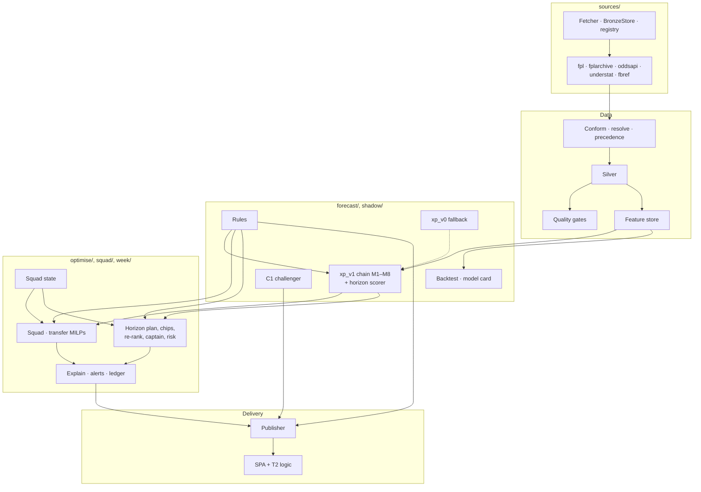
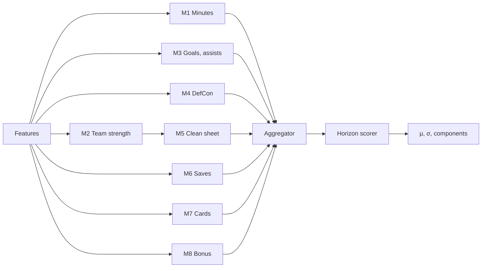

# Conceptual Design — FPL DOF

**Companion to:** [03-solution-architecture.md](03-solution-architecture.md)
**Level:** Logical component design. What each component is, what it consumes and produces, and how
it works. Function signatures and exact values belong in code and configuration.
**Baselined:** 2026-08-09 · **Revised:** 2026-10-17 — rewritten to the components as built at the end
of R1.0

Architecture-level facts — sources and stack, data flow, the web contract, workflows, storage — live
in 03 and are linked, not repeated. Where 03's module-design review
([03 §12](03-solution-architecture.md#12-module-design--review-of-2026-10-17)) found a defect in a
component, that section names it in one line ("03 §12 P2"). The binding constraints are in
[`DESIGN-PRINCIPLES.md`](../DESIGN-PRINCIPLES.md); DP-07, 08, 09, 10 and 12 are in
[`guiding-principles.md`](../guiding-principles.md).

---

## Contents

1. [Logical component map](#1-logical-component-map)
2. [Data sources](#2-data-sources)
3. [Data layer](#3-data-layer)
4. [Application and domain services](#4-application-and-domain-services)
5. [Analytical models](#5-analytical-models)
6. [Decision engine](#6-decision-engine)
7. [Risk and ownership model](#7-risk-and-ownership-model)
8. [User experience](#8-user-experience)
9. [Orchestration](#9-orchestration)
10. [Testing](#10-testing)
11. [Documentation](#11-documentation)
12. [Logging, metrics, metadata and lineage](#12-logging-metrics-metadata-and-lineage)
13. [Configuration and feature flags](#13-configuration-and-feature-flags)
14. [Extensibility](#14-extensibility)
15. [Open design questions](#15-open-design-questions)

---

## 1. Logical component map



**Dependency rule:** sources → data → models → decisions → delivery. Only `sources/` may name a
source, enforced by `tests/test_source_isolation.py`, a text scan of `src/` (no import linter, 03
§5.4). The import graph as built, and its one wrong-way edge `optimise → forecast` (DP-02), are 03
§12.1.

---

## 2. Data sources

### 2.1 Source catalogue

Each source's adapter and state are tabled in
[03 §2](03-solution-architecture.md#2-context-view-c4-level-1). This section says what each supplies.

#### S1 — Official FPL API *(essential)*

Public, unauthenticated, undocumented (CON-5). The `fpl` adapter fetches `bootstrap-static/`,
`fixtures/`, `element-summary/{id}/`, `event/{gw}/live/` and `leagues-classic/{id}/standings/` (the
last three slow path only), `team/set-piece-notes/`, and `entry/{id}/` with `history/`,
`event/{gw}/picks/` and `transfers/`. It supplies prices, ownership, status flags, the points ledger, the rules (DL-17), chip
windows — and **expected goals, assists and goals conceded per match**, so the model needs no scraped
source (DL-34, DL-46). The pre-deadline picks gap is handled by squad state (§4.2, DL-20). If it
fails, the run stops and the last publication stays live.

#### S2 — Understat *(adapter built, off, blocked)*

xG, npxG, xA, shots, key passes into `player_advanced`. `robots.txt` disallows the site (D-23);
nothing published consumes it (DL-33). Off by default; the adapter stays, dormant (PIPE-09).

#### S3 — FBref *(adapter built, off, blocked)*

Defensive and progressive actions. Cloudflare 403 on every request (D-23); off by default, the
adapter dormant (PIPE-09).
Defensive Contribution comes from the FPL feed instead (M4).

#### S4 — Bookmaker odds *(football-data.co.uk through its adapter; The Odds API off)*

`fdcouk` reads football-data.co.uk's match files (PIPE-04): off in the pipeline run, and read by the
prospective harness through `sources.LiveFeed` for upcoming odds and its hash-pinned past seasons
(REM-07). When enabled — no shipped configuration enables it — it de-vigs past seasons' files, each
immutable and fetched once, into `team_match_expectation`, and gold `team_match_odds` takes the last
pre-deadline capture per fixture (PIPE-05); until then both stay empty. `oddsapi` is off by
default (PIPE-09) and fetches nothing without `ODDS_API_KEY`; its free-tier credit budget is enforced
in the adapter. No history (D-20), so not backtestable; the M2 market blend is unwired (DL-60).

#### S5 — Historical archive *(build-time)*

`fplarchive` reads prior-season per-gameweek data from the community mirror, because the API has none
(DL-19). On in the live run (DL-87), backfilling 2023/24 to 2025/26, as it is for the weekly backtest. Its bronze is immutable: never re-fetched unless
`--rebackfill` or `--force-refresh`, and kept on `data` beyond the rolling window (PIPE-03). Identity
across seasons is FPL's stable `code` for players and clubs (DL-52).

#### Future sources *(OD-04)*

Injury feeds, predicted lineups, player prop odds, European fixtures (Q-08). Each would be one adapter
(§14.1). No injury or press-conference feed this season: the FPL API's availability fields are the
source (OD-04, closed by [DL-79](../decisions/DL-79.md)).

### 2.2 Adapter framework

Every adapter subclasses `SourceAdapter` (`sources/base.py`):

| Member | Responsibility |
| --- | --- |
| `name`, `version`, `summary`, `base_url`, `attribution`, `health_*` | Identity in lineage; text on `/health` |
| `resources` | Each endpoint with its cache TTL, whether it is on the fast path, and whether it is `immutable` (PIPE-03) |
| `enabled_by_default`, `essential` | Runs without configuration? Can the run recommend without it? |
| `contributes` | Canonical fields it can supply, for precedence |
| `configuration_problem()` | Reports a missing credential before fetching |
| `ingest(request)` | Fetch to bronze, guarding slow-path resources with `wants()`. **No conforming** |
| `conform(request)` | Bronze to silver tables (and, for `fpl`, the rules), stamping `observed_at` from `note_observed()` (DL-83) |

**Shared:** `Fetcher` (`sources/fetch.py`) — serial rate limit, retry with backoff and jitter,
honest user agent, secret redaction, and caching by serving the latest snapshot inside its TTL, or
at any age if it is immutable; `--force-refresh` and `--rebackfill` bypass the cache, and `--offline`
serves only bronze;
`BronzeStore`; `robots.py`. Conditional requests: a snapshot's `ETag` and `Last-Modified` are sent
back, and a 304 revalidates it without a download (PIPE-07); a forced re-fetch sends neither
(REM-10). Credit budgeting lives in the one adapter that needs it.

**Registry:** `@register`; `sources.overrides.<name>.enabled` overrides the class default; an unknown
name is rejected. A failing non-essential source removes its fields and nothing else (NFR-15).
**Field precedence** is data (`sources/precedence.py`, overridable by `sources.field_precedence`);
`player_metric` records which sources contributed.

---

## 3. Data layer

### 3.1 Canonical entity model

`silver/tables.py`, one Pandera schema per table, validated on read and write:

| Group | Tables |
| --- | --- |
| Game | `player`, `team`, `fixture`, `gameweek`, `chip`, `set_piece_note` |
| Performance | `player_gameweek`, `player_season_history`, `price_history` |
| The owner | `entry`, `entry_pick`, `entry_transfer`, `entry_chip`, `entry_gameweek` (DL-69) |
| Mini-league | `league_standing`, `league_pick` |
| Cross-source | `player_crosswalk`, `player_advanced`, `player_metric`, `team_match_expectation` |

Identity is FPL's stable player `code`; season-local ids never cross a season (DL-19, DL-52).
`player_gameweek` is one row per player **per fixture**, so doubles and postponements are not special
cases, and carries `kickoff_time` as its knowability boundary. `player_advanced` and `player_metric`
carry `as_of_gameweek` and `observed_at`, and the crosswalk records each source's `ingress`
(DL-83). `price_history`, `player_gameweek`, `player_advanced` and `player_metric` accumulate across
runs rather than being rebuilt (`APPENDED` in `stages/transform.py`, 03 §7.1). Forecasts and
decisions are gold, not silver. Silver has no `run_id` column; lineage is per snapshot and artefact (§12.4).

### 3.2 Entity resolution (FR-07, R-10)

A mismatched player silently attributes one footballer's numbers to another. `sources/resolve.py`
resolves each external row to an FPL `code` in order: **override** (`sources/entity_overrides.yaml`,
committed and reviewable); **deterministic** (normalised name and club, plus position, accepted only
if unique); **fuzzy** (token-set similarity within the club, above a threshold and a margin over the
runner-up, `sources.resolution`). The rest stay `unmatched`. Gates fail the run on a high unmatched
rate, a non-unique mapping or a crosswalk for another season (§3.4); two rows from one source claiming
one player raise an error. The mechanism is tested; no external source currently delivers data to
resolve (D-07, D-23).

### 3.3 Layers and physical layout

Under `paths.DataLayout`; what persists between CI runs is
[03 §7](03-solution-architecture.md#7-data-architecture).

| Layer | Layout |
| --- | --- |
| Bronze | `bronze/{source}/{resource}/{date}/{key}__{timestamp}.{json,csv,html}.gz` + `.meta.json` (URL, status, fetch time, SHA-256 of the uncompressed payload, size, `run_id`, source version, `immutable`, `ETag`/`Last-Modified`) |
| Silver | `silver/season={s}/{table}.parquet` plus the season's `rules.json`; rebuilt from bronze each run except the accumulating tables (03 §7.1) |
| Gold | `gold/season={s}/` — `expected_points.parquet`, `player_career_history.parquet`, `team_match_odds.parquet`, `squad.json`, `plan.json`, `week.json` (and `week_<id>.json`, `plan_<id>.json` per other published strategy), `quality.json`, `model-card.md`, backtest outputs |
| Quarantine | `quarantine/bronze/…` from `bronze verify --quarantine`, and every capture that broke its source's contract, at ingest or by `bronze verify --contract`, with `quarantine_reason` in its sidecar (ORC-10); `quarantine/silver-{time}/` from `silver rebuild` (REM-10). Kept, never read |
| Ledger | `ledger/advice/gwNN.json`, append-only (DL-69): the champion's advice, and every published strategy's under `models` by registry id: its last success before the deadline, stamped `as_of` and `trigger`, with a later failure noted as `last_failure`, or its "no advice" reason, with the silver tables it lacked as `missing` and the first such run's `as_of` as `since` (MOD-04, [DL-94](../decisions/DL-94.md), ORC-07). The writer refuses a write after the deadline. Beside it, `ledger/predictions/gwNN/<strategy>.parquet` (ORC-08): that strategy's full-pool forecast for the gameweek it advised from (`player_id`, `xp_next`, `xp_next_sd`, `start_probability`), replaced only by a later success and refused after the deadline on the same terms. And `ledger/evaluation/entry-<id>/gwNN.json` (ORC-05): each Finished gameweek judged once, stamped `evaluation_version` (`week/evaluation.py` `EVALUATION_VERSION`) and recomputed only when it changes: per strategy with a record, its realised points, the same XI's underlying expected points with its forecast error and luck (ORC-12, `rules/underlying.py`), and its xP accuracy (MAE, bias, players) from its predictions; and the season log's row for the owner (`log`), with the hindsight optimum and its diagnostics, which read each strategy's predicted xP per player (D-37). A gameweek waits until every player whose club played has his row and, with a team configured, the game has scored the owner's gameweek and silver holds his picks for it |
| Runs | `runs/{run_id}/manifest.json` |
| Web contract | `web/v1/*.json`, served at `/data/v1/` (03 §7.2) |

### 3.4 Quality gates (FR-08)

Declarative gates (`GATES` in `quality/rules.py`, run by `quality/gates.py`) in four classes:
**schema** (no player without position or price); **range** (prices, ownership, FPL difficulty);
**referential** (clubs exist for players and fixtures; history references players; the crosswalk is
one-to-one, for this season, under the unmatched threshold); **freshness and volume** (player, club
and fixture counts, player count against the previous run, snapshot age, a deadline still ahead).

`ERROR` blocks publication (Invariant 7); `WARN` publishes and shows on `/health`; `INFO` is unused.
Every gate names the requirement it protects; thresholds are configuration. Gates read the run's
`as_of`, never the wall clock. The temporal gate (PIPE-10, DL-83) blocks three things:
- a current-season metric row observed after its `as_of_gameweek` deadline;
- a current-season `player_gameweek` row that kicked off at or before its own gameweek's deadline;
- price history that is future-dated or not strictly increasing.

A source added mid-season is backdated by `sources/retrospective.py` and held to the same check.

### 3.5 Feature store

`forecast/features.py` builds one frame for the live forecast, the backtest, the chip replay and the
monolith, so training and inference share definitions: per-90s over the last 3/6/12 matches of goals,
assists, clean sheets, saves, bonus, BPS, defensive contribution, xG, xA, total points and yellow cards
(`forecast.features.rolling_statistics`; the chain reads the six-match window); minutes; appearance and start rates; matches observed; rest;
congestion and recent absence; price; venue and opponent; prior-season ratios (off, D-22).

**Hard rule:** every `FeatureSpec` declares its `Knowability`; `build_features` reads only matches
that kicked off strictly before `as_of`, and stamps each row with it; `assert_no_look_ahead` fails a
fold whose rows are stamped after its deadline; the backtest strips every outcome column before
predicting (DL-32). Season totals are admissible only in a later season (Invariant 5, R-04). Live,
the fit stops at the earliest unfinished gameweek's deadline, so a gameweek in play never trains
the model (DL-84).

---

## 4. Application and domain services

### 4.1 Rules engine

`build_game_rules` seeds scoring, squad size and composition, formation bounds, budget, club limit
and sell-on fee from the API's `game_config`, `game_settings` and `element_types`, and takes from
`config/defaults/rules.yaml` only what FPL does not publish — the saves and goals-conceded divisors,
Defensive Contribution thresholds, the bonus split, the 60-minute boundary, transfer rules — each with
a reason (DL-17). `GameRules` records provenance and the snapshot checksum and is published as
`rules.json`, so the browser uses the same numbers (DL-14). `scoring.points_for` returns a breakdown;
`legality.validate_squad` returns every violation and runs after every solve; `selling_price` applies
the sell-on fee. 100% coverage (NFR-08).

Chip set 1 expires at the GW19 deadline as the API publishes it — 18:30 GMT on 1 January 2027, per
the API on 17 October 2026. FPL can move deadlines, so the code reads the chip window, not a date.

The authoritative values are the API and the `fpl-rules` skill, not this page. Still asserted rather
than read: the chip captain multiplier (D-16). The most-captained id never reaches the decision layer
(D-15). The BPS matrix is not modelled; BPS is ingested as a value (§5, M8).

### 4.2 Squad state service

`squad.load_squad_state` reconstructs the fifteen, purchase and selling prices, bank, free transfers
and chips used, with provenance `from_picks`, `reconstructed` (picks plus later transfers) or
`declared`. A declared squad (`entry.declared_*`) is a first-class input, because preseason there is
nothing to reconstruct (DL-20), and is validated on entry. Picks publish no purchase price, so it is
what was paid: the cost of the latest transfer that bought the player, else his price in the first
gameweek he was held. Where neither is known the run warns and assumes the lowest price seen this
season, which can understate the sell value but never overstate it. Free transfers are recomputed from history;
Wildcard and Free Hit do not consume them. An illegal reconstruction raises, and the week and decision
stages skip with a reason. `squad/selection.py` picks the XI across legal formations under the start
floor (§6.1) and orders the bench by P(plays) × μ, ties by id (DL-66); the app's squad builder
uses the same rule, held by `contracts/conformance/lineup-corpus.json` (WEB-04).

### 4.3 Fixture and schedule service

Not one service:

- **Doubles and blanks** — fixture counts per club in `optimise/chips.py`, for chip pruning and the
  calendar.
- **Model-derived difficulty** — `publish/fixtures.py` turns M2's ratings into the fixture ticker
  (FR-30, DL-37). Descriptive; the optimiser reads per-fixture forecasts.
- **Congestion** — inside M1 only.
- **Deadlines** — `week/cadence.py` gives each deadline in UK time and the owner's zone with a
  decide-by time (DL-11); CI guards are 03 §9. `week/` mixes advice with scheduling (03 §12 P7).

`week/` also owns alerts (availability, price pressure, chip expiry, squad-state warnings), the advice
ledger (DL-69), advised-versus-played reconciliation, and the evaluation step (ORC-05,
`week/evaluation.py`), which judges each finished gameweek once: each model's advice scored by the one
scorer (`rules/realised.py`, ORC-04), its xP accuracy, and E14's hindsight work (DL-72), an oracle
that re-solves the single-gameweek transfer MILP on actual points from the squad, selling prices,
clubs and bank the owner had at the deadline, with oracle-gap diagnostics. `log.json`, the live
gameweeks' points in `models.json` and the live `xp_accuracy.json` are assembled from those
evaluations, never recomputed on publish. The oracle's option set (roll, best single transfer, best
overall) is shaped by the one function, `week/oracle.py` `option_set`, that also shapes each
model's own transfer solve on its predicted xP into `recommendation.option_set` of its week file;
the ledger keeps it with the advice, and `models.json` publishes it per live gameweek, so Last
gameweek sets the two side by side (ORC-11). It adds no solve.

### 4.4 Explanation service

`optimise/explain.py` (FR-23): a headline (for chips, "Free Hit in GW18 beats Free Hit in GW17 by X,
and no chip by Y"), the gain over holding, a per-gameweek decomposition with hits, runners-up with
margins and simulated scores, the ownership bet (§7), price exposure, the assumptions in force, and
the standing caveats — D-13 on any hit or chip, D-21 on chip timing. Per-player decomposition comes
from the forecast (§5).

---

## 5. Analytical models

A **chain of small, individually testable models**: each is validated against its own outcome,
failures are diagnosable, and the decomposition is what the UI shows. The chain is `xp_v1`
(`forecast/models.py`, scored by `xp_v1.py`, assembled live by `live.py`), and `run` publishes it
(DL-46).



| Model | Built as | Variants (flags in §13) |
| --- | --- | --- |
| M1 | Empirical band frequencies; status flag scales P(play) | `minutes_v2` on (DL-48, DL-76) |
| M2 | Attack × defence × home, time-decayed, on goals | Fitted home advantage (DL-55); xG ratings dark (DL-56); promoted-club widening inert (DL-57); market blend unwired (DL-60) |
| M3 | Shrunk per-90 on xG and xA (DL-34) | Opponent adjustment (DL-58), penalty duty (DL-50) off; share-of-team-xG not built |
| M4 | Per-90 count; P(threshold) by Poisson survival | — |
| M5 | From M2's goals against | — |
| M6 | Shrunk per-90 saves | Pressure-normalised keeper off (DL-51) |
| M7 | Shrunk per-90 yellow cards from the player's own record (F1, DL-90) | No referee or red-card model |
| M8 | Expected BPS ranked against a population distribution | Not ranked within the match |

Live, the backtest and the chip replay fit through one interface, `fit_as_of` (`forecast/fit.py`);
the C1 challenger has its own `fit_as_of` (`shadow/c1.py`) on its own features, and both reach the
walk-forward harness through `Strategy.predictor` (§13). The published-model
choice is implicit in the stage, and points arithmetic is duplicated across `rules/scoring.py`,
`xp_v0` and `xp_v1` (03 §12 P6).

### M1 — Availability and minutes

**Predicts:** P over `{0, 1–59, 60+}` minutes and expected minutes — the largest source of
expected-points error. **Method:** band frequencies by position and appearance-rate band; the status
flag, or `chance_of_playing_next_round` where published, scales P(play). `minutes_v2` adds congestion,
an injury-return ramp and an availability split, each moving mass only out of 60+ (DL-48). No European
rotation (Q-08). `start_probability` is **P(appears at all)** in every model (DL-66). **Validated
on:** a multiclass Brier score over the whole population against a reconstructed status-flag haircut,
per position and band (DL-48). It is under-confident about full starts — the band the head of the
ranking is made of.

### M2 — Team strength and match model

Expected goals for and against each club per fixture: league mean × attack × opponent defence × home
advantage, time-decayed, fitted on goals over the forecast season only, in live, backtest and replay
alike (DL-81). Validated on the
fixture-aware backtest (DL-52).

### M3 — Goal involvement

A recent per-90 shrunk toward a position prior in proportion to minutes observed, reading **expected**
goals and assists (DL-34).

### M4 — Defensive contribution

The per-90 of the feed's `defensive_contribution`, scaled by the minutes distribution and treated as a
Poisson count; P(count ≥ the rules' threshold) gives the points. Live, the chain fits on this
season's counts; the raw counts exist from 2025/26 only, so the backtest and `xp_v0` rest on one
prior season (D-11, Q-13).

### M5 — Clean sheets and concessions

Clean sheet = exp(−goals against from M2), counted only in the 60+ band; goals-conceded points are
linear in M2's goals against.

### M6 — Saves · M7 — Cards

Shrunk per-90 saves. Cards are the player's own shrunk per-90 yellow-card rate (before
[DL-90](../decisions/DL-90.md) every player took the position prior, because `yellow_cards` had no
rolling feature); both are small contributors.

### M8 — Bonus points

Expected BPS from a shrunk per-90, then P(first, second, third) against a population BPS mean and
spread, binomial over the other players. Prior-season bonus comes from a different BPS regime (Q-05).

### Aggregator

- **Mean:** appearance points plus each component, integrated over the three minutes bands.
- **Variance:** a mixture over the bands, `Σ P(s)(Var_s + μ_s²) − μ²`, with goal, assist, duty and
  clean-sheet terms plus a unit floor in each played band. Defensive contribution, saves, bonus, cards and conceded add none — a known gap;
  the minutes mixture dominates (DL-51). Covariance between players is not modelled (§6.4).
- **Horizon:** `forecast/horizon.py` scores each horizon gameweek's real fixtures — a blank scores
  zero, a double sums means and variances — into `xp_gw_<n>` and `xp_gw_<n>_sd`, plus a discounted
  `xp_horizon`.
- **Output:** `expected_points.parquet`, a forecast frame (§6) — per-gameweek μ and σ, minutes
  probabilities, `start_probability`, `component_*` for the next gameweek, a confidence tier, the
  `model` per row, and the producing strategy's `strategy` and `strategy_digest`. Variance travels
  with every mean (Invariant 6). Beside it, `captain_line.json`: B0's per-position price line,
  fitted on the model's own training window — the captain policy's input, not a forecast column
  (§6.5).

### Cold start (FR-14)

`xp_v0` is the named fallback (DL-46): prior-season per-90s decayed by season, shrunk toward a
position × price-tier prior, start rate × availability, FPL difficulty for fixtures, and a heuristic σ
by confidence. It fires below `forecast.published.cold_start_minimum_gameweeks` completed gameweeks or
when the chain cannot fit, and says so in the `model` column, the stage metrics and the model card. In
`xp_v1` a player with no history takes the position priors. Ownership and promoted-club scaling are
not priors.

### Backtesting (FR-37, B7)

`forecast/backtest.py` walks forward over `backtest.training_seasons` with every registered
strategy that is not retired and has live code, the champion first (`factory/experiments.py`
`grade`, MOD-08; frozen ones are recorded as not graded). At each historical deadline it fits each
strategy through `Strategy.predictor` (`fit_as_of`, as live does) and every baseline on rows
strictly before it, strips every outcome column (DL-32), and predicts. Each strategy sees only its
`training_window`: a `current_season` strategy's features, training rows and fit come from the
fold's season alone, as live (F3). Every strategy is graded on the same folds — those where every
window holds `backtest.minimum_training_matches` gameweeks — and the same rows; each is refitted
every `backtest.refit_every_gameweeks` folds (1) and at each new season. Each strategy walks in its
own process, up to `backtest.strategy_workers` at once, so the grades are the sequential ones; a
strategy whose fit raises at any fold is recorded as not graded with the fold and the error, and
the others are graded without it (D-32). `fpl-dof backtest` is not
part of `run`; CI runs it weekly with the archive enabled (DL-68). Per fold on the 2024/25–2025/26
archive (measured 2026-10-23 on a workstation): `c3`, `engine` and `c1` together ~24 s a fold, 68
folds in 27 min, mostly `c1`; `backtest.yml` allows 150 min.

- **Metrics:** MAE, RMSE and skill; Spearman by position, price band and fixture band; calibration
  slope by position and fixture band; top-20 precision and captaincy hit rate **per gameweek**
  (DL-49), all on rows with at least `backtest.minimum_minutes_for_scoring` minutes; minutes Brier
  over every row (DL-48).
- **Baselines:** B0 (price within position), a constant, trailing six-gameweek points, the
  status-flag haircut. The model beats B0 when its MAE skill is positive and its Spearman exceeds
  B0's, and beats the model-free bar when its Spearman exceeds trailing form's. Skill is against
  them, never absolute (DP-12). They stay the harness's own, fitted from each fold's
  all-seasons training rows, rather than registered strategies.
- **Pairs:** each strategy minus the champion, per gameweek, for MAE, Spearman and top-20
  precision, with a 95% gameweek-bootstrap interval (`backtest.bootstrap_draws`,
  `backtest.bootstrap_seed`; `bootstrap_ci` in `forecast/metrics.py`).
- **Monolith:** a gradient-boosted regressor on the same declared features, inside `walk_forward`
  only, never promotable, reporting the explainability gap (DL-53).
- **Outputs:** `backtest.json`, `backtest-predictions.parquet`, `backtest-card.md`, and the
  experiments record `ledger/experiments/<run_id>.json`: one record per registered strategy —
  id and digest, role, training window, run id, config digest, data window, metrics, paired
  deltas against the champion; the champion's also carries DL-21's verdict and the baselines. CI
  appends it to the `ledger` branch, keyed by run and never overwritten. Beside it,
  `ledger/models_history/<run_id>.json`: each graded strategy's simulated season per archive
  season (below), which publish turns into `models_history.json`. On every forecast run
  `model-card.md` — published model, fallback, guardrail, the latest verdict for the champion's
  current digest from `ledger/experiments/` (or a plain statement that none exists), weaknesses.
  **Read it before acting on a ranking** (DL-21): no −8 hit, chip or Wildcard on the chain alone
  (D-13).
- **Models history** (`factory/history.py`, ORC-06): every graded strategy plays each archive
  season on its own squad over the backtest's folds — a fresh squad at its first graded gameweek,
  then each week the decision engine's one-gameweek week on its walk-forward forecast (transfers
  and hits, XI, its own captain rule), no chips — scored by `rules/realised.py`. In parallel like
  the walks; a season that cannot be simulated is recorded with the reason. A backtest, not real
  play. The frozen-era tables it replaced are records in
  [`archive/R1.3.0/models-history-frozen-era/`](archive/R1.3.0/models-history-frozen-era/README.md).
- **Not in the package:** a simulated season of the full multi-gameweek optimiser with chips. The
  chip replay (`factory/replay.py`, DL-28) covers chip timing only; the pre-registered comparison is
  [`prospective/`](../../prospective/README.md).

The question is **"does this beat doing something simple?"** So far it beats price on rank
correlation and loses to trailing form at the head (DL-21, DL-53), which is why trailing form is
published beside it (DL-70).

---

## 6. Decision engine

Three solver models, all reading the forecast and nothing source-specific (DP-02, DL-33):

| Model | Code | Runs | Solver |
| --- | --- | --- | --- |
| Squad MILP — best fifteen | `optimise/squad.py` | Preseason, or `optimiser.squad_solve: always`; otherwise `squad.json` is skipped with a reason (DL-67) | CBC |
| Transfer MILP — this week | `optimise/transfer.py` | Every `week` run, once per published strategy | CBC |
| Horizon plan — transfers and chips | `optimise/horizon.py`, `plan.py`, `chips.py` | Every `week` run, once per published strategy whose policy plans | HiGHS (DL-26) |

**One decision path for every strategy** (MOD-04). `decision.decide(frame, squad_state, rules,
policy) → Decision` turns any strategy's forecast frame into its advice: the transfer MILP, the
captain by the policy's rule (§6.5), the XI and bench by `squad.select_team` — with the
start-probability floor relaxed, and said so in the warnings, when the advised squad cannot field
an XI above it — and the horizon plan with its chips unless the policy's `plan` is false. An
infeasible plan is a stated reason beside a week that stands. The policy arrives resolved
(`DecisionPolicy`: plan, B0's line or none, and the transfer, optimiser and decision config) from
`Strategy.decision_policy`; `decide` reads no file and no config (DP-03). The week stage calls it
once per published strategy on one input snapshot, so two strategies differ only by the forecaster
and policy their registry entries name. The registry's champion goes first, and its week (decided
with the plan off) is written and recorded in the ledger before anything that could fail or take
long: then its plan, through `decision.solve_plan` (the plan step of `decide`), where a failure of
any kind is "no plan" with its reason beside the week; then each challenger, isolated (NFR-15).

Each re-encodes legality, solver construction is repeated, and `optimiser.solver` is never read (03
§12 P2).

**What the engine reads** is the forecast frame, version `FORECAST_FRAME_VERSION` in
`optimise/frame.py` (MOD-02). Every entry point — `optimise_squad`, `recommend_transfers`,
`build_plan` and every forecaster's own output (`xp_v1`, `xp_v0`, C1) — validates it first and refuses a frame that breaks it, with
every failing column named; nothing is coerced. Required: `player_id` (unique), `position`,
`team_id`, `price`, `xp_next`, `xp_horizon` and their `_sd`, and `start_probability` in [0, 1]. Every
`xp_gw_<n>` must come with `xp_gw_<n>_sd` and the reverse. Every sd is a float, never negative, never
missing (Invariant 6). Optional, checked when present: `player_code`, `start_floor`, the
`p_*_appearance` minutes probabilities, `expected_minutes`, `component_*`, `strategy` and
`strategy_digest`. Other columns (names, status, ownership) pass through unread by the contract.
The hindsight oracle feeds realised points through the same engine with an sd of zero.

### 6.1 Candidate selection

Only the horizon plan prunes (`optimise/candidates.py`); the other two see every player. The pool is
the union of owned and locked players (always), the top N per position by `xp_horizon` and by
`xp_horizon` per £, and **cheap enablers** — the best in each position's bottom price quantile,
because a pure ranking drops them and they make premiums affordable. Bans and excluded clubs apply
first, never to owned or locked players. `pruning_matches_full_pool` validates the rule; nothing runs
it on a schedule (D-17).

**Start floor.** No player starts whose `start_probability` (P(appears), DL-66) is below
`forecast.minimum_start_probability_for_xi`, unless locked; `week` relaxes it with a warning if no XI
clears it.

### 6.2 MILP formulation

The horizon model. **Indices:** players `p` in the pool, gameweeks `w ∈ 1..H`
(`decision.horizon.gameweeks`, clipped to the season), clubs `c`. **Parameters:** `μ[p,w]`
(`xp_gw_<w>`), `buy[p]`, `sell[p]` with the sell-on fee, `sbp[p]` (`selected_by_percent`), `γ`
(`decision.horizon.discount`), `B₀`, `FT₀`. `σ` is carried, not used (§6.4). **Variables:** `own`,
`start`, `cap`, `tin`, `tout` per player-week; integer `ft`, `hits`, `charged`, `remaining` per week
with an `at_cap` binary; `bank`; a parallel `field` squad in a Free Hit week. **Chips are not
variables** (§6.3).

| # | Constraint | Status |
| --- | --- | --- |
| C1–C5 | 15 by position; 11 within formation bounds; `start ≤ own`; club limit; one captain, `cap ≤ start` — all from the rules | Built |
| C6 | Continuity `own[w] = own[w−1] + tin − tout` | Built |
| C7 | Bank through selling and buying prices | Built |
| C8 | `ft[w+1] = min(cap, remaining[w] + 1)`, linearised | Built |
| C9 | `hits ≥ charged − ft`; a per-week transfer cap outside chip weeks | Built |
| C10–C12 | Chip variables | **Not built** — enumeration (DL-15) |
| C13 | Free Hit: a legal `field` fifteen with its own budget; the owned squad does not move | Built per scenario |
| C14 | Triple Captain linearisation | Not needed: the multiplier is a scenario parameter (D-16) |
| C15 | **Chips do not consume free transfers:** `charged = 0` under Wildcard and Free Hit | Built, property-tested |
| C16 | Same-club XI cap (`decision.risk.same_club_starting_limit`) | Built; relaxable per club; raised with a warning when the held squad cannot otherwise field an XI |

C15 matters because missing it is silent: a model that thinks a Wildcard spends banked transfers plays
chips late or never.

```
maximise  Σ_w γ^(w−1) · [ Σ_p μ[p,w] · ( start + (m_w − 1)·cap )   ← m_w = 3 under Triple Captain
                        + β_w · Σ_p μ[p,w] · ( own − start )        ← β_w = 1 under Bench Boost
                        + hit_cost · hits[w]                        ← from the rules (negative)
                        + ρ_dial · Σ_p sbp[p] · start[p,w] ]        ← risk term, §7
          + ε · Σ_w Σ_p held[p] · own[p,w]                          ← tie-break, undiscounted
```

`β` is `decision.horizon.bench_weight`. Bench order is decided after the solve by P(plays) × μ
(DL-66); the browser orders by `xp_next` (03 §12 W2).

The squad MILP maximises `xp_horizon` over starters and a weighted bench plus a captain bonus on
`xp_next`, under C1–C5 and the floor. The transfer MILP solves that single-gameweek problem on
`xp_next` per transfer count up to `transfers.max_transfers`, subtracting hits afterwards; a move must
gain more than `transfers.min_gain_over_hit`. `xp_horizon` uses the one planning horizon,
`decision.horizon` (gameweeks and discount; DL-78, D-29) — the forecast and the plan share it.

#### The tie-break term, and why it is not cosmetic

The problem is densely degenerate: many fifteens tie to within floating-point noise, so a solver's
choice can change between runs on unchanged inputs — breaking byte-for-byte reproducibility (the
charter claims logical reproducibility, DL-13) and churning the advice. `ε`
(`decision.horizon.incumbency_bonus`) rewards each held player, too little to overturn a real
difference, and a plan must beat holding by `decision.horizon.transfer_margin` (Q-10, R-16).

#### The correlation problem, and the cheap part of the fix

Two defenders from one club share one clean sheet, and portfolio variance is quadratic, so the MILP
cannot see it (§6.4). C16 is the linear part: two per club in the XI targets the dominant correlation,
relaxable per club (`relax_club_cap_team_ids`, FR-22, Q-12).

### 6.3 Chip strategy — enumeration, not decision variables

Chip timing is decided by solving the horizon model once per scenario (DL-15):

1. `available_chips` reads windows from the silver `chip` table and drops chips used and windows
   closed — so set-1 expiry is enforced, not advised (§4.1).
2. Scenarios are "no chip" plus one `(chip, gameweek)` per available pair in the horizon; Bench Boost
   is pruned where the squad's clubs average too few fixtures; owner overrides force or forbid a chip
   week; the list is capped (`decision.chips.max_scenarios`).
3. A "hold" plan — no chip, no transfers — is the baseline.
4. Every solved plan is ranked (§6.4) and published in `plan.json` with its alternatives
   (`decision.chips.runners_up` is not read).

Enumeration is tractable, independent per scenario, and explainable: "Free Hit in GW18 beats GW17 by
4.1 points" is a sentence to argue with. A season **chip calendar** (`build_calendar`) projects
windows from fixture structure alone — doubles flag Bench Boost and Triple Captain, blanks and doubles
flag Wildcard and Free Hit — and reports each set's expiry.

### 6.4 Solving, and an honest limitation

**Solvers.** HiGHS for the horizon model, refusing a silent fallback to CBC (DL-26), under a
per-scenario limit and a total budget that drops unsolved scenarios with a warning (D-19, R-07); CBC
for the other two. No warm start.

**Fallbacks.** The squad MILP falls back to a greedy fill by xP per £ (preseason infeasibility is a
hard failure with a diagnosed reason); the horizon model to holding the squad. Both are flagged
`greedy_fallback`. The transfer MILP skips a count that does not solve. Every output passes
`validate_squad`.

**The honest limitation:** the MILP maximises *expected* points; `σ` reaches decisions only through
the re-rank and correlation only through C16. The full treatment is the stochastic layer deferred in
DL-06, which is why the forecast carries variance from day one.

#### Simulation re-rank — most of the stochastic layer, for a fraction of the cost

`optimise/simulate.py`, on by default, samples every solved plan many times with a fixed seed — each
draw a factor shared by a club in a gameweek times the player's own, so a clean sheet is shared within
a club but not with the opponent — and re-ranks on a percentile set by the dial. Bench Boost and
Triple Captain are variance plays, which is where it matters. It is proven to move real chip decisions
and to respond to the dial, not to time them well, and it pulls chips to the front of the horizon for
an unidentified reason (DL-28, D-21); the plan carries that caveat.

### 6.5 Captaincy

Captaincy is policy (DL-76, MOD-02). Under a strategy's `policy.captain_rule: price_position` — the
champion's and C1's — the weekly captain and vice are the two starters with the highest B0 score,
because the backtest's B0 captain beats the chain's own pick; under `model` the solver's captain
stands, as it does when nothing has been played to fit B0 on. The horizon plan keeps the MILP's
captain. B0 is fitted by the forecaster on its own training window and handed over as a
`PricePositionLine` (`optimise/captain.py`: an intercept and slope per position and a fallback mean,
validated on its own), written beside the frame as `captain_line.json`; the rule applies it to the
frame's price and position.

---

## 7. Risk and ownership model

The horizon objective carries a linear risk term (DL-07): `ownership_weight[dial] ×
selected_by_percent × start`, per starter per gameweek, discounted with the week. The dial is
`safe`, `balanced` or `aggressive`, default Balanced (DL-25), set in `decision.risk.dial`; the app
displays it and cannot change it. Safe pulls toward the template, Aggressive rewards low ownership. No
`σ` term. It is a heuristic, and the UI says so.

### 7.1 Effective ownership is not directly observable (CON-12, OD-06)

`EO = selected_by% + captained_by%`, and no endpoint publishes `captained_by%` — only one
`most_captained` id per gameweek. Of three routes (estimate it, sample leagues after the deadline,
redefine), **Redefine** was adopted: `EO = selected_by_percent` (DL-24). Every figure is labelled
"selected by". The most-captained callout renders "not available" because the id never reaches the
decision layer (D-15). Stated, not fixed: the dial cannot see captaincy concentration, and
`selected_by_percent` is the whole field, not the top-100k cohort.

**What the UI shows** at every dial position: the ownership bet — the most underweight and overweight
players, with a plain sentence about what happens if they haul or blank (FR-16). Mini-league rivals
are displayed, not fed into the objective (Q-09).

---

## 8. User experience

### 8.1 Principles

1. **Deadline-first.** The home screen answers "what do I do before the deadline?".
2. **Explain, don't assert.** Every recommendation shows what it beat.
3. **Uncertainty is visible.** Ranges, not false precision; a missing σ reads "unquantified".
4. **Mobile is first-class.** Deadline decisions happen on a phone.
5. **The owner can always overrule.** Lock, ban, swap, and see the consequence.
6. **Fast.** Precomputed, read once, no spinner on the deadline path (NFR-04).

### 8.2 Information architecture

A hash router (DL-35) inside a theme provider, a client-side password gate (deterrence only — the data
stays publicly fetchable) and one data context. Eight sections, declared once in `web/src/routes/nav.ts`
with each section's sub-views as tabs (R1.4.0 WEB-07): all eight in the top bar on a wide screen, Data
health last; on a narrow one a bottom bar of Home, This gameweek, Last gameweek, League and Scouting,
with Models, Analysis and Data health behind "More". A global header carries the run banner and the
strategy selector, which lists every published strategy that has a week and chooses whose advice is
shown in every section; Settings sits behind a gear beside it. Strategy ids, labels, roles, colours and
artefact paths come from the published registry (`strategies.json`), never from the code (MOD-07).
Player detail is reached from Scouting and the squad.

### 8.3 Screens

Each section's views as they stand; WEB-08 to WEB-14 rebuild them to the R1.4.0 plan §1.

| Route | Content |
| --- | --- |
| `/` Home | Deadline countdown, alerts, this week's move with the roll option beside it, squad and bench, plan and ownership bet |
| `/league` League | Standings, overlap, differentials, captain divergence (DL-40) |
| `/models` Models | A multi-select comparison of the registry's published strategies against the champion (advice differences, xP on the players they disagree on, historical performance), then summary, details and xP accuracy |
| `/models/season` | Every model's live season to date: points per gameweek, the cumulative chart, the latest advice |
| `/models/2025-26` | The 2025/26 playthrough of every frozen model (`/history` redirects) |
| `/review` Last gameweek | The hindsight optimum against each model's advice (E14), and the options each model weighed at the deadline beside the hindsight's (ORC-11) |
| `/review/all` | Per evaluated gameweek: played, scored, advised, followed, and the hindsight optimum (DL-69, ORC-05; `/log` redirects) |
| `/gameweek` This gameweek | Both deadlines, the move with every option weighed, including the roll, the selected model's roll, best single and best overall in the hindsight's table (ORC-11), and the alerts |
| `/gameweek/plan` | Plan ahead: the multi-gameweek plan as a timeline and the chip calendar with its expiry clock |
| `/scout` Scouting | Every player, virtualised (DL-36): filter, sort, presets, xP with range, trailing form beside it (DL-70), decomposition, "owned" filter, select into Compare |
| `/scout/fixtures` | Clubs × gameweeks shaded by model difficulty (DL-37; `/fixtures` redirects) |
| `/player/:id` | xP with range, decomposition, P(plays), fixture run, trends |
| `/analysis` Analysis | The optimiser's squad, or the owner's in-season (DL-67); the builder — swap, start, bench, lock, ban, live legality, heuristic re-optimise (`/squad` redirects) |
| `/analysis/compare` | Up to four players: rows, overlaid trends, a verdict naming a leader only when forecasts separate (`/compare` redirects, with its `?compare=`) |
| `/health` Data health | Last run, gates, every source's status and freshness, trends from recent manifests (DL-41) |
| `/settings` | Team and league IDs, kept in the browser (DL-44); a copyable link to dispatch a run |

Not built: risk dial, horizon or constraint settings in the UI (pipeline configuration only); a run
queued from the browser (Q-16).

### 8.4 Visualisation inventory

Hand-written SVG in `web/src/components/charts/` (03 §5.2):

| Visualisation | Built as |
| --- | --- |
| Uncertainty range | `IntervalChart`: the ±2σ band is the mark, the mean a tick |
| Points, minutes, Defensive Contribution, price, ownership over time | Bar and line charts on player detail; overlaid on Compare |
| Expected versus actual returns | Cumulative lines on player detail |
| Fixture difficulty | An HTML grid, not a chart |
| Model accuracy over time | xP error and cumulative points per model in Models |
| Pipeline health | Solve time, rows, price dependence over recent runs |
| xP decomposition | A list with a sum check, not a bar |
| Ownership versus xP scatter | **Not built** |

Legible without colour and in both themes (NFR-14), checked by `web/verify/`.

### 8.5 Interaction tiers

Tiers are [03 §4](03-solution-architecture.md#4-the-static-hosting-constraint-and-how-interactivity-survives-it).
Every screen is **T1**. **T2** is TypeScript parameterised from `rules.json`: `legality.ts` (pinned to
Python by the corpus, DL-39), `lineup.ts`, `reoptimise.ts` (greedy build plus hill-climb around locks
and bans, ignoring transfer costs and chips, labelled a heuristic, never returning an illegal squad)
and `verdict.ts`. **T3** is a `workflow_dispatch` the owner starts on GitHub. No query engine or
solver runs in the browser.

---

## 9. Orchestration

Workflows, cadence, guards and the run lifecycle are [03 §9](03-solution-architecture.md#9-orchestration);
failure handling is 03 §10.3.

---

## 10. Testing

Weighted toward where a bug is likely and invisible (DP-13).

| Level | As built |
| --- | --- |
| **Unit** | Scoring, selling price, free transfers, chip eligibility, constraints; `fpl_dof.rules` at 100% in CI (NFR-08) |
| **Property-based** | Hypothesis: no optimiser returns an illegal squad (`test_optimise.py`, `test_transfer.py`, `test_horizon.py`); legality, scoring, squad state, prior-season knowability |
| **Contract** | Adapters against recordings with `respx`; the scraped sources' fixtures are hand-made (D-23) |
| **Network drift** | `--network`, by hand; no workflow passes it |
| **Cross-language** | `contracts/conformance/legality-corpus.json`, read by pytest and vitest (DL-39); the only corpus (03 §12 W2) |
| **Contract schema** | Every artefact validated before it is written |
| **Leakage** | No outcome column reaches a prediction; a rewritten future leaves a fold bit-identical |
| **Quality gate** | Injected bad data blocks publication |
| **Fault injection** | Each non-essential source fails; the run degrades (`test_source_degradation.py`) |
| **Source isolation** | `test_source_isolation.py`, over `src/` and `scripts/`; it also fails if a stage or core module reads the wall clock |
| **Backtest** | Weekly in CI, reporting only; frozen model configs pinned |
| **Slow** | `--slow`: the chip replay (DL-28) |
| **Web** | Vitest and Testing Library |
| **Browser and smoke** | `web/verify/`: layout, accessibility, PWA and offline, a performance budget (DL-30, DL-38); deployed smoke test. By hand, not in CI |

**Not built:** recomputing historical points from raw stats against FPL's totals — the end-to-end
check the baseline called the strongest; golden-file tests; a backtest regression gate. Some tests
reach past interfaces (03 §12 P9).

---

## 11. Documentation

Where each fact lives: [`docs/README.md`](../README.md). How documents are written and archived:
[`docs/agents/documentation.md`](../agents/documentation.md).

---

## 12. Logging, metrics, metadata and lineage

Observability is built from artefacts and surfaced in the product (03 §10.2).

### 12.1 Structured logging

`obs/logging.py`: one JSON object per record, with `run_id` and `stage` from context. Source responses
log status, size and cache hit, never payloads. Kept as CI artefacts.

### 12.2 Run manifest

`runs/{run_id}/manifest.json` (`obs/manifest.py`), flushed after every stage: run id, times, status,
git SHA and dirty flag, config digest, and per stage its status, timing, metrics (source outcomes,
gates, solver status) and artefacts with checksum, size and rows. It records the run's `as_of`, the
one clock every stage reads (PIPE-12); `schema_version` 2 added it.

### 12.3 Metrics history

**Not built as a table.** `publish/health.py` derives the `/health` trends from recent manifests
(`publish.health.history_runs`). Backtest metrics live in each backtest's outputs; live xP accuracy
per model is the published `xp_accuracy` artefact, built from the evaluations (ORC-05), beside the
2025/26 backtest season, a record publish carries forward from `publish/records/` (WEB-04).

### 12.4 Lineage

The test: **for any recommendation ever made, reconstruct what it knew and why.** What exists: bronze
sidecars (URL, time, checksum, `run_id`, source version); the manifest (SHA, config digest, artefact
checksums); `rules.json`'s source snapshot; `run_id` in gold artefacts and `model` per forecast row;
advice frozen per gameweek on `ledger` before the deadline, with the prospective inputs (DL-69,
DL-73); a permanent bronze tarball per gameweek (03 §7.3). There is no row-level link from gold to
bronze: silver has no `run_id`, and every table but the persisted `price_history` is rebuilt from, or
accumulated over, retained bronze (03 §7.1).
Reconstruction is by replaying retained bronze under the recorded SHA and config.

### 12.5 Surfacing

`/health` renders `health.json` — sources with status, freshness and reason, gates, manifest trends
(FR-33, DL-41). A failed workflow opens an issue (FR-38). The model card sits beside the artefacts.

---

## 13. Configuration and feature flags

Layering, validation and the digest are [03 §10.1](03-solution-architecture.md#101-configuration).
`Config` (`config/models.py`, 03 §12 P8), with defaults in `config/defaults/*.yaml` and the pydantic
models:

| Domain | Sections |
| --- | --- |
| Rules | `rules` — only what FPL does not publish (DL-17) |
| Sources | `http`, `sources` (overrides, precedence, resolution, backfill), `retention` |
| Models | `forecast` (priors, shrinkage, horizon, flags, published model, duty table, `c1`'s hyperparameters and seed), `backtest` |
| Decision | `optimiser`, `transfers`, `decision` (horizon, chips, risk, simulation, candidates, overrides), `alerts` |
| Owner | `entry` — IDs by environment variable (DL-44), declared squad |
| Running | `quality`, `publish`, `schedule`, `runtime` |

Every tunable is named, defaulted and described where declared (DP-06). Two do nothing:
`optimiser.solver` (03 §12 P2) and `forecast.discrimination.market_blend` (DL-60).

**Feature flags** let new behaviour merge without shipping (DP-08). As shipped:

| Flag | Shipped | Decision |
| --- | --- | --- |
| `forecast.expected_goals.enabled` | On | DL-34 |
| `forecast.expected_goals.team_strength_from_xg` | Off; measured better, awaiting shadow gameweeks | DL-56 |
| `forecast.discrimination.minutes_v2` | **On**, the champion's minutes model | Measured in DL-48; on without a shadow window (DL-76) |
| `forecast.discrimination.adaptive_shrinkage` | Off | DL-49 |
| `forecast.discrimination.duty_term` | Off | DL-50 |
| `forecast.discrimination.gkp_v2` | Off | DL-51 |
| `forecast.discrimination.opponent_adjusted_rates` | Off | DL-58 |
| `forecast.features.prior_season.enabled` | Off | DL-31, DL-63 |
| `decision.simulation.enabled` | On | DL-28 |

**Strategies** — the unit published, compared and promoted is a strategy, a forecaster paired with
a decision policy ([DL-86](../decisions/DL-86.md)). Each is one file in
`pipeline/src/fpl_dof/config/strategies/`, validated by `fpl_dof.factory.registry`, which is the
single home of its id, label, description and role (MOD-03):

| Field | Meaning |
| --- | --- |
| `id` | Stable; never reused, never a role name; equals the file name |
| `role` | `champion` (exactly one), `challenger`, `experiment` or `retired`. Changing the champion is a role change plus a `DL-nn` |
| `published` | Runs every refresh and appears in the app; needs a forecaster model with live code |
| `aliases` | Legacy ids that mean this strategy — the frozen harness's key, the app's old model id — unique, never another id |
| `forecaster` | `type` (`recipe` or `frozen`), `model`, `config` overrides, `training_window` |
| `policy` | `captain_rule` (`price_position` or `model`, §6.5), `plan` (whether the multi-gameweek plan and chips are solved) |
| `requires` | The silver tables the strategy reads |

Registered ([DL-87](../decisions/DL-87.md)): `c3`, the champion; `engine`, `c1`, `a` and `a_odds`,
published challengers. A strategy's digest is the sha256
of (entry, code, effective config): its entry and the run config sections it reads (`forecast`,
`transfers`, `optimiser`, `decision`) as canonical JSON, and the source of the packages that
decide its advice (`forecast`, `shadow`, `factory`, `optimise`, `decision`, `squad`, `config`)
with line endings normalised. A published strategy must be one `Strategy.forecast` can run
(a live recipe), and the champion must be published; `week.json` and `plan.json` (the champion's) and every other
published strategy's `week_<id>.json` and `plan_<id>.json` carry `strategy: {id, digest}`, and the published `strategies.json` lists every entry with its aliases and the paths of its week and plan (`artefacts`), which are the only place the app learns a file name. Every builder that
names a model — `models.json`, the model history, xP accuracy, the paired accuracy tests — reads the
registry and resolves the harness's keys through the aliases. The forecast stage runs the
champion through `Strategy.forecast`, which stamps the frame with the strategy's id and digest; the
week stage runs every published strategy through `Strategy.forecast` and `decide` with
`Strategy.decision_policy`, so the captain rule, `plan` and whether a strategy publishes at all are
read from the registry alone (MOD-04).

**Shadow mode** — publishing a candidate for comparison without letting it decide — is how a model
changes mid-season; promotion needs the
[E8 §5](epics/E8-ongoing-in-season-monitoring.md#5-the-bar-for-changing-the-model-mid-season) bar.
Four mechanisms, none promoting automatically:

- **Flagged variants** in the chain, each graded per flag in the backtest (DL-47).
- **The challenger, `c1`** (`shadow/c1.py`, reached through `Strategy.forecast`, and through
  `Strategy.predictor` for the walk-forward harness): per position, a gradient-boosted P(plays)
  and points-if-plays model for the next gameweek, decided by the same `decide` as the champion
  and published as `week_c1.json`. Its frame is its own (MOD-05): mean P(play) x points | play,
  with P(play) scaled by availability news as the champion's is; sd from the two-state mixture
  (the champion's `mixture_moments`) with points | play spread by the per-position residuals,
  floored; B0 fitted on its own training rows. It forecasts one gameweek (`horizon_gameweeks` 1),
  so it runs `plan: false`. Its features are declared as `FeatureSpec`s, stamped `as_of` and
  checked by `assert_no_look_ahead`; it trains on every season silver holds (`all_seasons`),
  keyed by `player_code`, with rolling features reset each season. Hyperparameters, windows,
  half-lives and the seed are `forecast.c1` (DP-06). A failure records "no advice" with its reason
  there and in the ledger, unless an earlier success this gameweek stands ([DL-94](../decisions/DL-94.md)), and stops nothing else (NFR-15).
- **The component challenger, `a`** (`shadow/a.py`, as C1 is reached): C1's features plus rolling
  counts, and per position P(play), P(a full appearance | play), bonus, goals and assists (saves
  for goalkeepers) and the defensive-contribution award, each priced by the rules config; clean
  sheets and goals conceded from the club xG; variance summed over independent events inside the
  two-state mixture; C1's one-gameweek frame and B0 (`week_a.json`, `plan: false`). Tunables and
  the seed are `forecast.a` (DP-06); its deviations from the frozen original are listed in
  [05 §5.2](05-target-architecture.md#52-the-registered-strategies).
- **The odds challenger, `a_odds`** (`shadow/a_odds.py`): A with the market's club layer where
  every fixture of a club's gameweek has odds knowable before its deadline, A elsewhere. It reads
  silver `team_match_expectation` (the forecast inputs' `match_odds`), `requires` it, and records
  "no advice" without odds for the gameweek being decided (DL-87). Tunables are `forecast.a_odds`;
  deviations in [05 §5.2](05-target-architecture.md#52-the-registered-strategies).
- **The monolith**, backtest only (DL-53).
- **The retired prospective harness**: five models frozen before each deadline until the switch
  gameweek (DL-87). Its record still publishes in `models.json` under the registry ids for the
  gameweeks before the switch; from it, `models.json` is each strategy's live advice scored on the
  owner's real squad (DL-89), and every record carries `record: frozen | live`
  ([`prospective/`](../../prospective/README.md)).

---

## 14. Extensibility

The owner's requirement (DL-05). A step outside a recipe means its abstraction has leaked.

### 14.1 Adding a data source

1. Create `sources/{name}/` with a `SourceAdapter` subclass under `@register`: `resources`,
   `contributes`, `attribution`, health text, `enabled_by_default = False`, `essential = False`.
2. Implement `ingest` through `Fetcher` and `BronzeStore` (and `robots.py` if scraping), and
   `conform` into existing silver tables — usually `player_advanced` or `team_match_expectation`.
   Emit `player_crosswalk` references (`resolve.REF_COLUMNS`), not resolved ids: `enrich.py`
   resolves every source at once. Stamp `observed_at` with `note_observed()`; a source added
   mid-season backdates through `retrospective.py`, which sets `ingress` (DL-83).
3. Record real responses under `pipeline/tests/fixtures/`; add a `respx` contract test and a
   degradation test.
4. Add its host and endpoint strings to `FORBIDDEN_PATTERNS` in `tests/test_source_isolation.py`
   (registered names are checked automatically, in `src/` and `scripts/`), and its fields to
   `DEFAULT_FIELD_PRECEDENCE` in `sources/precedence.py` where it competes.
5. Enable it under `sources.overrides.<name>.enabled` in
   `pipeline/src/fpl_dof/config/defaults/sources.yaml` if it should run by default; credentials by
   environment variable only ([`environment.md`](../environment.md)), passed by the workflow that
   ingests.
6. Run. Bronze, silver, gates, lineage and `/health` work already.

No change to models, optimiser or UI. A new table needs a schema in `silver/tables.py`; a new field
needs model work to exploit. The operational scripts (day-before gate, xP
scorer) read through `sources.LiveFeed` rather than the ingest stage (REM-06, REM-07).

### 14.2 Adding a model component

1. Add it in `forecast/models.py` — usually a `RateModel` in `RATE_COMPONENTS` — with a mean and a
   variance contribution, and add its observed column to `forecast.features.rolling_statistics`, or
   the rate reads no player history and returns the position prior.
2. Score it in `xp_v1`, add its `component_*` column, and report its fitted state in `describe()` so
   an inert component shows on the cards.
3. Gate it behind a `forecast.discrimination` flag, off, so flags-off reproduces today exactly
   (DL-47).
4. Grade it in the backtest against the baselines, per position, flag on and off.
5. Turn it on only past the E8 §5 bar, recording the decision.

Live, the backtest and the chip replay all fit through `fit_as_of`, so a new input reaches them
together; C1 builds its own features and does not see it.

### 14.3 Adding an optimiser constraint

1. Add it to each model it applies to — legality lives separately in the squad, transfer and horizon
   models (03 §12 P2).
2. Add a Hypothesis test that it holds for any input; keep `validate_squad` passing on every output.
3. Expose its parameter in `DecisionConfig` or `OptimiserConfig`, named, defaulted and justified. The
   UI has no constraint settings.

### 14.4 Structural safeguards

- `test_source_isolation.py` forbids naming a source outside `sources/`, in `src/` and `scripts/`.
- The web contract is versioned and validated on write (03 §7.2); the read side is unchecked (03 §12
  W1).
- The forecast→decision contract carries variance, so a distributional decision model needs no
  forecast change.
- Rules are read from the API and published, so a scoring change is a re-run (DL-17).

---

## 15. Open design questions

Status: **Open**, **Answered** (with the entry), or **Superseded**.

| ID | Question | Status |
| --- | --- | --- |
| Q-01 | Planning horizon — 5, 6 or 8 gameweeks, measured against forecast decay | **Open.** Not measured; plan and forecast use different defaults (§6.2) |
| Q-02 | Discount `γ` from measured forecast decay | **Open.** Configured, not measured; two discounts in use |
| Q-03 | Bench weight `β` from historical auto-substitution rates | **Open.** Configured, not measured |
| Q-04 | Whether one blended model beats the chain enough to outweigh explainability | **Answered** ([DL-53](../decisions/DL-53.md)): the monolith only reaches B0 at the head; the chain stays |
| Q-05 | How to weight earlier seasons given the BPS revision and Defensive Contribution | **Open.** Training is unweighted; M8 rests on a superseded BPS regime |
| Q-06 | Whether DuckDB-WASM is acceptable on mobile | **Superseded.** Not adopted; plain JSON meets the budget ([DL-38](../decisions/DL-38.md), 03 §5.4) |
| Q-07 | Whether to model price changes, given FPL's own predictor | **Open.** Not modelled; a price-pressure alert only |
| Q-08 | How aggressively to model rotation for European competitors | **Open, blocked on data** ([DL-48](../decisions/DL-48.md)); M1 models fixture density instead |
| Q-09 | Whether mini-league rivals should feed the risk objective | **Open.** Displayed only |
| Q-10 | Size of `ε`, the incumbency tie-break, measured against churn | **Open.** `ε` and a transfer margin configured, not measured |
| Q-11 | How to weight the simulation re-rank against the MILP objective per dial | **Open.** The re-rank replaces the ranking with a percentile; timing quality is D-21 |
| Q-12 | Same-club XI cap (C16): 2 or 3 | **Open.** 2, relaxable per club |
| Q-13 | Whether Defensive Contribution can be reconstructed before 2025/26 | **Answered: no** ([DL-62](../decisions/DL-62.md)) |
| Q-14 | Whether evidence-adaptive shrinkage widens the head | **Answered: no** ([DL-49](../decisions/DL-49.md)) |
| Q-15 | Separate goalkeeper formulation or a re-weighted chain | **Answered** ([DL-51](../decisions/DL-51.md)): separate is better, stays off; re-weighting hurts |
| Q-16 | Whether IDs entered in the browser may seed a run automatically | **Open** ([DL-64](../decisions/DL-64.md)): every run stays owner-initiated |
