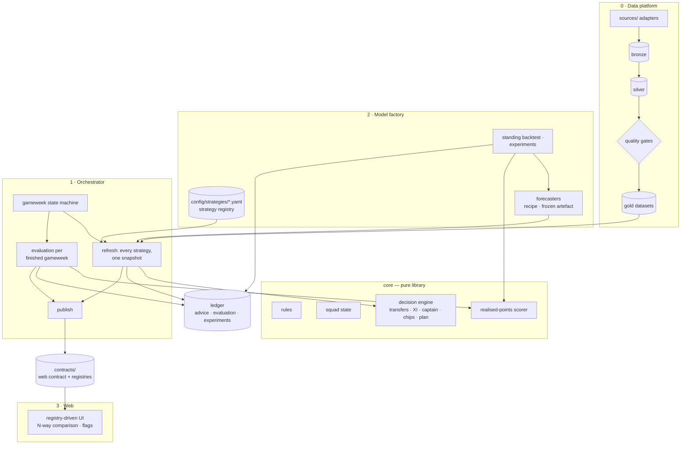
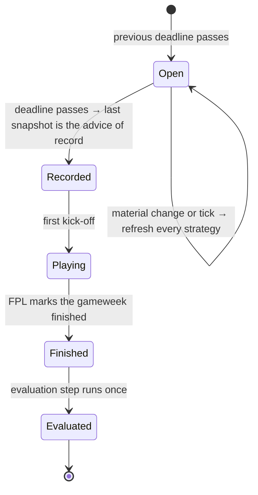
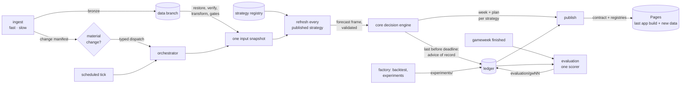

# Target Architecture — FPL DOF modular platform

**Companion to:** [03-solution-architecture.md](03-solution-architecture.md) (what runs today) and
[04-conceptual-design.md](04-conceptual-design.md) (each component's design)
**Adopted by:** [DL-86](../decisions/DL-86.md), 2026-10-22 · **Delivered by:** R1.2.0, R1.3.0 and
R1.4.0 ([backlog](epics/R1.2.0-modular-platform-backlog.md))

This page is the design the platform is moving to, downstream of the data pipeline. It is living:
when a release builds part of it, that part is rewritten into 03 as what runs today and cut down
here to a pointer. The binding constraints on any of it are in
[`DESIGN-PRINCIPLES.md`](../DESIGN-PRINCIPLES.md); none is relaxed.

---

## 1. Goal and drivers

Three modules downstream of the data pipeline, each updatable and enhanceable on its own:

1. **Orchestrator** — keeps each gameweek's state current, re-scores every model's recommendation as
   new data arrives (prices, status, odds, fixtures), and evaluates the finished gameweek's
   predictions and advice.
2. **Model factory** — where models and recommendation policies are built, tuned, trained and graded,
   and from which they are deployed to the app to be compared on history and on this gameweek.
3. **Web** — the UI that serves the models, their comparison, the stats and the app.

| Driver | Consequence |
| --- | --- |
| Many test-and-learn experiments on the recommendation engine, not only the forecast | The unit deployed and compared is a **strategy**: a forecaster paired with a decision policy (§5) |
| New data sources keep arriving | The data platform stays a module of its own; nothing downstream names a source (DP-01) |
| N models selectable and comparable, like for like | Every strategy runs through one decision engine, on one input snapshot, at the same time (§6) |
| Models and UI change on different days | Modules meet only at versioned contracts on disk (§4), enforced in CI (§3) |
| One maintainer, intermittent hours, the season is the clock | One repository and one release train; thin increments that never break the weekly advice (§11) |
| Zero cost, no server, public repository | Unchanged. Modularity comes from contracts, not infrastructure (NFR-01, DL-03, DL-12) |

---

## 2. Where the code stands — review of 2026-10-22

What blocks the goal today. Evidence is file and line as of the review; the architecture's own
module review is [03 §12](03-solution-architecture.md#12-module-design--review-of-2026-10-17).

### 2.1 Orchestration

| Finding | Evidence |
| --- | --- |
| Every pipeline run recomputes transform → publish in full; the manifest records outputs and the config digest, not input digests, so nothing can tell whether a run is needed | `pipeline.py:179-248`, `obs/manifest.py:88-145` |
| Fast ingest never reaches the advice: a price or status change waits for the next scheduled run. Odds reach only the prospective harness, never the champion | `pipeline.yml:1-3`, `forecast/models.py:485` (no caller) |
| Three decision paths: live `recommend_transfers` (champion, C1, hindsight oracle), the horizon planner (champion only), and the frozen harness's own `decide.py` | `stages/week.py:113`, `shadow/c1.py:241`, `stages/decision.py:86`, `pipeline.yml:230` |
| The season log is recomputed in full on every publish, scores only the champion (its multi-model branch reads a `models` key nothing writes), and solves the hindsight optimum on placeholder prices, clubs and bank | `publish/season_log.py:306-329,369-378`, `week/ledger.py:62-63` |
| Domain logic in the stage edge; stages hand off through imported file-name constants; workflows chain by display names, titles and cron strings | 03 §12 P3, O1, O2; `stages/publish.py:40-44` |

### 2.2 Models

| Finding | Evidence |
| --- | --- |
| A model is code plus config, refitted every run; its only identity is `"xp_v1"` or `"xp_v0"` whatever its flags; the backtest report carries no digest | `stages/forecast.py:131,144`, `stages/backtest.py:96-104` |
| Model ids are restated in at least six places, and `"engine"` names the live champion in `week.json` but the minutes_v2-off reference in `models.json` | `stages/week.py:57`, `publish/benchmark.py:18-24`, `prospective/xp_accuracy.py:24`, `contracts/v1/models.schema.json:33`, `web/src/data/model.ts:13-40` |
| Two of the five compared models (A, A_odds) exist only inside the frozen prospective bundle, a parallel copy of the stack with its own ingest | `prospective/bundle/`, `pipeline.yml:207-216` |
| Only the champion gets a plan and chips; C1 gets one gameweek, borrows the champion's variance and builds features outside the knowability seam | `shadow/c1.py:63,238-240` |
| Tuning is a hand-edited flag and a hand-compared backtest; the backtest grades one predictor against fixed baselines; the CI model card never sees the backtest verdict | `forecast/backtest.py:380,413-436`, `backtest.yml:60-65` |
| The model-history tables are rebuilt by scripts that depend on branches and caches outside the repository | `scripts/models_history/README.md` |

### 2.3 Web and contract

| Finding | Evidence |
| --- | --- |
| Model lists, labels, colours and which models have a full week are compiled into TypeScript and locked by schema enums; the labels `models.json` already publishes go unread | `web/src/data/model.ts:13-49`, `ModelsPage.tsx:23-53`, `modelStyle.ts:4-17` |
| Adding an artefact touches about a dozen files across Python, TypeScript and the verification scripts | `publish/contract.py:26-59`, `web/src/data/store.ts:35,59,221,244`, `offline.ts:44`, `smoke-check.mjs:44` |
| Every pipeline run rebuilds and redeploys the whole site; data cannot refresh without a web build, and nothing checks that the data's contract version matches the bundle's | `deploy.yml:15-21,124-130`; `contract_version` unread in `web/src` |
| The publish stage writes `web/src/contract/types.ts`; no CI step checks it | `stages/publish.py:166-169` |
| No feature-flag or variant mechanism exists in the UI | — |

---

## 3. Module map

| Module | Owns (today's code) | Never |
| --- | --- | --- |
| **0 · Data platform** | `sources/`, `silver/`, `quality/`, ingest, transform, retention | Knows a model or a strategy exists |
| **core** | `rules/`, `squad/`, the decision engine (`optimise/`, `decision/`), one realised-points scorer | Performs I/O, reads config files, names a source or a model (DP-03) |
| **1 · Orchestrator** | `stages/`, `pipeline.py`, `week/` (state, ledger, reconciliation, evaluation), scheduling, workflows, `publish/` | Decides which strategy is good, or fits a model outside the registry interface |
| **2 · Model factory** | `forecast/`, `shadow/`, the backtest, the strategy registry, experiments, models-history builders | Writes a published artefact or the ledger's advice of record |
| **3 · Web** | `web/` | Reads anything but `contracts/` artefacts; hard-codes a model, artefact or rule (Invariants 8, 9) |

**Dependency rules**, enforced by `import-linter` in CI ([DL-86](../decisions/DL-86.md)): data
platform → core → factory and orchestrator; the orchestrator reaches the factory only through the
registry interface (`load_strategy`); nothing imports `stages`. The modules stay subpackages of
`fpl_dof` in one repository with one `Rx.y.z` release train. A physical split into workspace
packages, or per-module versions, waits until these rules prove insufficient (§12).

---

## 4. Seams — the only places modules meet

| Seam | From → to | Form | Versioning |
| --- | --- | --- | --- |
| **Upstream data** | Data platform → everything | Silver and gold schemas (`silver/tables.py`), each row knowable at `as_of` (Invariant 5, DL-83) | Schema change → `silver rebuild` |
| **Strategy registry** | Factory → orchestrator, web | Built ([04 §13](04-conceptual-design.md#13-configuration-and-feature-flags)), with `Strategy.forecast` for `xp_v1` and C1 and `Strategy.decision_policy` for `decide` ([04 §6](04-conceptual-design.md#6-decision-engine), MOD-04). Still target: `forecast` for `a` and `a_odds` (MOD-05) | Digest of (entry, code, effective config): the entry with its training window, the source that decides advice, and the run config sections it reads |
| **Forecast frame** | Forecaster → decision engine | Built: [04 §6](04-conceptual-design.md#6-decision-engine) (MOD-02) | `FORECAST_FRAME_VERSION` |
| **Decision output** | Decision engine → orchestrator, web | Built (MOD-04): the `week` and `plan` schemas, one pair per published strategy | Web contract |
| **Ledger records** | Orchestrator, factory → evaluation, web | `advice/gwNN.json` (advice of record per strategy), `evaluation/gwNN.json`, `experiments/<id>/…`, each stamped with strategy digest and `as_of` | Record schema version |
| **Web contract and registries** | Publish → web | `contracts/v1/*.schema.json`, plus published `strategies` and `artefacts` registries and `ui` flags | `contract_version` major, `contract_minor` (§7.3) |

A seam with a schema is tested at the seam: every forecaster's frame is validated before the engine
reads it, every published artefact before it is written, and the scorer is pinned by a conformance
corpus read in both languages where both need it (DP-04, DP-13, DL-39).

---

## 5. Model factory

### 5.1 A strategy is a forecaster paired with a decision policy

What is deployed, compared and promoted is a **strategy**, because most experiments worth running
are on the policy (hits, captaincy, chips, risk), and those must be as comparable as a new forecast.
The decision engine is a pure library in `core`; a strategy only parameterises it. The registry is
built: one file per strategy, its fields and its digest are in
[04 §13](04-conceptual-design.md#13-configuration-and-feature-flags). Still target:

- **`forecast` for every forecaster**, so the orchestrator runs any registered strategy without
  naming its code (MOD-05); `forecast` and `predictor` (the walk-forward harness's
  `fit_as_of`/`predict`) exist for `xp_v1` and C1, each with its own variance. `decide` is built (MOD-04).
- **Recipe forecasters** are the default: code version, config, feature set and training window,
  refitted by the orchestrator through `fit_as_of` on fresh data and recorded by digest (DP-11).
- **Frozen forecasters** carry fitted parameters trained offline by the factory, for heavier models;
  they sit behind the same interface.
- **Every forecaster carries its own variance** and builds its features through `FeatureSpec` with
  declared knowability, checked by `assert_no_look_ahead` (Invariants 5 and 6).
- **`requires` is enforced**: a strategy whose required data is missing records a fail-closed
  "no advice" (MOD-05).

### 5.2 The registered strategies

The five ids are registered ([04 §13](04-conceptual-design.md#13-configuration-and-feature-flags)).
`engine` is live (R1.2.2, MOD-05): `xp_v1` on the shipped forecast config with `minutes_v2` off,
the solver's captain, no plan; a strategy's `forecaster.config` is a validated deep-merge override of that
config, `training_window` (`current_season` or `all_seasons`) filters the history it is fitted on, and `requires`
is enforced in `Strategy.forecast`. `c1` is rebuilt behind the frame contract (MOD-05): its own
variance, `FeatureSpec` features checked by `assert_no_look_ahead`, hyperparameters and seed in
`forecast.c1`, trained on `all_seasons` keyed by `player_code`, one gameweek with `plan: false`
([04 §13](04-conceptual-design.md#13-configuration-and-feature-flags)). `a` is ported from the
frozen bundle's `comp_A` (MOD-05, [DL-89](../decisions/DL-89.md) item 7, `shadow/a.py`): on C1's
features plus rolling goals, assists, saves and award, per-position HistGBMs give P(play), P(a full
appearance | play), the Poisson rates of bonus, goals and assists (saves for goalkeepers) and
P(defensive-contribution award); clean sheets and goals conceded come from C1's club xG; every
event is priced by the rules config; its variance sums each event's (independent events) inside
the two-state mixture; one gameweek, `plan: false`, `all_seasons`, tunables and seed in
`forecast.a`. Its deviations from the frozen original: points from `GameRules`, not literals
(goals conceded priced by position as the rules say, the award's threshold and points by
position); the award gated on recorded defensive contributions, not on the 2025/26 label; tunables
from config and every fit seeded; refitted every run, not every fourth gameweek, and stopping at
the first unfinished gameweek; its own variance and availability-scaled P(play), where the frozen
frame carried a mean; a constant where a component has nothing to learn. Still target: `a_odds`
goes live in R1.2.2 (it reads odds, so the live run enables football-data.co.uk). The frozen harness is
switched off when the ports go live, with no parity check; its records stay on `ledger` as each
strategy's history up to the switch, which the app marks ([DL-87](../decisions/DL-87.md)).

### 5.3 Experiments and promotion

An experiment is a committed, declared file: hypothesis, the result that would falsify it, baseline
strategy, variant (a config or forecaster diff), metric, length in gameweeks, and whether it is
graded by backtest, live shadow or both. The factory runs it locally or in CI on the same commands;
every result is stamped with the strategy digest and data window and appended to `ledger` under
`experiments/`. The weekly backtest is a standing experiment over every registered strategy,
compared in pairs against the champion, and its verdict reaches the model card.

Nothing promotes itself. Promotion is the owner's decision, recorded as a `DL-nn`, past the
[E8 §5 bar](epics/E8-ongoing-in-season-monitoring.md#5-the-bar-for-changing-the-model-mid-season)
mid-season (DP-08).

---

## 6. Orchestrator

### 6.1 Gameweek state

### 6.2 Refresh

Built in R1.2.0 (MOD-04, [04 §6](04-conceptual-design.md#6-decision-engine)): every published
strategy gets the full recommendation from the one decision engine on one snapshot, and the ledger's
advice file records each strategy's advice, or its "no advice" reason, under `models`. Still target:

- **Triggers.** Ingest writes a change manifest — what moved since the last ingest: prices, status,
  odds, fixtures. A material change dispatches the orchestrator with typed `workflow_dispatch`
  inputs; a scheduled tick reads the state machine and the input digests. Nothing chains by workflow
  name or title.
- **The change manifest and input digests decide whether a run is needed**, never which strategies
  run: every published strategy is refreshed together, so any two on screen were computed from
  identical data.
- **The app shows the latest snapshot**, stamped with its `as_of` and what triggered it.

### 6.3 Advice of record

The last successful recommendation before the deadline is each strategy's advice of record for that
gameweek, written to `ledger`. A strategy that produced nothing records "no advice" with the reason,
fail-closed, rather than carrying last week's forward; within a run this is built (MOD-04), and the
deadline rule is ORC-03. The scheduler's freeze guard (`schedule.freeze_minutes`) only stops a run
starting too close to the deadline.

### 6.4 Evaluation

Once a gameweek is finished, one evaluation step scores every strategy from the owner's real squad,
bank and chips:

1. **xP accuracy** — error, calibration and rank against the points that followed.
2. **Advice quality** — points from the advised XI, captain and transfers net of hits, against what
   the owner played and against the hindsight optimum, solved from real prices, clubs and bank.
3. **Advised against played** — today's reconciliation.

Results are stored per gameweek under `evaluation/` on `ledger` and recomputed only when the
scorer's version changes; the season log is assembled from them. One realised-points scorer, in
`core` and pinned by a conformance corpus, serves evaluation, the backtest and the models history.
Each strategy's own-path season simulation stays available as a secondary, labelled view.

---

## 7. Web

### 7.1 Registry-driven

The UI renders registries instead of compiled lists: the published strategy registry supplies ids,
labels, roles, colours and what each strategy publishes; the artefact registry supplies paths and
loading policy for one `useArtefact(key)` hook. A new strategy or artefact appears without a web
change.

### 7.2 Comparison and experiments

Any subset of published strategies can be selected and compared side by side: this gameweek's
advice as differences from the champion, xP on the players they disagree on, and historical
performance from the standing backtest and the season's evaluations. UI test-and-learn is variants
the owner switches on: published `ui` flags plus per-device overrides in settings. There is one
user, so there is no split testing.

### 7.3 Independent release

- The app is built once per change to `web/` or `contracts/` and kept as an artefact tagged with the
  contract version it supports; a data refresh repacks that build with new data, without a rebuild.
- Deploy runs only when a run published, and refuses data whose contract major differs from the
  app's; the app checks `contract_version` at runtime and fails visibly.
- An additive change stays in `v1` and bumps `contract_minor`; a breaking change goes to `v2`,
  published beside `v1` until the app has moved.
- The web build generates the TypeScript types from `contracts/`; CI checks them. The publish stage
  writes nothing into `web/src`.

---

## 8. Data flow

---

## 9. Configurability — where each knob lives

| Knob | Home |
| --- | --- |
| Which strategies exist, their roles, forecaster and policy | `pipeline/src/fpl_dof/config/strategies/*.yaml` (the registry) |
| A forecaster's tunables, including hyperparameters now hard-coded (C1, M2's half-life) | The forecaster's config in the registry, validated by `ForecastConfig` (DP-06) |
| An experiment | A declared experiment file in the factory |
| Cadence, freeze guard, material-change thresholds | `schedule` config |
| Data sources | `sources.overrides`, as today ([04 §14.1](04-conceptual-design.md#141-adding-a-data-source)) |
| UI variants | Published `ui` flags, overridable per device in settings |
| Game rules | The API and `rules` config, as today (Invariants 2 and 9) |

---

## 10. Testing at the seams

| Seam | Test |
| --- | --- |
| Module boundaries | `import-linter` contracts in CI, beside `test_source_isolation.py` |
| Strategy registry | Every file validates; exactly one champion; ids unique and never reused; the published registry matches the files |
| Forecast frame | Every registered forecaster's frame validates on a fixture snapshot, and carries variance |
| Decision engine | One engine for every strategy; a strategy differs from another only by its registry entry |
| Scorer | One conformance corpus, including auto-substitutions, read by every caller |
| Web | The registry renders a fixture strategy the TypeScript has never named; the runtime refuses a contract major it does not support |

---

## 11. Migration path

Each release is a vertical slice that leaves the weekly advice working ([DP-07](../guiding-principles.md)).

| Release | Slice | Absorbs |
| --- | --- | --- |
| **R1.2.0 and R1.2.2 — Registry and five models live**, two drops (DL-87) | Boundaries and `core` (a ratchet); the forecast-frame contract; the registry; all five strategies through one engine with full recommendations; the archive and football-data.co.uk live; the frozen harness retired, the switch marked; N-way comparison UI from the registry; the standing multi-strategy backtest and the experiments store; the first two experiments (card rates, training window) | 03 §12 P1, P3, P6, P9, P10; F1, F3 as experiments; F4, F5 |
| **R1.3.0 — Gameweek orchestration** | State machine; change manifest and typed dispatch; refresh-all-together; advice of record; the evaluation step; the one scorer; season log from evaluations; reproducible models history | O1, O2; F2 |
| **R1.4.0 — Independent web** | Decoupled app and data deploys; `contract_minor` and the runtime check; types in the web build; the artefact registry; UI flags; `experiment.yml` and experiments in the app | W1, W2, W3, W5 |

Stories and acceptance criteria: [R1.2.0 backlog](epics/R1.2.0-modular-platform-backlog.md).

---

## 12. Deliberately later

- **Advice revision history** — each pre-deadline revision with what changed and why. The advice
  of record is the last snapshot; history is a backlog item ([DL-86](../decisions/DL-86.md)).
- **Physical package split and per-module versions** — when the import rules prove insufficient.
- **Frozen-artefact forecasters in production** — the type is designed for; the first one waits for
  a model that needs it.
- **Solve time with many strategies** — the per-strategy `plan: false` switch is the control; a
  limit on published strategies follows if CI time requires it.
