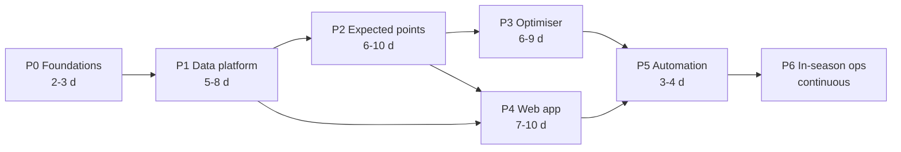

# Project plan — superseded sections

§3, §4, §7 and §8 of [the project plan](../02-project-plan-and-blueprint.md), superseded by the
epics (DL-10) and archived on 2026-10-17 (DL-74). The text is unchanged; only links are re-pointed.

## 3. Phase plan

Effort is in **focused build days** for a single AI-assisted maintainer — real elapsed time depends
entirely on availability. Phases are sequential in dependency, not necessarily in time.

---

> **Superseded — read [epics/](R1.0/README.md) for the plan of record.** The phase deliverables below
> remain a useful checklist of *what has to exist eventually*; the epics decide *when*.

### Phase 0 — Foundations · 2–3 days

**Goal:** a repository that can run one command end-to-end and prove the toolchain works.

| # | Deliverable |
| --- | --- |
| 0.1 | Git repository initialised; public/private decision taken (OD-01); `.gitignore`, licence, README |
| 0.2 | Python package skeleton with dependency and virtual-environment management, linting, formatting, type checking |
| 0.3 | Vite + React + TypeScript app skeleton that builds and serves |
| 0.4 | Layered configuration — defaults in the repo, secrets from environment, local overrides |
| 0.5 | Structured logging and the run-manifest primitive |
| 0.6 | FPL source adapter, first cut: `bootstrap-static` and `fixtures` only, writing raw snapshots |
| 0.7 | CI workflow: lint, type-check, test on every push |
| 0.8 | One published static JSON file rendered by the React app — **the walking skeleton** |

**Exit criteria:** `run ingest` on a clean checkout fetches live FPL data, writes a snapshot with a
manifest, and the web app displays something derived from it. CI is green.

**Risks addressed:** integration risk, toolchain risk on Windows.

---

### Phase 1 — Data platform · 5–8 days

**Goal:** a trustworthy conformed dataset covering current and historical seasons.

| # | Deliverable | Requirements |
| --- | --- | --- |
| 1.1 | Complete the FPL adapter: element summaries, live gameweek stats, entry/picks/transfers, leagues, set-piece notes, game settings | FR-01, FR-25 |
| 1.2 | Formalise the source-adapter interface: rate limiting, retry with backoff, caching, snapshotting, schema declaration — all in the base class | FR-04, NFR-10 |
| 1.3 | Understat adapter | FR-02 |
| 1.4 | FBref adapter, with a crawl delay and aggressive caching | FR-02, NFR-10 |
| 1.5 | Odds adapter with credit budgeting, and derived team goal expectations | FR-03, CON-7 |
| 1.6 | Bronze → silver transformations into the canonical entity model | FR-01–03 |
| 1.7 | Entity resolution: cross-source player and team crosswalk plus a curated override file | FR-07 |
| 1.8 | Data quality gates — schema, ranges, referential integrity, freshness — blocking on failure | FR-08, NFR-07 |
| 1.9 | Historical backfill for training and backtesting | FR-06 |
| 1.10 | Price and ownership history tracking, including selling-value mechanics | FR-09 |
| 1.11 | Contract tests per adapter against recorded responses | NFR-08, R-02 |

**Exit criteria:** a single command produces a clean, validated, documented silver dataset for the
current season and history; every adapter has a contract test; quality gates demonstrably block on
injected bad data; killing any non-FPL source degrades but does not break the run (NFR-15).

---

### Phase 2 — Expected points engine · 6–10 days

**Goal:** a validated per-player, per-fixture expected-points forecast with uncertainty.

| # | Deliverable | Requirements |
| --- | --- | --- |
| 2.1 | Scoring rules module implementing 2026/27 rules exactly, parameterised from the API where exposed | FR-15 |
| 2.2 | **Rules conformance test** — recompute historical gameweek scores from raw stats and reconcile against FPL's published points | FR-15, NFR-08 |
| 2.3 | Feature engineering layer — rolling form, per-90 rates, opponent-adjusted metrics, home/away splits, rest days | FR-10–12 |
| 2.4 | Availability and minutes model | FR-10 |
| 2.5 | Team strength and fixture model — odds blended with rolling xG ratings; goal-expectation and clean-sheet probabilities | FR-11 |
| 2.6 | Player component models — goal involvement, defensive contribution, bonus, saves, cards | FR-12 |
| 2.7 | Expected-points aggregation with variance | FR-12, FR-13 |
| 2.8 | Preseason prior and shrinkage model for the cold start | FR-14 |
| 2.9 | Ownership and effective-ownership model | FR-16 |
| 2.10 | **Backtesting harness** — walk-forward, no look-ahead, held-out season | FR-37 |
| 2.11 | Model metrics tracked over time and published for the data health page | NFR-07 |

**Exit criteria:** backtest meets or exceeds the tier-2 thresholds in charter §5, or the targets are
consciously recalibrated with evidence. Expected points for every player for the next 8 gameweeks are
published as a static artefact. **The system is now genuinely useful even with no optimiser.**

---

### Phase 3 — Decision engine · 6–9 days

**Goal:** rule-legal, explained squad and transfer recommendations over a multi-gameweek horizon.

| # | Deliverable | Requirements |
| --- | --- | --- |
| 3.1 | Candidate pruning — reduce ~700 players to a tractable, unbiased shortlist | CON-4 |
| 3.2 | Single-gameweek squad MILP: budget, composition, club limit, formation, captaincy | FR-17, FR-19 |
| 3.3 | **Property-based legality tests** — any returned squad satisfies every FPL rule, for any input | NFR-08 |
| 3.4 | Multi-gameweek extension: transfer variables, free-transfer accrual and rollover, −4 hits, discount factor | FR-18 |
| 3.5 | Selling-price and bank mechanics inside the optimiser | FR-09, FR-18 |
| 3.6 | Chip modelling — Wildcard, Free Hit, Triple Captain, Bench Boost, with set-1 expiry at GW19 | FR-20 |
| 3.7 | Risk dial — ownership-deviation term in the objective, safe through aggressive | FR-21 |
| 3.8 | Constraint overrides — locks, bans, budget, formation, club exclusions, chip forcing | FR-22 |
| 3.9 | Explainability layer — decomposition, runner-up options, marginal gain, always including "roll the transfer" | FR-23, FR-24 |
| 3.10 | Solve-time management: time limits, warm starts, and a greedy fallback if the solver does not converge | CON-4 |

**Exit criteria:** produces a legal GW1 squad and a legal multi-gameweek transfer plan; solves inside
the CI time budget; property tests pass across randomised inputs; every recommendation carries an
explanation and a runner-up.

---

### Phase 4 — Web application · 7–10 days

**Goal:** the product surface. Runs in parallel with phases 2–3 once phase 1 lands.

| # | Deliverable | Requirements |
| --- | --- | --- |
| 4.1 | App shell — routing, layout, theming, responsive frame, data-loading layer | FR-34, NFR-03 |
| 4.2 | **Scout view** — searchable, filterable, sortable player table over the full player set | FR-27 |
| 4.3 | Player detail — profile, fixtures, expected-points decomposition, underlying statistics | FR-23, FR-29 |
| 4.4 | Player comparison view | FR-28 |
| 4.5 | Trend charts — points, xG/xA, minutes, defensive contribution, price, ownership over time | FR-29 |
| 4.6 | Dashboard — current squad, expected points, recommended action, deadline countdown | FR-26 |
| 4.7 | Squad builder — the optimised squad, with manual editing and live legality checking | FR-17, FR-22 |
| 4.8 | Transfer planner — multi-gameweek plan and chip calendar | FR-31 |
| 4.9 | Fixture ticker with model-derived difficulty | FR-30 |
| 4.10 | Data health and model performance page | FR-33 |
| 4.11 | PWA — installable, offline access to last-published data | FR-34 |
| 4.12 | Accessibility pass and performance budget verification | NFR-04, NFR-14 |
| 4.13 | Mini-league / rival comparison *(could-have)* | FR-32 |

**Exit criteria:** all must-have views work on a laptop and a phone; performance and accessibility
budgets met; the app is fully functional against published static data with no backend.

---

### Phase 5 — Automation and publication · 3–4 days

**Goal:** the system runs itself and stays fresh without the owner touching it.

| # | Deliverable | Requirements |
| --- | --- | --- |
| 5.1 | Scheduled ingest workflows, with cadence escalating near deadlines | FR-35, NFR-05 |
| 5.2 | Scheduled model and optimiser workflows | FR-35 |
| 5.3 | Site build and deploy workflow; hosting decision taken (OD-02) | NFR-01 |
| 5.4 | Manual dispatch for every stage, for deadline-day reruns | FR-36 |
| 5.5 | Failure alerting on run failure and blocked quality gates | FR-38 |
| 5.6 | Concurrency control, idempotency and safe re-runs | NFR-06 |
| 5.7 | Published-artefact retention and pruning to stay inside free-tier storage | NFR-01 |
| 5.8 | End-to-end smoke test against the deployed static site | NFR-08 |

**Exit criteria:** a full week passes with zero manual intervention and a current recommendation
available before the deadline.

---

### Phase 6 — In-season operations · continuous to 30 May 2027

**Goal:** run the season, learn from it, improve the model where the evidence says to.

**Weekly loop:**

1. **Post-gameweek review** — compare recommendation against outcome; log the decision and the result.
2. **Drift check** — rolling accuracy metrics on the data health page; investigate significant drops.
3. **Data health check** — freshness, gate failures, adapter errors.
4. **One improvement** — a single model, optimiser or UX increment. One, not three.
5. **Deadline run** — review, override where the human knows something the model does not, submit.

**Periodic:**

| When | Activity |
| --- | --- |
| Monthly | Retrain models on accumulated current-season data; re-run backtest regression |
| GW10–12 | First honest assessment of tier-2 metrics on live out-of-sample data |
| Before GW19 | Chip set 1 must be fully used — hard deadline (OBJ-4) |
| Mid-season break | Larger improvements — stochastic layer, extra sources (OD-04), refactors |
| End of season | Retrospective against charter §5; decide whether 2027/28 is worth it |

---

## 4. Milestones

> **Superseded.** Milestones are now the exit criteria of each epic. The mapping below is kept only so
> that references to M0–M7 elsewhere remain resolvable.

| ID | Milestone | Now delivered by | Definition of achieved |
| --- | --- | --- | --- |
| **M0** | Planning baselined | — | ✅ Documents 00–04, the epic set and the AI tooling plan complete and reviewed |
| **M1** | Walking skeleton | [E0](R1.0/E0-steel-thread-gw1.md) S1–S3 | Live FPL data ingested and rendered in the app |
| **M2** | Trusted data | [E2](R1.0/E2-data-platform.md) | Validated conformed dataset, all adapters contract-tested |
| **M3** | Forecast validated | [E3](R1.0/E3-expected-points-engine.md) | Backtest clears the tier-2 thresholds over baseline B0, or the targets are consciously reset with evidence |
| **M4** | First real recommendation | [E1](R1.0/E1-weekly-operating-loop.md), then [E4](R1.0/E4-decision-engine.md) in full | A legal squad and transfer plan for a live gameweek, with explanation |
| **M5** | Product usable | [E6](R1.0/E6-web-application.md) | Scout, dashboard and planner working on laptop and mobile |
| **M6** | Hands-off | [E7](R1.0/E7-automation-and-hosting.md) | One full week with no manual intervention |
| **M7** | Season complete | [E8](../epics/E8-ongoing-in-season-monitoring.md) | 38 gameweeks played; retrospective written |

---

## 7. The GW1 decision — **closed**

> **Resolved 2026-08-09 by [DL-10](../../decisions/DL-10.md):
> build a steel thread to GW1.** Neither Track A nor Track B below was taken. The chosen route is a
> third option that emerged from this analysis — a thin but *complete* path through every
> architectural layer, in which nothing is thrown away. It costs roughly a day more than Track B and
> produces no disposable code. The plan is [epics/E0](R1.0/E0-steel-thread-gw1.md).
>
> **What was traded away:** blueprint B7, *validate before you believe*, cannot be honoured before
> GW1 — there is no time to backtest and preseason has no current-season data. Mitigations are named
> in [epics/README §5](R1.0/README.md#5-guardrails-carried-from-the-planning-set) and the breach is
> logged as debt item D-01, repaid as the *first* deliverable of E3.
>
> The two tracks are retained below because the reasoning is what justifies the third option, and
> because Track A's honest assessment — that a hand-picked GW1 squad costs less than it feels like it
> should — remains the correct fallback if E0 overruns.

The situation as it stood: twelve days to the GW1 deadline, no code. Two tracks, stated honestly.

### Track A — Full build, GW1 handled manually

Start phase 0 whenever convenient and build in the proper order. Pick the GW1 squad by hand, using
ordinary FPL judgement, and aim for the system to take over around GW4–GW8.

- **Pro:** no deadline pressure distorting architecture; every phase gets its full exit criteria; the
  foundations stay clean, which matters far more across 38 gameweeks than across one.
- **Con:** OBJ-2 is missed as stated, and must be re-baselined.
- **Honest assessment:** the cost is smaller than it looks. A hand-picked GW1 squad from a
  knowledgeable manager is not far off optimal, an early Wildcard corrects most of the gap, and the
  season is decided by the other 37 deadlines.

### Track B — GW1 fast lane

A deliberately narrow slice, targeting a usable GW1 squad by 19 August with two days of buffer.

| Day | Work |
| --- | --- |
| 1 | Phase 0 walking skeleton; FPL adapter for `bootstrap-static`, `fixtures`, `element-summary` |
| 2 | Minimal silver layer — players, teams, fixtures, prior-season history. FPL source only; no Understat, no FBref, no odds |
| 3 | Preseason expected-points v0: prior-season per-90 rates, shrunk toward position and price priors, scaled by fixture difficulty over GW1–6 |
| 4 | Single-shot 15-player squad MILP: budget, composition, club limit, formation, captaincy. No transfers, no chips, no risk dial |
| 5 | Minimal UI — the squad, the expected-points table, sortable and filterable |
| 6 | Sanity-check against public consensus, adjust priors, lock the squad |
| 7 | **Buffer** |

- **Deliberately excluded:** external sources, minutes modelling, multi-gameweek horizon, transfers,
  chips, the risk dial, backtesting, the scout UI, automation, quality gates.
- **Pro:** OBJ-2 is met, and the walking skeleton it produces is genuine reusable phase 0/1 work.
- **Con:** the GW1 squad rests on an **unvalidated** model, breaching principle B7. Mitigation:
  treat the output as a strong opinion to sanity-check, not an oracle — the human check on day 6 is
  not optional. There is also real risk of the throwaway shortcuts hardening into the codebase; every
  fast-lane shortcut must be logged as explicit technical debt on day 7.

### Recommendation as written at the time

**Track A**, unless the owner specifically wants the GW1 squad to come from the tool as a matter of
principle. The season is won across 37 remaining deadlines, and the cost of a hurried, unvalidated
model plus its technical debt outweighs the marginal gain on one squad.

**The owner chose to build** (DL-10), and the steel-thread framing removes most of the objection: the
technical debt argument was against *throwaway* shortcuts, and the steel thread has none. The B7
breach stands, and the day-6 gate the recommendation insisted on survives as
[E0-S8](R1.0/E0-steel-thread-gw1.md#e0-s8--human-verification-gate), a mandatory story with its own
acceptance criteria. If the model's squad looks eccentric against consensus, the human overrules it.

---

## 8. Estimation summary

> **Superseded** by the [epic register](R1.0/README.md#2-epic-register) — **43–61 focused days**. The
> phase figures below are retained for comparison; the increase is honest rather than scope creep, and
> the reasons are given there.

| Phase | Focused days | Cumulative |
| --- | --- | --- |
| P0 Foundations | 2–3 | 2–3 |
| P1 Data platform | 5–8 | 7–11 |
| P2 Expected points | 6–10 | 13–21 |
| P3 Decision engine | 6–9 | 19–30 |
| P4 Web application | 7–10 | 26–40 |
| P5 Automation | 3–4 | 29–44 |
| **Build total** | **29–44** | |
| P6 In-season ops | ~0.5 day/week × 38 | ~19 |

Estimates assume AI-assisted development, no team coordination overhead, and a maintainer already
fluent in the FPL domain. Phases 2 and 3 have the widest ranges because model quality is discovered,
not scheduled — the backtest tells you when you are done, and it may take more than one attempt.

### The availability assumption — ASM-8

Every estimate in this project is in **focused build days**, which says nothing about elapsed time.
The epic target gameweeks only mean something against an assumed rate, and until 2026-08-09 that rate
was never written down. It is now:

> **ASM-8 — the maintainer sustains 3–4 focused build days per week** from mid-August through
> approximately GW30, *in addition to* the ~0.5 day/week operating loop (E8).

This is what the epic register's target gameweeks already implicitly assume. Making it explicit
matters because it is **demanding and has no slack**: the epic sequence to GW15 totals roughly 60
focused days across 15 calendar weeks. There is no allowance for illness, travel, a work crunch, or
an E3 that needs a second attempt — which [§8 above](#8-estimation-summary) explicitly warns is
likely.

**If the rate drops below ~3 days/week for more than a fortnight, the targets are wrong and must be
re-baselined rather than quietly missed.** The tell is not a missed epic date; it is the
[weekly question](R1.0/README.md#the-weekly-question) starting to return the same answer several
weeks running.

**The one thing that must not absorb the slippage is chip planning.** Chip set 1 expires at the GW19
deadline and cannot be recovered. E4 is last in the sequence and depends on E3, so it is structurally
the most exposed. That exposure is de-coupled deliberately: a minimal
[chip-expiry tracker](R1.0/E2-data-platform.md#e2-s7--chip-expiry-tracker--05-day--obj-4) ships in
E2, long before the real chip optimiser, purely so that a dated irreversible loss never depends on
two large epics both landing on time.

---

